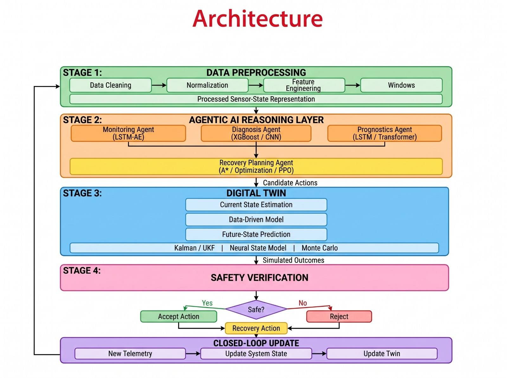
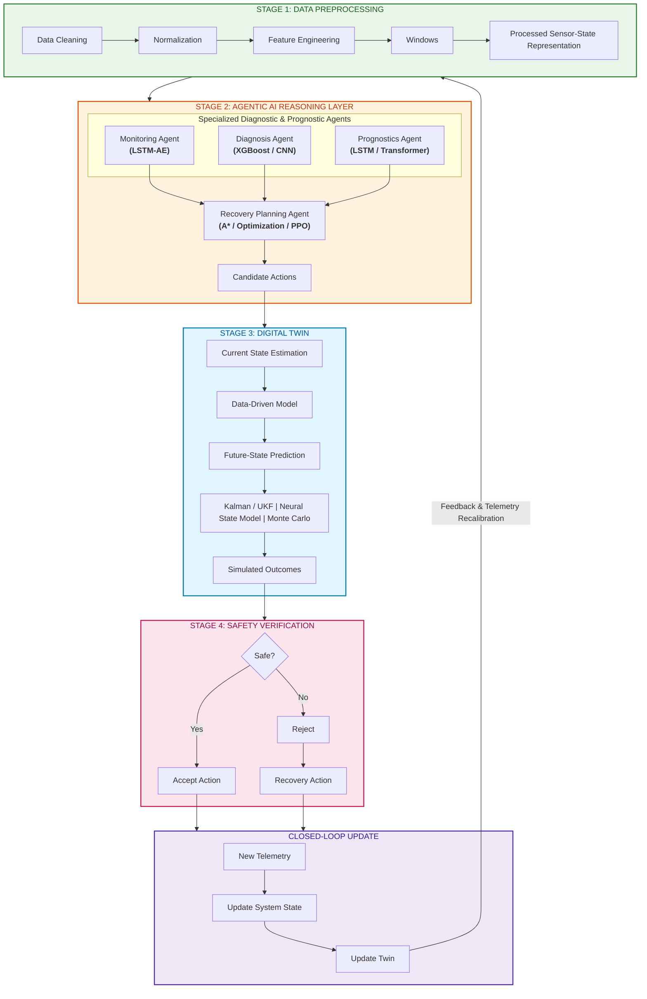

# AI-Based Aircraft Engine Health Monitoring, Fault Diagnosis and Predictive Maintenance

[](https://www.python.org/)
[](https://data.nasa.gov/dataset/C-MAPSS-Aircraft-Engine-Simulator-Data/xaut-bemq)
[](#7-verification--validation-vv-summary)
[](#9-technologies-used)
[](#9-technologies-used)
[](#11-license--academic-use)

---

> **Academic Disclaimer:** This repository is an academic and research engineering prototype developed for final-year engineering research. It utilizes simulated turbofan degradation data from the NASA Commercial Modular Aero-Propulsion System Simulation (C-MAPSS) benchmark. It is designed for methodology evaluation and educational demonstration and is **not certified or deployed for real-world aircraft operations or live flight control**.

---

## 1. Project Overview

In commercial and defense aviation, gas turbine engines are high-capital, mission-critical assets. In-flight component failures, unscheduled engine removals, and uncontained mechanical breakdowns incur severe operational disruptions, financial penalties, and flight-safety hazards.

This project delivers a complete, end-to-end intelligent predictive maintenance and closed-loop Digital Twin framework for high-bypass aircraft turbofan engines. By combining physics-informed aerothermal modeling, multivariate deep learning, state estimation, and multi-agent AI reasoning, the system continuously tracks engine health, forecasts Remaining Useful Life (RUL), diagnoses subsystem fault modes, and enforces strict safety governance over candidate maintenance and operational actions.

---

## 2. Problem Statement

Traditional aircraft maintenance relies on fixed flight-hour intervals or reactive servicing after fault alarms occur—leading to either premature component replacement or delayed intervention. Modern aircraft engines generate rich telemetry streams across variable flight regimes, presenting four core engineering challenges:

1. **Operating Condition Complexity:** Variations in flight altitude, Mach number, and throttle resolver angle (TRA) produce large operational swings that obscure underlying component degradation.
2. **Multi-Component Fault Dynamics:** Degradation may originate in the High-Pressure Compressor (HPC), Fan, or both simultaneously, each exhibiting distinct aerothermal wear rates.
3. **Sensor Heterogeneity & Noise:** Raw gas-path telemetry requires leakage-free normalization, derived aerodynamic indicators, and non-linear state filtering.
4. **Safety-Critical Decision Governance:** Prognostic predictions must be paired with autonomous recovery planning and deterministic safety firewalls before modifying system states.

---

## 3. System Architecture

The end-to-end 4-stage closed-loop architecture integrates data preprocessing, multi-agent AI reasoning, Digital Twin simulation, and safety verification:





### Architectural Breakdown

* **Stage 1 — Data Preprocessing & State Representation:**
  * **Data Cleaning & Immutability:** Zero-null verification, chronological cycle continuity, and cryptographic SHA-256 baseline protection.
  * **Normalization & Feature Engineering:** Leakage-free `MinMaxScaler` fit exclusively on training engines, paired with derived thermodynamic indicators ($\Delta T_{\text{HPC}} = T_{30} - T_{24}$, Overall Pressure Ratio $\text{OPR} = P_{30}/P_2$, and spool speed ratio $N_c/N_f$).
  * **Sliding Windows:** 30-cycle temporal tensors ($30 \times D$) with left-edge replication padding for short trajectories.
* **Stage 2 — Agentic AI Reasoning & Planning Layer:**
  * **Monitoring Agent (`LSTM-AE` + Isolation Forest + PCA-SPE):** Combines deep sequence reconstruction error (`LSTM-AE`) with regime-aware Isolation Forest and PCA Squared Prediction Error ($Q$-residuals) plus a 3-cycle temporal persistence filter.
  * **Diagnosis Agent (`1D-CNN` + Aerothermal Attribution):** Multi-channel 1D Convolutional Neural Network classifying subsystem fault modes (`NOMINAL`, `HPC_DEGRADATION`, `FAN_DEGRADATION`, `SENSOR_BIAS`, `THERMAL_DISTRESS`) with gradient channel saliency maps.
  * **Prognostics Agent (`Temporal Transformer` + `Bi-LSTM` + `XGBoost`):** Self-attention Temporal Transformer with Monte Carlo Dropout (MCDO) epistemic uncertainty paired with XGBoost and Bi-LSTM consensus RUL forecasting.
  * **Recovery Planning Agent (`A* Search` + `PPO Policy`):** Discrete graph search with admissible thermal heuristics (`A*`) alongside a continuous Proximal Policy Optimization (`PPO`) actor-critic controller for optimal derate and bleed adjustments.
* **Stage 3 — Digital Twin Core:**
  * **Current State Estimation (`UKF`):** 8-state Unscented Kalman Filter (`TurbofanStateUKF`) using 17 scaled sigma points to filter measurement noise and track unmeasured HPC efficiency/flow deltas alongside a 40-variable state vector.
  * **Data-Driven & Neural State Modeling:** Real-time synchronization between physical C-MAPSS trajectories and neural sequence states.
  * **Counterfactual & Monte Carlo Simulation:** Interactive What-If sandbox verified across 50-run Monte Carlo repeatability loops ($\sigma^2 = 0.0$).
* **Stage 4 — Safety Verification & Closed-Loop Update:**
  * **Closed-Loop Safety Governor:** Tri-state decision engine (`ACCEPTED`, `REQUIRES_REVIEW`, `REJECTED`) enforcing metallurgical redlines ($T_{30} \le 1625.0^\circ\text{R}$), physics sanity bounds, and human-in-the-loop operator sign-off.
  * **Hardware Firewall & Rollback:** `FIREWALL_MEASURED_IMMUTABILITY` prevents direct overwrites of raw telemetry channels and executes automatic state rollback on rejected actions.

---

## 4. Dataset Information: NASA C-MAPSS

Benchmarked against the **NASA Commercial Modular Aero-Propulsion System Simulation (C-MAPSS)** dataset (90,000 lbf thrust-class commercial turbofan):

| Subset | Operating Conditions | Fault Modes | Training Trajectories | Testing Trajectories | Ground-Truth RULs | Total Rows |
| :--- | :--- | :--- | :--- | :--- | :--- | :--- |
| **FD001** | 1 (Sea Level) | 1 (HPC Degradation) | 100 engines (20,631 rows) | 100 engines (13,096 rows) | 100 values | 33,727 |
| **FD002** | 6 (Multi-Regime) | 1 (HPC Degradation) | 260 engines (53,759 rows) | 259 engines (33,991 rows) | 259 values | 87,750 |
| **FD003** | 1 (Sea Level) | 2 (HPC + Fan) | 100 engines (24,720 rows) | 100 engines (16,596 rows) | 100 values | 41,316 |
| **FD004** | 6 (Multi-Regime) | 2 (HPC + Fan) | 249 engines (61,249 rows) | 248 engines (41,214 rows) | 248 values | 102,463 |
| **Total** | — | — | **709 engines (160,359 rows)** | **707 engines (104,897 rows)** | **707 values** | **265,256 rows** |

### Telemetry Variables (26 Columns)
Each operational record represents one snapshot taken during a flight cycle:
- **Identifier:** `unit_number` (Engine ID, positive integer).
- **Time Index:** `time_cycles` (Discrete flight cycle counter, starting at 1).
- **Operational Settings:**
  - `op_setting_1`: Flight Altitude (0 to 42,000 ft).
  - `op_setting_2`: Mach Number (0.00 to 0.84).
  - `op_setting_3`: Throttle Resolver Angle (TRA: 60 to 100).
- **Sensor Measurements (21 continuous channels):**
  - Temperatures: Fan inlet ($T_2$), LPC outlet ($T_{24}$), HPC outlet ($T_{30}$), LPT outlet ($T_{50}$).
  - Pressures: Fan inlet ($P_2$), Bypass duct ($P_{15}$), HPC outlet total ($P_{30}$), HPC outlet static ($Ps_{30}$).
  - Spool Speeds: Physical fan speed ($N_f$), Physical core speed ($N_c$), Corrected fan speed ($Nf_{\text{dmd}}$), Corrected core speed ($Nc_{\text{dmd}}$).
  - Ratios & Mass Flows: Engine Pressure Ratio ($\text{epr}$), Fuel flow to $Ps_{30}$ ratio ($\phi$), Bypass Ratio ($\text{BPR}$), Burner Fuel-Air ratio ($\text{farB}$), Bleed enthalpy ($ht\text{Bleed}$), Demanded speeds ($Nf_{\text{dmd2}}$, $PCNfR_{\text{dmd}}$), Coolant bleeds ($W_{31}$, $W_{32}$).

For complete documentation on the dataset source, citations, and hash records, refer to [`docs/dataset_source.md`](docs/dataset_source.md).

---

## 5. Completed Implementation Summary (Phases 1–9)

* **Phase 1 — Dataset Setup & Cryptographic Verification:** Ingested all 12 NASA C-MAPSS files and locked SHA-256 baseline digests ([`docs/dataset_source.md`](docs/dataset_source.md)).
* **Phase 2 — Exploratory Data Analysis (EDA):** Audited all 265,256 rows for quality, continuity, and sensor variance, generating 86 diagnostic plots and the [CMAPSS EDA Report](reports/eda/CMAPSS_EDA_Report.md).
* **Phase 3 — Preprocessing & Feature Engineering:** Implemented piecewise linear RUL capping (125 cycles), leakage-free 80/20 engine-level splits, `MinMaxScaler` normalization, and 30-cycle sliding window generation.
* **Phase 4 — RUL Prognostics & Benchmark Evaluation:** Trained and evaluated XGBoost and PyTorch Bi-LSTM models across all 707 held-out test engines using RMSE, MAE, and the asymmetric NASA scoring metric $S$.
* **Phase 5 — Digital Twin & UKF State Estimation:** Built `DigitalTwinSimulator` tracking a 40-variable state vector and integrated `TurbofanStateUKF` for non-linear gas-path filtering.
* **Phase 6 — Multi-Agent AI & Planning Architecture:** Deployed `MonitoringAgent` (`LSTM-AE`, Isolation Forest, PCA-SPE), `DiagnosisAgent` (`1D-CNN`), `PrognosticsAgent` (`Temporal Transformer`, Bi-LSTM, XGBoost), and `RecoveryPlanningAgent` (`A* Search` + `PPO Policy`).
* **Phase 7 — Safety Verification & Guardrails:** Implemented `ClosedLoopSafetyGovernor` enforcing metallurgical redlines, non-finite arithmetic guards, and read-only telemetry firewalls.
* **Phase 8 — Full-Stack Web Dashboard:** Built a FastAPI REST backend and React + Tailwind CSS Mission Control dashboard with real-time sensor telemetry, consensus RUL charts, and interactive What-If simulation sandboxes.
* **Phase 9 — System Testing, V&V & Demonstration Runbook:** Certified all 12 system testing milestones, compiled the 65-case Master V&V Matrix ([`docs/phase9_step9_10_verification_matrix.md`](docs/phase9_step9_10_verification_matrix.md)), logged defect remediations ([`docs/phase9_step9_11_defect_resolution_log.md`](docs/phase9_step9_11_defect_resolution_log.md)), and published the timed presentation runbook ([`docs/phase9_step9_12_demonstration_runbook.md`](docs/phase9_step9_12_demonstration_runbook.md)).

---

## 6. Repository Folder Structure

```text
Aircraft_Engine_AI/
├── agents/                          # Stage 2: Multi-agent reasoning, deep models & planning
│   ├── models/
│   │   ├── lstm_autoencoder.py      # LSTM-AE sequence reconstruction anomaly detector
│   │   ├── cnn_fault_classifier.py  # 1D-CNN subsystem fault classifier & saliency maps
│   │   └── temporal_transformer.py  # Multi-head self-attention Transformer + MCDO RUL
│   ├── planning/
│   │   ├── a_star_planner.py        # A* optimal recovery graph search planner
│   │   └── ppo_recovery_policy.py   # PPO actor-critic continuous control policy
│   ├── monitoring_agent.py          # Statistical & deep surveillance agent
│   ├── diagnosis_agent.py           # Differential fault attribution agent
│   ├── prognostics_agent.py         # Multi-model consensus RUL & uncertainty agent
│   └── orchestrator.py              # End-to-end multi-agent workflow coordinator
├── backend/                         # FastAPI REST API & verification services
│   ├── api/                         # Routers: fleet, monitoring, prognostics, simulation
│   └── services/                    # Demo sequence runner, V&V reporter, fault auditor
├── digital_twin/                    # Stage 3: Turbofan Digital Twin & UKF state estimator
│   ├── twin_simulator.py            # 40-variable state vector & aerothermal engine twin
│   ├── unscented_kalman_filter.py   # 8-state Unscented Kalman Filter (UKF)
│   └── trajectory_loader.py         # C-MAPSS trajectory ingestion & boundary validation
├── safety/                          # Stage 4: Closed-loop safety governor & firewall guards
│   ├── verification.py              # Metallurgical redlines & read-only telemetry firewall
│   └── closed_loop.py               # Tri-state governance & automatic state rollback
├── frontend/                        # React + Vite + Tailwind CSS Mission Control UI
├── preprocessing/                   # Phases 2 & 3: EDA, RUL formulation, scaling, windowing
├── models/                          # Saved scalers & champion model checkpoints
├── dataset/                         # NASA C-MAPSS raw data & split/sequence manifests
├── docs/                            # Architecture diagram, V&V matrix, runbooks & reports
│   ├── architecture.png             # Complete 4-stage system architecture diagram (PNG)
│   └── architecture.jpg             # High-resolution architecture diagram (JPG)
├── reports/                         # EDA statistics & 86 diagnostic visualizations
└── tests/                           # 55 automated test suites (601 passing tests)
```

---

## 7. Verification & Validation (V&V) Summary

The system has undergone comprehensive end-to-end verification and validation covering all architectural components and pipeline stages:

- **Automated Test Coverage:** **601 passing unit and integration tests** distributed across **55 test suites**.
- **Master Test Matrix (Phase 9 Step 9.10):** 65 verified test cases spanning fleet discovery, telemetry matching ($|\Delta| \le 10^{-5}$), dual-model prognostics, digital twin determinism, agent anomaly detection, and safety governance with a **100% pass rate**. See [`docs/phase9_step9_10_verification_matrix.md`](docs/phase9_step9_10_verification_matrix.md).
- **Defect Remediation (Phase 9 Step 9.11):** 5 formal defects audited and resolved (DEF-01 through DEF-05) covering tensor serialization, client adapter exception routing, boundary handling, NaN/Inf defenses, and graceful checkpoint fallback. See [`docs/phase9_step9_11_defect_resolution_log.md`](docs/phase9_step9_11_defect_resolution_log.md).
- **Presentation Demonstration Runbook (Phase 9 Step 9.12):** Validated live sequence runner executing within ~2.96 seconds, demonstrating fleet tracking, timeline scrubbing, dual RUL inference, and What-If sandbox evaluation. See [`docs/phase9_step9_12_demonstration_runbook.md`](docs/phase9_step9_12_demonstration_runbook.md).

---

## 8. Quickstart & Installation

### 1. Prerequisites & Environment Setup

Clone the repository and set up a virtual environment:

```bash
# Clone the repository
git clone https://github.com/Srujan73389/AI-Aircraft-Engine-Health-Monitoring-.git
cd AI-Aircraft-Engine-Health-Monitoring-

# Create and activate virtual environment
python -m venv .venv
# Windows (PowerShell):
.venv\Scripts\Activate.ps1
# Linux / macOS:
source .venv/bin/activate

# Install dependencies
pip install -r requirements.txt
```

### 2. Run Test Suites

Verify system integrity by executing the full test suite:

```bash
pytest
```

Expected output: `601 passed in ~215s`.

### 3. Launch the Application

#### Backend (FastAPI REST Service)
```bash
uvicorn backend.main:app --host 0.0.0.0 --port 8000 --reload
```
Interactive Swagger API documentation is available at `http://localhost:8000/docs`.

#### Frontend (React + Vite Dashboard)
```bash
cd frontend
npm install
npm run dev
```
The Mission Control Dashboard opens at `http://localhost:5173`.

---

## 9. Technologies Used

- **Core & Runtime:** Python 3.12+, Node.js (v20+)
- **Deep Learning & Machine Learning:** PyTorch, XGBoost, scikit-learn, SciPy
- **State Estimation & Control:** Unscented Kalman Filter (`filterpy`/custom UKF), $A^*$ Search, PPO (Proximal Policy Optimization)
- **Data Engineering:** NumPy, Pandas
- **Backend API:** FastAPI, Pydantic v2, Uvicorn, HTTPX
- **Frontend Dashboard:** React 19, TypeScript/Vite, Tailwind CSS, Lucide React, Recharts
- **Testing & Verification:** pytest, pytest-asyncio, httpx
- **Visualization & Reporting:** Matplotlib, Seaborn

---

## 10. References & Citations

1. A. Saxena, K. Goebel, D. Simon, and N. Eklund, *"Damage Propagation Modeling for Aircraft Engine Run-to-Failure Simulation"*, in Proceedings of the 1st International Conference on Prognostics and Health Management (PHM08), Denver, CO, Oct 2008.
2. D. K. Frederick, J. A. DeCastro, and J. S. Litt, *"User's Guide for the Commercial Modular Aero-Propulsion System Simulation (C-MAPSS)"*, NASA Technical Memorandum NASA/TM-2007-215026, 2007.
3. NASA Prognostics Center of Excellence (PCoE) Data Set Repository, NASA Ames Research Center.
4. P. Wang, Y. Zheng, et al., *"Long short-term memory network for remaining useful life estimation"*, in IEEE International Conference on Prognostics and Health Management (ICPHM), 2017.

---

## 11. License & Academic Use

This project is licensed for academic, research, and non-commercial educational use. All raw dataset rights belong to the National Aeronautics and Space Administration (NASA).
