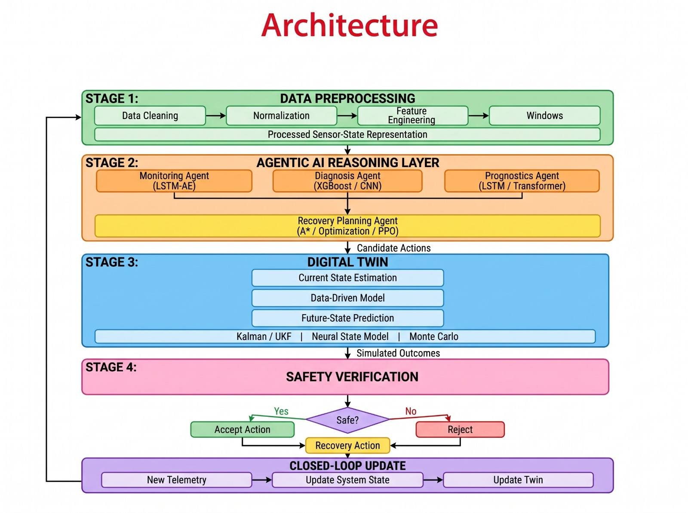

# AI-Based Aircraft Engine Health Monitoring, Fault Diagnosis and Predictive Maintenance

[](https://www.python.org/)
[](https://data.nasa.gov/dataset/C-MAPSS-Aircraft-Engine-Simulator-Data/xaut-bemq)
[](#disclaimer)

---

> **Academic Disclaimer:** This repository is an academic and research engineering prototype developed for final-year engineering research. It utilizes simulated turbofan degradation data from the NASA Commercial Modular Aero-Propulsion System Simulation (C-MAPSS) benchmark. It is designed for methodology evaluation and educational demonstration and is **not certified or deployed for real-world aircraft operations or live flight control**.

---

## 1. Project Overview

In commercial and defense aviation, gas turbine engines are high-capital, mission-critical assets. In-flight component failures, unscheduled engine removals, and uncontained mechanical breakdowns incur severe operational disruptions, financial penalties, and flight-safety hazards. 

This project develops an end-to-end intelligent predictive maintenance framework for high-bypass aircraft turbofan engines. By combining physics-informed domain understanding, advanced multivariate machine learning, digital twin simulation, and agentic AI reasoning, the system continuously tracks engine degradation, predicts Remaining Useful Life (RUL), diagnoses subsystem fault modes, and recommends actionable maintenance decisions before catastrophic failure occurs.

---

## 2. Problem Statement

Traditional aircraft maintenance primarily relies on fixed flight-hour intervals or reactive servicing after alarms occur. Fixed schedules often lead to either premature component replacement (incurring unnecessary operational costs) or delayed intervention (risking secondary damage and unplanned groundings). 

Modern aircraft engines generate rich streams of sensor telemetry across variable flight regimes. The primary engineering challenges are:
1. **Operating Condition Complexity:** Variations in altitude, Mach number, and throttle angle produce large operational swings that obscure underlying component degradation.
2. **Multi-Component Fault Dynamics:** Degradation may originate in the High-Pressure Compressor (HPC), Fan, or both simultaneously, each with distinct wear rates.
3. **Sensor Heterogeneity:** Telemetry channels range from invariant environmental measurements to dynamic thermodynamic parameters requiring robust feature selection and regime-aware normalization.
4. **Prognostics and Health Management (PHM):** Accurate RUL prediction must be combined with autonomous, safety-verified mitigation decisions.

---

## 3. Project Objectives

- **Phase 1 – Dataset Setup & Verification:** Ingest, verify cryptographic immutability (SHA-256), and document the NASA C-MAPSS dataset. *(Complete)*
- **Phase 2 – Dataset Understanding & Exploratory Data Analysis:** Conduct programmatic data quality audits, trajectory tracking, and distribution comparisons across all four subsets (FD001–FD004). *(Complete)*
- **Phase 3 – Preprocessing & Feature Engineering:** Perform target RUL formulation, data quality auditing, feature selection, engine-level leakage-free splitting, feature normalization, and temporal sequence generation. *(Complete)*
- **Phase 4 – Remaining Useful Life (RUL) Modeling:** Train and evaluate statistical, machine-learning, and deep sequential models (e.g. CNNs, LSTMs, Transformers) to predict RUL. *(Next)*
- **Phase 5 – Digital Twin Simulation:** Construct a high-fidelity software twin to simulate thermodynamic degradation and test counterfactual operating scenarios.
- **Phase 6 – Agentic AI & Autonomous Decision-Making:** Deploy intelligent agent workflows that reason over health indicators and recommend maintenance strategies.
- **Phase 7 – Safety Verification & Fault Mitigation:** Implement guardrails and fail-safe verification to ensure generated recommendations respect flight safety limits.
- **Phase 8 – Full-Stack Telemetry Dashboard:** Deliver an interactive web platform for real-time fleet health monitoring, RUL forecasting, and maintenance alerts.
- **Phase 9 – System Optimization & Deployment:** Benchmark inference latencies, package containers, and prepare final research documentation.

---

## 4. Project Architecture

The overall multi-phase system architecture integrates data ingestion, preprocessing, health assessment, RUL estimation, digital twin tracking, and autonomous agentic decisions:



---

## 5. Dataset Information: NASA C-MAPSS

The project benchmarks against the **NASA Commercial Modular Aero-Propulsion System Simulation (C-MAPSS)** dataset, created by the NASA Prognostics Center of Excellence (PCoE) at NASA Ames Research Center.

The benchmark models a commercial 90,000 lbf thrust class turbofan engine and is organized into four subsets reflecting escalating operational and fault complexities:

| Subset | Operating Conditions | Fault Modes | Training Trajectories (Engines) | Testing Trajectories (Engines) | Ground-Truth RULs | Total Operational Rows |
| :--- | :--- | :--- | :--- | :--- | :--- | :--- |
| **FD001** | 1 (Single Condition) | 1 (HPC Degradation) | 100 engines (20,631 rows) | 100 engines (13,096 rows) | 100 values | 33,727 |
| **FD002** | 6 (Multi-Condition) | 1 (HPC Degradation) | 260 engines (53,759 rows) | 259 engines (33,991 rows) | 259 values | 87,750 |
| **FD003** | 1 (Single Condition) | 2 (HPC + Fan) | 100 engines (24,720 rows) | 100 engines (16,596 rows) | 100 values | 41,316 |
| **FD004** | 6 (Multi-Condition) | 2 (HPC + Fan) | 249 engines (61,249 rows) | 248 engines (41,214 rows) | 248 values | 102,463 |
| **Total** | — | — | **709 engines (160,359 rows)**| **707 engines (104,897 rows)**| **707 values** | **265,256 rows** |

### Telemetry Variables (26 Columns)
Each operational record represents one snapshot taken during a flight cycle:
- **Identifier:** `unit_number` (Engine ID, positive integer).
- **Time Index:** `time_cycles` (Discrete flight cycle counter, starting at 1).
- **Operational Settings:**
  - `op_setting_1`: Flight Altitude (0 to 42,000 ft).
  - `op_setting_2`: Mach Number (0.00 to 0.84).
  - `op_setting_3`: Throttle Resolver Angle (TRA: 60 to 100).
- **Sensor Measurements (21 continuous channels):**
  - Temperatures: Fan inlet ($T_2$), LPC outlet ($T_{24}$), HPC outlet ($T_{30}$), LPT outlet ($T_{50}$).
  - Pressures: Fan inlet ($P_2$), Bypass duct ($P_{15}$), HPC outlet total ($P_{30}$), HPC outlet static ($Ps_{30}$).
  - Spool Speeds: Physical fan speed ($N_f$), Physical core speed ($N_c$), Corrected fan speed ($Nf_{\text{dmd}}$), Corrected core speed ($Nc_{\text{dmd}}$).
  - Ratios & Mass Flows: Engine Pressure Ratio ($\text{epr}$), Fuel flow to $Ps_{30}$ ratio ($\phi$), Bypass Ratio ($\text{BPR}$), Burner Fuel-Air ratio ($\text{farB}$), Bleed enthalpy ($ht\text{Bleed}$), Demanded speeds ($Nf_{\text{dmd2}}$, $PCNfR_{\text{dmd}}$), Coolant bleeds ($W_{31}$, $W_{32}$).

For complete documentation on the dataset source, citations, and hash records, refer to [`docs/dataset_source.md`](docs/dataset_source.md).

---

## 6. Completed Work: Phase 1 & Phase 2

### Phase 1: Dataset Setup and Verification
- Ingested all 12 primary files and supporting documentation from the NASA repository.
- Established and verified dataset immutability using SHA-256 cryptographic hashes.
- Audited file headers, line terminators, and byte counts.
- Created comprehensive dataset documentation in [`docs/dataset_source.md`](docs/dataset_source.md).

### Phase 2: Dataset Understanding and Exploratory Data Analysis (EDA)
- **Step 2.1 – Inspection:** Confirmed 26-column tabular layout and initial record distributions.
- **Step 2.2 – Column Mapping:** Mapped columns to physical turbofan components per the PHM 2008 literature.
- **Step 2.3 – Boundary Check:** Analyzed first and last cycle records for all 12 dataset files.
- **Step 2.4 – Statistical Summary:** Computed total rows, columns, engine counts, and cycle lengths across subsets.
- **Step 2.5 – Data Quality Audit:** Verified zero missing values, zero non-numeric tokens, zero infinite values, and valid positive integer identifiers across all 265,256 rows.
- **Step 2.6 – Duplicate Analysis:** Confirmed zero full-row duplicates and zero key collisions on `(unit_number, time_cycles)`.
- **Step 2.7 – Chronological Continuity:** Programmatically verified that cycles increment strictly by $+1$ without gaps or reversals, and engine records form contiguous blocks.
- **Step 2.8 – Summary Statistics:** Computed parametric summary statistics (mean, standard deviation, quartiles, coefficient of variation) for all 26 columns across all 8 files.
- **Step 2.9 – Sensor Trajectories:** Generated 44 high-resolution trend plots across 11 key sensors for representative short, medium, and long engines.
- **Step 2.10 – Comparative Distributions:** Generated 42 comparative boxplots comparing training and testing distributions side-by-side.
- **Step 2.11 – Sensor Variation Classification:** Evaluated all 21 sensors across all four subsets into Constant, Near-constant, Low-variation, and Variable categories.
- **Step 2.12 – EDA Reporting:** Compiled the master [CMAPSS EDA Report](reports/eda/CMAPSS_EDA_Report.md) and [EDA Summary](reports/eda/EDA_Summary.md).

---

## 7. Completed Work: Phase 3 – Data Preprocessing & Target Preparation

Phase 3 established an end-to-end, reproducible, leakage-free data preparation pipeline that prepares the NASA C-MAPSS datasets for machine learning and deep learning RUL prognostics.

```text
Phase 3 Preprocessing Pipeline:
Raw Data (C-MAPSS)
  │
  ├── 1. RUL Target Formulation (Linear run-to-failure & test ground-truth alignment)
  │      └── calculate_training_rul.py & calculate_test_rul.py
  │
  ├── 2. Capping Strategy Evaluation (Piecewise linear RUL analysis: 125 cycles approved)
  │      └── analyze_rul_capping.py
  │
  ├── 3. Data-Quality & Monotonicity Verification (Zero missing, 265,256 verified rows)
  │      └── validate_processed_data.py
  │
  ├── 4. Feature Selection Analysis (Tier 1: 14 sensors, Tier 2: 17 features, Tier 3: 24 features)
  │      └── analyze_feature_selection.py
  │
  ├── 5. Engine-Level Split (80/20 train/validation split by engine ID, Seed 42)
  │      └── split_engines.py (Generates train_val_split_manifest.json)
  │
  ├── 6. MinMaxScaler Feature Scaling (Fit on Train partition only, no test/validation leakage)
  │      └── apply_feature_scaling.py (Generates scaler_manifest.json)
  │
  └── 7. Time-Window Sequence Generation (Window=30, Stride=1, Tier 3 Features)
         └── create_sequences.py (Generates sequence_configuration.json & 3D arrays)
```

### Key Components of Phase 3:

1. **RUL Target Formulation (Steps 3.1, 3.2, 3.3):**
   - **Training Sets:** Formulated as $RUL(i, t) = \max_t(i) - t$. Calculated and appended as a 27th column across all 160,359 training rows.
   - **Test Sets:** Formulated as $RUL(i, t) = RUL_{\text{GT}}(i) + (t_{\text{cutoff}}(i) - t)$, aligning exactly with the NASA ground-truth RUL files at cutoff ($0.0$ residual).
   - Documentation: [`docs/phase3_rul_target_definition.md`](docs/phase3_rul_target_definition.md), [`docs/phase3_step3_2_training_rul.md`](docs/phase3_step3_2_training_rul.md), and [`docs/phase3_step3_3_test_rul.md`](docs/phase3_step3_3_test_rul.md).

2. **RUL Capping Analysis (Step 3.4):**
   - Evaluated raw linear RUL vs. piecewise linear capped RUL ($RUL_{\text{capped}} = \min(RUL, R_{\text{early}})$) at 125 and 130 cycles.
   - Decision: Approved **125 cycles** as the primary target representation for advanced regression models, while retaining raw linear RUL as the baseline benchmark.
   - Documentation: [`docs/phase3_step3_4_rul_capping_analysis.md`](docs/phase3_step3_4_rul_capping_analysis.md) and [`reports/eda/rul_capping_comparison.csv`](reports/eda/rul_capping_comparison.csv).

3. **Data Quality & Validation Audit (Step 3.5):**
   - Programmatically validated all 8 processed datasets (265,256 rows).
   - Confirmed 0 missing, null, or non-numeric entries; confirmed strict cycle monotonicity ($+1$) and exact RUL target consistency across all engines.
   - Documentation: [`docs/phase3_step3_5_data_quality_and_cleaning.md`](docs/phase3_step3_5_data_quality_and_cleaning.md).

4. **Feature Selection Strategy (Step 3.6):**
   - Formulated a multi-tier feature hierarchy based on physical sensor roles, variance, and regime complexity:
     - **Tier 1 (Core Dynamic - 14 features):** 14 dynamic sensors (`sensor_2`, `3`, `4`, `7`, `8`, `9`, `11`, `12`, `13`, `14`, `15`, `17`, `20`, `21`).
     - **Tier 2 (Core + Operating - 17 features):** Tier 1 plus 3 operating settings (`op_setting_1`, `2`, `3`).
     - **Tier 3 (Extended Full - 24 features):** All 3 operating settings and all 21 sensors.
   - Documentation: [`docs/phase3_step3_6_feature_selection.md`](docs/phase3_step3_6_feature_selection.md) and [`reports/eda/feature_selection_summary.csv`](reports/eda/feature_selection_summary.csv).

5. **Engine-Level Train/Validation Split (Step 3.10):**
   - Split training engines **at the engine level** (80% train, 20% validation) using random seed 42 to guarantee zero cross-engine leakage.
   - Preserved engine-count distributions: FD001 (80/20), FD002 (208/52), FD003 (80/20), FD004 (199/50).
   - Traceability: Documented in [`docs/phase3_step3_10_engine_split.md`](docs/phase3_step3_10_engine_split.md) and tracked in [`dataset/processed/train_val_split_manifest.json`](dataset/processed/train_val_split_manifest.json).

6. **Feature Scaling & Pipeline (Steps 3.7 & 3.8):**
   - Evaluated scaling strategies; selected **MinMaxScaler** mapped to $[0, 1]$.
   - Strict leakage prevention: Fitted exclusively on the training engine partition; validation and test sets were transformed using the training parameters without fitting or clipping.
   - Reproducibility: Scaler parameters serialized and tracked in [`models/scalers/scaler_manifest.json`](models/scalers/scaler_manifest.json); documentation in [`docs/phase3_step3_7_scaling_strategy.md`](docs/phase3_step3_7_scaling_strategy.md) and [`docs/phase3_step3_8_scaling_execution.md`](docs/phase3_step3_8_scaling_execution.md).

7. **Time-Window Sequence Generation (Step 3.9):**
   - Formulated dense sliding-window sequences for recurrent and convolutional deep learning models:
     - **Window Size ($W$):** 30 cycles.
     - **Stride ($S$):** 1 cycle.
     - **Feature Count:** 24 features (Tier 3 Extended).
     - **Target ($y$):** RUL at the final observed cycle ($t_{\text{end}}$) of each window.
   - Generated sequence counts across all subsets:
     - **Training Sequences:** 111,459 sliding windows (FD001: 14,020; FD002: 36,857; FD003: 17,857; FD004: 42,725).
     - **Validation Sequences:** 28,339 sliding windows (FD001: 3,711; FD002: 9,362; FD003: 3,963; FD004: 11,303).
     - **Test Full Sliding Sequences:** 84,495 sliding windows (FD001: 10,196; FD002: 26,511; FD003: 13,696; FD004: 34,092).
     - **Test Final Evaluation Sequences:** Exactly **707 evaluation windows** (one window per test engine: 100 in FD001, 259 in FD002, 100 in FD003, 248 in FD004).
   - Sequence configuration manifest: [`dataset/processed/sequences/sequence_configuration.json`](dataset/processed/sequences/sequence_configuration.json).

8. **Padding Audit & Short Engine Handling:**
   - Trajectory length analysis identified that all 709 training/validation engines have $\ge 128$ cycles.
   - In test sets, 17 engines have fewer than 30 observations (6 in FD002, 11 in FD004; lengths between 19 and 29 cycles).
   - Computational padding: Left-edge replication padding repeats the earliest available recorded observation ($t=1$) backwards for $30 - L$ cycles. This constructs fixed-length $(30, 24)$ tensors and guarantees that all 707 test engines are evaluated against official NASA benchmark targets without modifying the final ground-truth RUL ($0.0$ residual).
   - All padded windows are explicitly tagged (`is_padded=True`). In Phase 4, model evaluation will report full benchmark metrics (all 707 engines), unpadded subgroup metrics (690 engines), and padded subgroup metrics (17 engines).
   - Detailed audit: [`docs/phase3_step3_9_padding_audit.md`](docs/phase3_step3_9_padding_audit.md) and [`docs/phase3_step3_9_time_window_sequences.md`](docs/phase3_step3_9_time_window_sequences.md).

> **Dataset Storage Note:** Following open-source repository best practices, large generated datasets (`dataset/processed/*_with_RUL.csv`, `*_split.csv`, `*_scaled.csv`), generated 3D tensor arrays (`*.npy`), and binary scaler objects (`*.pkl`) remain local and are excluded from Git via `.gitignore`. All scripts and JSON reproducibility manifests are committed so that any user can reproduce the exact processed artifacts locally.

---

## 8. Repository Folder Structure

```text
Aircraft_Engine_AI/
├── .gitignore                                 # Excludes raw data, large CSVs, .npy arrays, .pkl binaries
├── README.md                                  # Master project documentation
├── docs/
│   ├── architecture.png.jpg                   # System architecture diagram
│   ├── dataset_source.md                      # NASA C-MAPSS provenance and verification record
│   ├── phase3_rul_target_definition.md        # Step 3.1: RUL mathematical formulation
│   ├── phase3_step3_2_training_rul.md         # Step 3.2: Training RUL calculation report
│   ├── phase3_step3_3_test_rul.md             # Step 3.3: Test RUL calculation report
│   ├── phase3_step3_4_rul_capping_analysis.md # Step 3.4: Piecewise RUL capping analysis
│   ├── phase3_step3_5_data_quality_and_cleaning.md # Step 3.5: Data quality audit
│   ├── phase3_step3_6_feature_selection.md    # Step 3.6: Multi-tier feature selection
│   ├── phase3_step3_7_scaling_strategy.md     # Step 3.7: Feature scaling strategy
│   ├── phase3_step3_8_scaling_execution.md    # Step 3.8: Feature scaling execution report
│   ├── phase3_step3_9_time_window_sequences.md# Step 3.9: Time-window sequence generation
│   ├── phase3_step3_9_padding_audit.md        # Step 3.9: Left-edge replication padding audit
│   └── phase3_step3_10_engine_split.md        # Step 3.10: Engine-level train/val split report
├── dataset/
│   ├── raw/                                   # NASA C-MAPSS raw files (excluded from Git)
│   └── processed/                             # Processed datasets (CSVs and .npy excluded)
│       ├── .gitkeep
│       ├── train_val_split_manifest.json      # Step 3.10: 80/20 Engine split manifest
│       └── sequences/
│           └── sequence_configuration.json    # Step 3.9: Sequence configuration manifest
├── models/
│   └── scalers/
│       └── scaler_manifest.json               # Step 3.8: Min/Max scaling parameter manifest
├── preprocessing/                             # Reproducible preprocessing pipeline scripts
│   ├── inspect_dataset.py                     # Step 2.1: Dataset structure inspection
│   ├── inspect_first_last_rows.py             # Step 2.3: Boundary cycle inspection
│   ├── summarize_subsets.py                   # Step 2.4: Subset dimensions & cycle counts
│   ├── check_data_quality.py                  # Step 2.5: Missing & non-numeric audit
│   ├── check_duplicates.py                    # Step 2.6: Full-row & key duplicate check
│   ├── check_cycle_order.py                   # Step 2.7: Chronological continuity audit
│   ├── summary_statistics.py                  # Step 2.8: Parametric summary statistics
│   ├── plot_sensor_trends.py                  # Step 2.9: Sensor trajectory visualization
│   ├── compare_sensor_distributions.py        # Step 2.10: Comparative boxplot generation
│   ├── classify_sensor_variation.py           # Step 2.11: Sensor variation classification
│   ├── calculate_training_rul.py              # Step 3.2: Append linear RUL to training sets
│   ├── calculate_test_rul.py                  # Step 3.3: Append RUL to test sets from GT
│   ├── analyze_rul_capping.py                 # Step 3.4: Piecewise RUL capping analysis
│   ├── validate_processed_data.py             # Step 3.5: Comprehensive data quality audit
│   ├── analyze_feature_selection.py           # Step 3.6: Feature correlation & tier selection
│   ├── scaling_pipeline.py                    # Step 3.7: Feature scaling pipeline module
│   ├── split_engines.py                       # Step 3.10: 80/20 engine-level split
│   ├── apply_feature_scaling.py               # Step 3.8: Fit & apply MinMaxScaler
│   └── create_sequences.py                    # Step 3.9: Generate 3D time-window sequences
└── reports/
    └── eda/                                   # EDA and feature analysis reports
        ├── CMAPSS_EDA_Report.md               # Comprehensive technical EDA report
        ├── EDA_Summary.md                     # Executive EDA summary
        ├── feature_selection_summary.csv      # Step 3.6: Sensor & setting metrics
        ├── rul_capping_comparison.csv         # Step 3.4: RUL capping statistics
        ├── train_FD001_summary.csv            # FD001 training statistics
        ├── test_FD001_summary.csv             # FD001 testing statistics
        ├── train_FD002_summary.csv            # FD002 training statistics
        ├── test_FD002_summary.csv             # FD002 testing statistics
        ├── train_FD003_summary.csv            # FD003 training statistics
        ├── test_FD003_summary.csv             # FD003 testing statistics
        ├── train_FD004_summary.csv            # FD004 training statistics
        ├── test_FD004_summary.csv             # FD004 testing statistics
        ├── sensor_trends/                     # 44 individual sensor trajectory PNG plots
        └── sensor_distributions/              # 42 distribution boxplots & classification CSVs
            ├── sensor_variation_classification.csv
            ├── sensor_variation_analysis.md
            ├── train_sensor_distribution_comparison.csv
            └── test_sensor_distribution_comparison.csv
```

---

## 9. Technologies Used

- **Programming Language:** Python 3.12+
- **Package & Environment Management:** `uv`
- **Data Manipulation & Preprocessing:** `pandas`, `numpy`
- **Visualization:** `matplotlib`
- **Version Control & Documentation:** Git & GitHub

---

## 10. Getting Started & Reproducibility Guide

Follow these steps to reproduce the complete EDA and preprocessing pipeline from scratch.

### 1. Prerequisites & Environment Setup

Clone the repository and set up a virtual environment using `uv` (recommended) or standard `python`:

```bash
# Clone the repository
git clone https://github.com/Srujan73389/AI-Aircraft-Engine-Health-Monitoring-.git
cd AI-Aircraft-Engine-Health-Monitoring-

# Create virtual environment
uv venv

# Activate virtual environment
# Windows (PowerShell):
.venv\Scripts\Activate.ps1
# Linux / macOS:
source .venv/bin/activate

# Install required dependencies
uv pip install pandas numpy matplotlib
```

### 2. Acquire and Place Raw Dataset Files

1. Download the C-MAPSS dataset from the [NASA Data Portal](https://data.nasa.gov/dataset/C-MAPSS-Aircraft-Engine-Simulator-Data/xaut-bemq) or [NASA PCoE Repository](https://www.nasa.gov/intelligent-systems-division/discovery-and-systems-health/pcoe/pcoe-data-set-repository/).
2. Extract the archive so that the 12 text files reside in `dataset/raw/C-MAPSS/`:
   ```text
   dataset/raw/C-MAPSS/
   ├── train_FD001.txt, train_FD002.txt, train_FD003.txt, train_FD004.txt
   ├── test_FD001.txt, test_FD002.txt, test_FD003.txt, test_FD004.txt
   └── RUL_FD001.txt, RUL_FD002.txt, RUL_FD003.txt, RUL_FD004.txt
   ```
3. (Optional) Verify file integrity against documented SHA-256 hashes in [`docs/dataset_source.md`](docs/dataset_source.md).

### 3. Run the Preprocessing Pipeline in Order

Execute each step sequentially from the project root:

```bash
# Step 3.2: Calculate and append RUL to training datasets
python preprocessing/calculate_training_rul.py

# Step 3.3: Calculate and append RUL to test datasets from ground truth
python preprocessing/calculate_test_rul.py

# Step 3.4: Evaluate piecewise RUL capping (125 cycles)
python preprocessing/analyze_rul_capping.py

# Step 3.5: Audit data quality and verify zero missing/corrupted values
python preprocessing/validate_processed_data.py

# Step 3.6: Evaluate feature selection metrics and correlation tiers
python preprocessing/analyze_feature_selection.py

# Step 3.10: Perform 80/20 engine-level train/validation split (Seed 42)
python preprocessing/split_engines.py

# Step 3.8: Fit MinMaxScaler on training engines only and scale partitions
python preprocessing/apply_feature_scaling.py

# Step 3.9: Generate 3D time-window sequences (Window=30, Stride=1)
python preprocessing/create_sequences.py
```

Upon execution of `create_sequences.py`, all 3D sequence arrays (`X_train_*.npy`, `y_train_*.npy`, `X_validation_*.npy`, `X_test_*.npy`, `X_test_final_*.npy`) and trace metadata CSVs will be populated in `dataset/processed/sequences/`.

---

## 11. Current Status and Upcoming Roadmap

- [x] **Phase 1: Dataset Setup and Cryptographic Verification** *(Complete)*
- [x] **Phase 2: Dataset Understanding and Exploratory Data Analysis** *(Complete)*
- [x] **Phase 3: Data Preprocessing & Target Preparation** *(Complete)*
- [ ] **Phase 4: RUL Prognostics & Health Monitoring Models** *(Next - Statistical, Machine Learning, and Deep Sequence Models)*
- [ ] **Phase 5: High-Fidelity Turbofan Digital Twin Simulation**
- [ ] **Phase 6: Multi-Agent AI System for Autonomous Decision Support**
- [ ] **Phase 7: Safety Verification & Guardrail Architecture**
- [ ] **Phase 8: Full-Stack Web Platform (FastAPI & React Telemetry Dashboard)**
- [ ] **Phase 9: Comprehensive Validation, Benchmarking & Deployment**

---

## 12. References & Citations

1. A. Saxena, K. Goebel, D. Simon, and N. Eklund, *"Damage Propagation Modeling for Aircraft Engine Run-to-Failure Simulation"*, in Proceedings of the 1st International Conference on Prognostics and Health Management (PHM08), Denver, CO, Oct 2008.
2. D. K. Frederick, J. A. DeCastro, and J. S. Litt, *"User's Guide for the Commercial Modular Aero-Propulsion System Simulation (C-MAPSS)"*, NASA Technical Memorandum NASA/TM-2007-215026, 2007.
3. NASA Prognostics Center of Excellence (PCoE) Data Set Repository, NASA Ames Research Center.
4. P. Wang, Y. Zheng, et al., *"Long short-term memory network for remaining useful life estimation"*, in IEEE International Conference on Prognostics and Health Management (ICPHM), 2017.

---

## 13. License & Academic Use

This project is licensed for academic, research, and non-commercial educational use. All raw dataset rights belong to the National Aeronautics and Space Administration (NASA).
