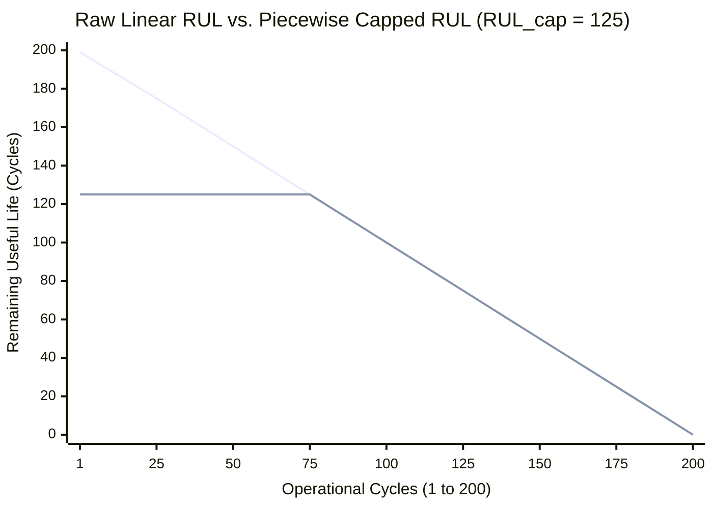

# Phase 3 – Step 3.1: Remaining Useful Life (RUL) Target Definition & Formulation

**Project:** AI-Based Aircraft Engine Health Monitoring, Fault Diagnosis and Predictive Maintenance  
**Dataset:** NASA Commercial Modular Aero-Propulsion System Simulation (C-MAPSS)  
**Document Status:** Complete (Step 3.1 Specification)  
**Date:** November 2026  

---

## 1. Executive Summary & Purpose

In prognostic health management (PHM) of turbofan engines, the primary regression and prognostic target is **Remaining Useful Life (RUL)**. Accurate estimation of RUL allows airline operators to transition from reactive or rigid schedule-based maintenance to condition-based predictive maintenance, maximizing component utility while preventing in-flight functional failures.

This document formally specifies the mathematical definitions, operational interpretations, indexing conventions, and verification protocols for computing RUL labels across all four C-MAPSS sub-datasets (`FD001`, `FD002`, `FD003`, `FD004`). 

Per the procedural guidelines of Phase 3, **Step 3.1 is strictly a documentation and formulation task**. No dataset modification, label calculation, feature scaling, or model training is conducted within this step.

---

## 2. Definition and Meaning of Remaining Useful Life (RUL)

### 2.1 Physical and Operational Meaning
In the context of the NASA C-MAPSS dataset, Remaining Useful Life ($RUL$) represents:
$$\text{The number of operational flight cycles remaining before an engine reaches functional failure.}$$

- **Operational Flight Cycle:** A discrete temporal unit representing one complete flight sequence (takeoff, climb, cruise, descent, landing). In C-MAPSS, each cycle is captured as a 26-variable operational record (unit number, cycle index, 3 operating settings, 21 sensor measurements).
- **Functional Failure:** The operational threshold where degradation in engine components (e.g., High-Pressure Compressor [HPC] degradation in `FD001`/`FD002`, or combined HPC and Fan degradation in `FD003`/`FD004`) compromises aerodynamic efficiency, thermodynamic stability, or structural safety margins below operational limits.

### 2.2 Simulation Framework (Saxena et al., 2008)
As established by Saxena et al. (2008), each simulated turbofan trajectory begins with an unknown level of initial manufacturing variation and baseline wear, considered normal healthy operation. Over successive cycles, wear accumulation or fault progression accelerates until the engine degrades to failure.

---

## 3. Training Subset Target Formulation

### 3.1 Run-to-Failure Characteristics
The training datasets (`train_FD001.txt` through `train_FD004.txt`) consist of **complete run-to-failure** trajectories. Each engine unit $i$ is operated until simulated catastrophic failure occurs at its maximum observed cycle, denoted $t_{\text{max}, i}$.

### 3.2 Mathematical Formulation
For an engine $i$ at operational flight cycle $t \in \{1, 2, \dots, t_{\text{max}, i}\}$:

$$RUL_{\text{train}}(i, t) = t_{\text{max}, i} - t$$

Where:
- $i \in \{1, 2, \dots, N_{\text{train}}\}$ is the engine unit identifier.
- $t$ is the current recorded operational cycle of engine $i$.
- $t_{\text{max}, i} = \max_{t} \{ \text{cycle} \mid \text{unit} = i \}$ is the terminal cycle of engine $i$ (the cycle at which failure occurs).

### 3.3 Boundary Conditions & Properties
1. **At initial recorded observation ($t = 1$):**
   $$RUL_{\text{train}}(i, 1) = t_{\text{max}, i} - 1$$
2. **At terminal failure observation ($t = t_{\text{max}, i}$):**
   $$RUL_{\text{train}}(i, t_{\text{max}, i}) = t_{\text{max}, i} - t_{\text{max}, i} = 0$$
   *The final record of each training engine is the snapshot taken at system failure; therefore, its remaining useful life at that snapshot is exactly 0 cycles.*
3. **Monotonicity:**
   $$RUL_{\text{train}}(i, t + 1) = RUL_{\text{train}}(i, t) - 1$$
   *RUL strictly decrements by exactly 1 cycle per elapsed operational cycle.*

---

## 4. Testing Subset Target Formulation

### 4.1 Censored Trajectory Characteristics
The test datasets (`test_FD001.txt` through `test_FD004.txt`) consist of **right-censored** trajectories. For operational evaluation, sensor logging for each test engine is intentionally truncated at an arbitrary point in time prior to failure, denoted $t_{\text{cutoff}, i}$.

The test files do **not** run to failure ($RUL > 0$ at cutoff). Instead, NASA provides separate ground-truth files (`RUL_FD001.txt`, `RUL_FD002.txt`, `RUL_FD003.txt`, `RUL_FD004.txt`) containing the exact remaining operational cycles for each test unit after its last observed cycle.

### 4.2 NASA Ground-Truth Definition
Let $RUL_{\text{ground\_truth}}(i)$ denote the scalar value provided in line $i$ of the corresponding `RUL_FD00x.txt` file. Per NASA documentation:
$$RUL_{\text{ground\_truth}}(i) = \text{number of cycles remaining after cycle } t_{\text{cutoff}, i}$$

Therefore, at the terminal observed cycle $t_{\text{cutoff}, i}$:
$$RUL_{\text{test}}(i, t_{\text{cutoff}, i}) = RUL_{\text{ground\_truth}}(i)$$

### 4.3 Formulation for Earlier Test Observations ($t \le t_{\text{cutoff}, i}$)
When training sequence models, recurrent architectures, or evaluating point predictions throughout an engine's observed life, target labels are needed for all cycles $t \le t_{\text{cutoff}, i}$.

Because the engine progresses by exactly 1 cycle per step towards failure, the total simulated lifespan of test engine $i$ is:
$$T_{\text{total}, i} = t_{\text{cutoff}, i} + RUL_{\text{ground\_truth}}(i)$$

The RUL at any observed test cycle $t \in \{1, 2, \dots, t_{\text{cutoff}, i}\}$ is formulated as:

$$RUL_{\text{test}}(i, t) = T_{\text{total}, i} - t = RUL_{\text{ground\_truth}}(i) + (t_{\text{cutoff}, i} - t)$$

### 4.4 Boundary Conditions & Properties
1. **At cutoff cycle ($t = t_{\text{cutoff}, i}$):**
   $$RUL_{\text{test}}(i, t_{\text{cutoff}, i}) = RUL_{\text{ground\_truth}}(i) + (t_{\text{cutoff}, i} - t_{\text{cutoff}, i}) = RUL_{\text{ground\_truth}}(i)$$
2. **At initial observed cycle ($t = 1$):**
   $$RUL_{\text{test}}(i, 1) = RUL_{\text{ground\_truth}}(i) + t_{\text{cutoff}, i} - 1$$
3. **Monotonicity:**
   $$RUL_{\text{test}}(i, t + 1) = RUL_{\text{test}}(i, t) - 1$$

---

## 5. Comparative Analysis: Training vs. Testing Targets

| Dimension | Training Subsets (`train_FD00x.txt`) | Testing Subsets (`test_FD00x.txt`) |
| :--- | :--- | :--- |
| **Trajectory Status** | Complete (Run-to-failure) | Censored (Truncated prior to failure) |
| **Terminal Cycle** | $t_{\text{max}, i}$ (Failure point) | $t_{\text{cutoff}, i}$ (Arbitrary cutoff) |
| **Terminal RUL** | Exactly $0$ cycles | $RUL_{\text{ground\_truth}}(i) > 0$ cycles |
| **Ground-Truth Source** | Derived internally from max cycle | Provided externally in `RUL_FD00x.txt` |
| **Total Engine Life** | $T_{\text{total}, i} = t_{\text{max}, i}$ | $T_{\text{total}, i} = t_{\text{cutoff}, i} + RUL_{\text{ground\_truth}}(i)$ |
| **Target Formula** | $RUL(i, t) = t_{\text{max}, i} - t$ | $RUL(i, t) = RUL_{\text{ground\_truth}}(i) + (t_{\text{cutoff}, i} - t)$ |
| **Primary Usage** | Supervised model training | Model evaluation, benchmark scoring |

```mermaid
flowchart TD
    subgraph Training Trajectory (Run-to-Failure)
        TR1["Cycle 1\nRUL = t_max - 1"] --> TR2["..."]
        TR2 --> TR3["Cycle t\nRUL = t_max - t"]
        TR3 --> TR4["..."]
        TR4 --> TR5["Cycle t_max (Failure)\nRUL = 0"]
    end

    subgraph Testing Trajectory (Censored)
        TE1["Cycle 1\nRUL = RUL_GT + t_cutoff - 1"] --> TE2["..."]
        TE2 --> TE3["Cycle t\nRUL = RUL_GT + t_cutoff - t"]
        TE3 --> TE4["..."]
        TE4 --> TE5["Cycle t_cutoff (Last Observed)\nRUL = RUL_GT"]
        TE5 -. "Unobserved Future Cycles\n(Duration = RUL_GT)" .-> TE6["Unobserved Failure\nRUL = 0"]
    end
```

---

## 6. Concrete Illustrative Examples

To provide clarity and prevent implementation errors, we trace step-by-step calculations for a 5-cycle trajectory.

### 6.1 Training Engine Example
Consider an engine $i=1$ in a training subset whose recorded trajectory contains 5 cycles ($t = 1, 2, 3, 4, 5$).
- Maximum observed cycle: $t_{\text{max}, 1} = 5$.
- Simulated failure occurs at cycle 5.

| Observed Cycle ($t$) | Formula Applied: $t_{\text{max}} - t$ | Calculated $RUL_{\text{train}}$ | Operational Meaning |
| :---: | :---: | :---: | :--- |
| **1** | $5 - 1$ | **4** | 4 cycles remain before failure |
| **2** | $5 - 2$ | **3** | 3 cycles remain before failure |
| **3** | $5 - 3$ | **2** | 2 cycles remain before failure |
| **4** | $5 - 4$ | **1** | 1 cycle remains before failure |
| **5** | $5 - 5$ | **0** | Failure occurs at this operational snapshot |

### 6.2 Testing Engine Example
Consider an engine $j=1$ in a testing subset whose recorded trajectory ends at cycle 5 ($t_{\text{cutoff}, 1} = 5$), and whose external ground-truth value in `RUL_FD00x.txt` is **30**:
- Cutoff cycle: $t_{\text{cutoff}, 1} = 5$.
- Ground truth remaining cycles: $RUL_{\text{ground\_truth}}(1) = 30$.
- Total simulated lifespan: $T_{\text{total}, 1} = 5 + 30 = 35$ cycles.

| Observed Cycle ($t$) | Formula Applied: $RUL_{\text{GT}} + (t_{\text{cutoff}} - t)$ | Calculated $RUL_{\text{test}}$ | Operational Meaning |
| :---: | :---: | :---: | :--- |
| **1** | $30 + (5 - 1) = 34$ | **34** | 34 cycles remain until eventual failure |
| **2** | $30 + (5 - 2) = 33$ | **33** | 33 cycles remain until eventual failure |
| **3** | $30 + (5 - 3) = 32$ | **32** | 32 cycles remain until eventual failure |
| **4** | $30 + (5 - 4) = 31$ | **31** | 31 cycles remain until eventual failure |
| **5** | $30 + (5 - 5) = 30$ | **30** | 30 cycles remain after this final observed cycle |

---

## 7. Target Degradation Modeling: Raw Linear vs. Piecewise Capped RUL

In the prognostics literature, two distinct mathematical representations of the RUL target are widely employed. Step 3.1 documents both concepts; **no clipping threshold is selected or applied at this stage**.

### 7.1 Raw Linear RUL
Raw Linear RUL: Assigns a linearly decreasing target from the first recorded cycle to the final failure cycle. This is a target-labeling convention and does not imply that physical degradation begins at cycle 1.

- **Mathematical Form:** $RUL(t) = t_{\text{max}} - t$.
- **Characteristics:** Unbounded upper range (e.g., engines with 350 cycles have initial RUL of 349).
- **Limitation:** In physical turbofan engines, components typically operate in a baseline healthy state for hundreds of cycles before fatigue, microcracks, or fouling initiate detectable degradation. Forcing a machine learning model to distinguish between an engine at $RUL=300$ and $RUL=250$ when sensor measurements reflect identical healthy baselines can introduce unnecessary regression noise.

### 7.2 Piecewise Linear (Capped) RUL
- **Definition:** RUL is capped at a predefined threshold $RUL_{\text{cap}}$ during the healthy operational phase, transitioning to a linear countdown once RUL falls below the threshold:
  $$RUL_{\text{piecewise}}(i, t) = \min\left( RUL_{\text{raw}}(i, t), RUL_{\text{cap}} \right)$$
- **Literature Precedent:** Widely adopted in benchmark C-MAPSS studies (e.g., Heimes, 2008; Babu et al., 2016; Zheng et al., 2017), where $RUL_{\text{cap}}$ is typically selected in the range of **125 to 130 cycles**.
- **Theoretical Rationale:** Models are not penalized for predicting differences during early cycles where sensor signals are statistically indistinguishable from baseline healthy operation.



> [!IMPORTANT]
> **Scope Boundary for Step 3.1:**  
> The piecewise formulation is documented here for conceptual completeness. In Step 3.2 and Step 3.3, raw linear RUL values will be computed first as the ground-truth base target. Decisions regarding whether to apply a piecewise cap, and the specific cap value ($RUL_{\text{cap}}$), will be evaluated and decided during downstream feature preprocessing.

---

## 8. Technical Assumptions, Indexing Conventions & Pitfall Prevention

### 8.1 Indexing Conventions
1. **1-Based Cycle Indexing:** The `time_cycles` column in C-MAPSS starts at cycle `1` and increments sequentially by `1` without gaps ($t \in [1, t_{\text{max}}]$).
2. **1-Based Engine Identification:** Engine IDs are positive integers ($1, 2, \dots, N$).
3. **Ground-Truth File Alignment:** The ground truth files `RUL_FD00x.txt` contain exactly one scalar value per line. Line $k$ corresponds strictly to test unit number $k$.

### 8.2 Off-by-One Pitfall Prevention
Implementation of RUL label assignment frequently encounters common off-by-one errors. The table below documents these pitfalls and their prevention:

| Potential Error | Incorrect Expression | Correct Expression | Impact of Error |
| :--- | :--- | :--- | :--- |
| **Terminal Cycle Shift** | $RUL = t_{\text{max}} - t + 1$ | $RUL = t_{\text{max}} - t$ | Results in $RUL = 1$ at failure instead of $RUL = 0$. Artificially inflates life. |
| **Test Cutoff Inclusion** | $RUL(t_{\text{cutoff}}) = RUL_{\text{GT}} - 1$ | $RUL(t_{\text{cutoff}}) = RUL_{\text{GT}}$ | Misinterprets ground-truth scalar as the post-cutoff cycle rather than the remaining life at cutoff. |
| **Zero-Index Mapping** | Accessing line `k` for unit `k+1` | Strict `k == unit_id` matching | Shifts all test labels by one engine, corrupting evaluation. |
| **Non-Zero Terminal Life** | Assuming training ends at threshold | $RUL(t_{\text{max}}) \equiv 0$ | Fails to recognize that training trajectories are run-to-failure. |

---

## 9. Verification Protocols for Downstream Steps

### 9.1 Verification Plan for Step 3.2 (Training Target Calculation)
When training RUL labels are computed in Step 3.2, the following automated checks must pass before saving processed data:
1. **Row Count Invariance:** The total number of rows across all training subsets must equal the raw baseline:
   - `train_FD001`: 20,631 rows
   - `train_FD002`: 53,759 rows
   - `train_FD003`: 24,720 rows
   - `train_FD004`: 61,249 rows
2. **Terminal Zero Check:** For every engine $i$, $\min_{t}(RUL(i, t)) \equiv 0$ and must occur at $t = t_{\text{max}, i}$.
3. **Initial Value Check:** For every engine $i$, $\max_{t}(RUL(i, t)) == t_{\text{max}, i} - 1$.
4. **Stepwise Consistency:** For every engine $i$ and consecutive cycles $t, t+1$:
   $$RUL(i, t) - RUL(i, t+1) == 1$$

### 9.2 Verification Plan for Step 3.3 (Testing Target Calculation)
When test RUL labels are computed in Step 3.3:
1. **Row Count Invariance:** The total number of rows across test subsets must equal the raw baseline:
   - `test_FD001`: 13,096 rows
   - `test_FD002`: 33,991 rows
   - `test_FD003`: 16,596 rows
   - `test_FD004`: 41,214 rows
2. **Ground-Truth Cutoff Check:** For each test engine $i$, the computed RUL at its final recorded cycle $t_{\text{cutoff}, i}$ must match the scalar from `RUL_FD00x.txt` line $i$ exactly:
   $$RUL_{\text{test}}(i, t_{\text{cutoff}, i}) == RUL_{\text{ground\_truth}}(i)$$
3. **Stepwise Consistency:** For every engine $i$ and consecutive cycles $t, t+1$:
   $$RUL_{\text{test}}(i, t) - RUL_{\text{test}}(i, t+1) == 1$$
4. **Lifespan Additivity:** For all cycles $t \in [1, t_{\text{cutoff}, i}]$:
   $$RUL_{\text{test}}(i, t) + t == t_{\text{cutoff}, i} + RUL_{\text{ground\_truth}}(i)$$

---

## 10. Summary and Next Actions

Step 3.1 establishes the mathematical and conceptual foundation for all RUL labeling in Phase 3. 

- **Calculations Performed in Step 3.1:** None (documentation only).
- **Files Modified:** None (raw datasets and prior reports untouched).
- **Next Phase Step:** **Phase 3 – Step 3.2: Calculate and Append Training RUL Labels**.
