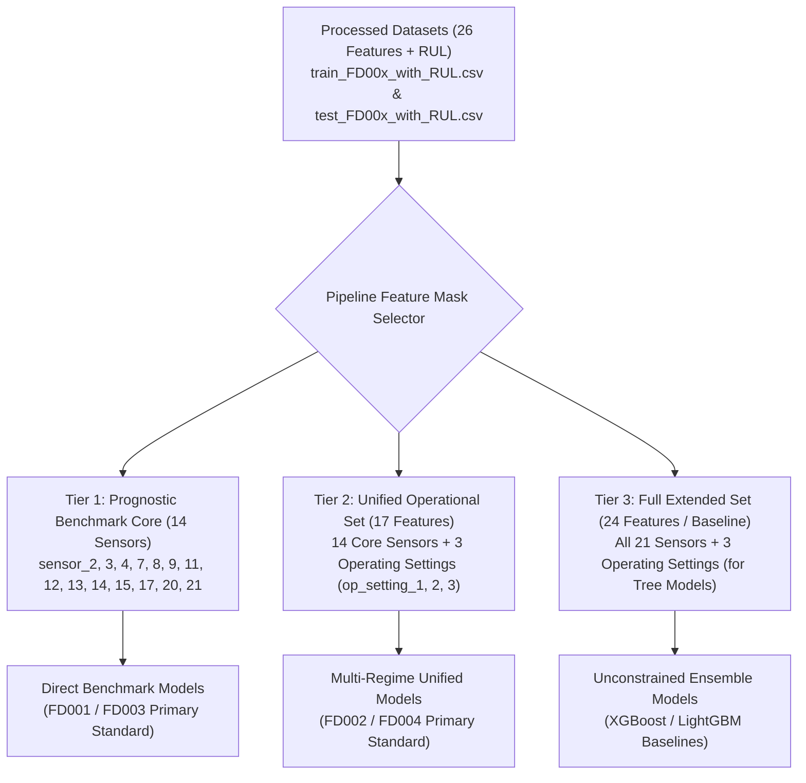

# Phase 3 – Step 3.6: Feature Selection & Input Variable Assessment

**Project:** AI-Based Aircraft Engine Health Monitoring, Fault Diagnosis and Predictive Maintenance  
**Dataset:** NASA Commercial Modular Aero-Propulsion System Simulation (C-MAPSS)  
**Execution Script:** `preprocessing/analyze_feature_selection.py`  
**Generated Report:** `reports/eda/feature_selection_summary.csv`  
**Document Status:** Complete (Step 3.6 Specification & Decision)  
**Date:** November 2026  

---

## 1. Objective

The objective of Step 3.6 is to evaluate all 24 potential predictor variables (3 operational settings and 21 thermodynamic sensors) across the four NASA C-MAPSS subsets (`FD001`, `FD002`, `FD003`, `FD004`) and establish a defensible, literature-aligned feature selection strategy for Remaining Useful Life (RUL) prediction.

This evaluation is grounded in:
1. Findings from Phase 2 Exploratory Data Analysis (EDA) on sensor distributions, cycle-by-cycle trends, and variation classification.
2. The fundamental physical difference between **single operating condition** datasets (`FD001`, `FD003`) and **multiple operating condition** datasets (`FD002`, `FD004`).
3. Strict data leakage prevention protocols (never using RUL or future temporal windows to bias selection).
4. Cross-subset model comparability across the four C-MAPSS benchmark scenarios.

Per Phase 3 specifications, **Step 3.6 is an analytical and architectural decision step**. No columns are deleted from disk, no feature scaling or normalization is performed, and no predictive models are trained.

---

## 2. Input Feature Inventory & Target Separation

The processed datasets (`dataset/processed/*_with_RUL.csv`) contain 27 columns:
- **Index Identifiers (2 columns):** `unit_number` (engine ID), `time_cycles` (temporal cycle counter).
- **Operational Settings (3 columns):** `op_setting_1`, `op_setting_2`, `op_setting_3`.
- **Thermodynamic Sensor Measurements (21 columns):** `sensor_1` through `sensor_21`.
- **Prognostic Target (1 column):** `RUL`.

> [!CRITICAL]
> **Target Leakage Prohibition:**  
> The `RUL` column represents the remaining operational cycles to failure and is strictly the supervised regression target. It must **never** be included as an input feature or used in feature engineering transforms.

---

## 3. Operational Settings Analysis

The three operational settings define the environmental flight profile in C-MAPSS simulation runs:

| Feature | Physical Meaning | FD001 / FD003 Behavior (Single Condition) | FD002 / FD004 Behavior (Six Conditions) | Role in Prognostic Pipeline |
| :--- | :--- | :--- | :--- | :--- |
| **`op_setting_1`** | Flight Altitude (0 to 42,000 ft) | Near-constant noise around zero ($-0.0087$ to $+0.0087$, $\sigma \approx 0.0022$). | Spans 0 to 42.008, $\sigma \approx 14.75$, clearly demarcating 6 flight regimes. | Critical regime discriminator in FD002/FD004. Zero degradation signal in FD001/FD003. |
| **`op_setting_2`** | Flight Mach Number (0.0 to 0.84) | Near-constant noise around zero ($-0.0006$ to $+0.0007$, $\sigma \approx 0.0003$). | Spans 0.0 to 0.842, $\sigma \approx 0.31$, demarcating flight speed regimes. | Critical regime discriminator in FD002/FD004. Zero degradation signal in FD001/FD003. |
| **`op_setting_3`** | Throttle Resolver Angle (TRA / Power) | Identically constant at $100.0$ ($\sigma = 0.0$). | Discrete binary values $\{60.0, 100.0\}$, $\sigma \approx 14.25$. | Discrete operating mode indicator in FD002/FD004. Completely invariant in FD001/FD003. |

### Strategic Assessment of Settings:
- In **FD001 and FD003**, all three operational settings exhibit zero or near-zero variance. Retaining them in single-condition models provides zero degradation information and adds uninformative dimensions.
- In **FD002 and FD004**, these three settings are essential: sensor readings vary by orders of magnitude simply because the aircraft changes altitude or Mach number. Models cannot decouple environmental regime shifts from physical component degradation without these settings (or condition-based normalization derived from them).

---

## 4. Sensor-by-Sensor Assessment

Using the empirical classifications from Step 2.11 and the statistical audit generated by `preprocessing/analyze_feature_selection.py`, all 21 sensors are evaluated across all four subsets.

### 4.1 Cross-Subset Sensor Classification Matrix

| Sensor | Symbol | Physical Description | Units | FD001 | FD002 | FD003 | FD004 | Prognostic Role |
| :---: | :---: | :--- | :---: | :---: | :---: | :---: | :---: | :--- |
| **`sensor_1`** | $T_2$ | Total temperature at fan inlet | °R | **Constant** | Variable | **Constant** | Variable | Invariant in 1/3; ambient condition indicator in 2/4 |
| **`sensor_2`** | $T_{24}$ | Total temperature at LPC outlet | °R | Low-variation | Variable | Low-variation | Variable | **Core degradation sensor** (active in all 4) |
| **`sensor_3`** | $T_{30}$ | Total temperature at HPC outlet | °R | Variable | Variable | Variable | Variable | **Core degradation sensor** (active in all 4) |
| **`sensor_4`** | $T_{50}$ | Total temperature at LPT outlet | °R | Variable | Variable | Variable | Variable | **Core degradation sensor** (active in all 4) |
| **`sensor_5`** | $P_2$ | Pressure at fan inlet | psia | **Constant** | Variable | **Constant** | Variable | Invariant in 1/3; ambient condition indicator in 2/4 |
| **`sensor_6`** | $P_{15}$ | Total pressure in bypass-duct | psia | Near-constant | Variable | Low-variation | Variable | Invariant in 1/3; condition sensitive in 2/4 |
| **`sensor_7`** | $P_{30}$ | Total pressure at HPC outlet | psia | Low-variation | Variable | Variable | Variable | **Core degradation sensor** (active in all 4) |
| **`sensor_8`** | $N_f$ | Physical fan speed | rpm | Near-constant | Variable | Near-constant | Variable | **Core degradation sensor** (fan dynamics in all 4) |
| **`sensor_9`** | $N_c$ | Physical core speed | rpm | Variable | Variable | Variable | Variable | **Core degradation sensor** (active in all 4) |
| **`sensor_10`** | epr | Engine pressure ratio ($P_{50}/P_2$) | — | **Constant** | Low-variation | Near-constant | Low-variation | Low diagnostic utility across all subsets |
| **`sensor_11`** | $P_{s30}$ | Static pressure at HPC outlet | psia | Low-variation | Variable | Low-variation | Variable | **Core degradation sensor** (active in all 4) |
| **`sensor_12`** | $\phi$ | Ratio of fuel flow to $P_{s30}$ | pps/psia | Low-variation | Variable | Variable | Variable | **Core degradation sensor** (active in all 4) |
| **`sensor_13`** | $N_{f\text{,dmd}}$ | Corrected fan speed | rpm | Near-constant | Variable | Near-constant | Variable | **Core degradation sensor** (active in all 4) |
| **`sensor_14`** | $N_{c\text{,dmd}}$ | Corrected core speed | rpm | Variable | Variable | Variable | Variable | **Core degradation sensor** (active in all 4) |
| **`sensor_15`** | BPR | Bypass ratio | — | Low-variation | Low-variation | Low-variation | Low-variation | **Core degradation sensor** (active in all 4) |
| **`sensor_16`** | farB | Burner fuel-air ratio | — | **Constant** | Near-constant | **Constant** | Near-constant | Invariant / negligible variance across all 4 |
| **`sensor_17`** | htBleed | Bleed Enthalpy | — | Variable | Variable | Variable | Variable | **Core degradation sensor** (active in all 4) |
| **`sensor_18`** | $N_{f\text{,dmd2}}$ | Demanded fan speed | rpm | **Constant** | Variable | **Constant** | Variable | Invariant in 1/3; regime indicator in 2/4 |
| **`sensor_19`** | $PCNfR_{\text{dmd}}$ | Demanded corrected fan speed | rpm | **Constant** | Variable | **Constant** | Variable | Invariant in 1/3; regime indicator in 2/4 |
| **`sensor_20`** | $W_{31}$ | HPT coolant bleed | lbm/s | Low-variation | Variable | Low-variation | Variable | **Core degradation sensor** (active in all 4) |
| **`sensor_21`** | $W_{32}$ | LPT coolant bleed | lbm/s | Low-variation | Variable | Low-variation | Variable | **Core degradation sensor** (active in all 4) |

---

### 4.2 Grouping and Functional Categorization

From the analysis, three distinct functional categories emerge:

#### Category 1: The Core 14 Degradation Sensors (Active in All Subsets)
`sensor_2`, `sensor_3`, `sensor_4`, `sensor_7`, `sensor_8`, `sensor_9`, `sensor_11`, `sensor_12`, `sensor_13`, `sensor_14`, `sensor_15`, `sensor_17`, `sensor_20`, `sensor_21`.
- **Physical Rationale:** These sensors monitor internal thermodynamic states: temperatures at LPC/HPC/LPT exits, high-pressure core/fan rotational speeds, static and total compressor pressures, fuel ratios, and turbine bleed enthalpies.
- In single-condition subsets (FD001/FD003), their observed drift directly tracks progressive component degradation (HPC blade erosion and fan degradation).
- In multi-condition subsets (FD002/FD004), once operating conditions are accounted for, these identical 14 sensors carry the physical degradation signature.
- **Academic Benchmark Alignment:** This exact 14-sensor subset is universally selected across peer-reviewed C-MAPSS literature (e.g., Saxena et al., 2008; Babu et al., 2016; Zheng et al., 2017; Li et al., 2018).

#### Category 2: Operating Condition Sensitive Sensors (Invariant in FD001/3, Dynamic in FD002/4)
`sensor_1` ($T_2$), `sensor_5` ($P_2$), `sensor_6` ($P_{15}$), `sensor_18` ($N_{f\text{,dmd2}}$), `sensor_19` ($PCNfR_{\text{dmd}}$).
- In FD001 and FD003, these sensors have **identically zero or near-zero variance** because inlet ambient conditions and demanded control setpoints are fixed at sea-level cruise simulation baselines.
- In FD002 and FD004, these sensors vary widely because inlet temperature ($T_2$) and inlet pressure ($P_2$) fluctuate with altitude (0 to 42,000 ft) and Mach number (0 to 0.84).
- **Prognostic Role:** They do not reflect engine wear; they reflect flight operating conditions.

#### Category 3: Invariant / Low-Diagnostic Sensors Across All Subsets
`sensor_10` (epr) and `sensor_16` (farB).
- `sensor_16` (Burner Fuel-Air Ratio) is identically constant at $0.03$ in FD001/FD003 and has negligible variation (span $= 0.01$, $\sigma = 0.0047$) in FD002/FD004. It carries negligible diagnostic information in any subset.
- `sensor_10` (Engine Pressure Ratio) is identically constant at $1.30$ in FD001, near-constant in FD003 ($\sigma = 0.0035$), and has very low variation ($\sigma = 0.127$) in FD002/FD004.

---

## 5. Evaluation of Feature-Selection Alternatives

| Strategy | Description | Advantages | Disadvantages | Suitability for Project |
| :--- | :--- | :--- | :--- | :--- |
| **Alternative A: Retain All 26 Features** | Keep all 3 settings and 21 sensors for all models and subsets. | Zero information loss; identical raw feature schema across all models; tree models (XGBoost/LightGBM) naturally ignore zero-variance features. | Neural networks (MLP, CNN, LSTM) can suffer numerical instability during z-score standardization (division by $\sigma=0$); redundant features add noise and increase computational overhead. | **Suitable as baseline benchmark**, but suboptimal for deep learning without zero-variance filtering. |
| **Alternative B: Subset-Specific Feature Filtering** | Drop constant features per subset (e.g., drop 7 sensors + 1 setting in FD001/3; keep 24 features in FD002/4). | Completely removes zero-variance noise tailored specifically to each subset. | Produces mismatched feature dimensions across subsets (18 features for FD001/3 vs 24 features for FD002/4), hindering cross-subset model architecture uniformity. | Viable, but introduces architectural branching across subsets. |
| **Alternative C: Literature Standard 14-Sensor Prognostic Core** | Retain strictly the 14 degradation sensors (`sensor_2, 3, 4, 7, 8, 9, 11, 12, 13, 14, 15, 17, 20, 21`). | Directly comparable with published peer-reviewed benchmarks; completely immune to zero-variance scaling issues; compact and computationally efficient. | For FD002 and FD004, operating settings are omitted; requires operating-regime normalization to be applied prior to model input. | **Highly recommended as the prognostic core**, paired with regime features for multi-condition sets. |
| **Alternative D: Common Unified Feature Set Across FD001–FD004** | Use a single fixed feature mask across all four subsets (e.g., 14 core sensors + 3 settings = 17 features). | Single unified network architecture runs across all four subsets; settings are present when needed (FD002/4) and dormant (near-zero) in FD001/3. | In FD001/3, the 3 settings are near-zero constants, requiring standard scalers to handle $\sigma \approx 0$ safely. | **Strong candidate for unified multi-subset pipelines**. |

---

## 6. Data Leakage Prevention Principles

In accordance with strict prognostic machine learning governance, the following rules are strictly enforced:

1. **Strict Target Separation:** `RUL` is the dependent variable. It is excluded from all feature matrices, transformations, and predictive inputs.
2. **No Test Set Contamination:** Feature selection is derived strictly from domain physical properties and training subset variation distributions. No test features or test ground-truth labels were used to select features.
3. **No Temporal Lookahead:** All features represent contemporaneous sensor snapshots taken at cycle $t$. No future cycles ($t + k$) are used.
4. **Distinction Between Variance and Degradation:** High statistical variance does not equal predictive importance. For example, `sensor_1` has high variance in FD002 ($\sigma = 26.39$), but this variance is driven entirely by flight altitude changes, not engine degradation. Feature selection explicitly separates operating-condition variance from progressive component degradation.
5. **Deferred Supervised Importance:** Supervised feature importance (e.g., SHAP, permutation importance, random forest Gini importance) will only be computed after a formal train/validation engine split is established in Step 3.8 to prevent validation leakage.

---

## 7. Recommended Feature Selection Architecture

To preserve data integrity, academic comparability, and architectural flexibility, the project adopts a **Two-Tier Feature Selection Architecture implemented via software column masks (no files on disk are modified)**:

### 7.1 Tier 1: Primary Prognostic Benchmark Core (14 Features)
- **Included Features:** `sensor_2`, `sensor_3`, `sensor_4`, `sensor_7`, `sensor_8`, `sensor_9`, `sensor_11`, `sensor_12`, `sensor_13`, `sensor_14`, `sensor_15`, `sensor_17`, `sensor_20`, `sensor_21`.
- **Application:** Primary feature set for **FD001 and FD003** (single condition).
- **Justification:** Eliminates all 7 invariant/near-constant features (`sensor_1, 5, 6, 10, 16, 18, 19`) and 3 inactive settings. Exactly matches published deep learning benchmarks (Babu et al., 2016; Zheng et al., 2017).

### 7.2 Tier 2: Unified Multi-Regime Operational Set (17 Features)
- **Included Features:** The **14 Core Degradation Sensors** + **3 Operating Settings** (`op_setting_1`, `op_setting_2`, `op_setting_3`).
- **Application:** Primary feature set for **FD002 and FD004** (six operating conditions), and option for single-architecture models running across all four subsets.
- **Justification:** Provides the model with the 14 degradation sensors while supplying the 3 operational settings needed to decouple flight regimes from wear accumulation.

### 7.3 Tier 3: Unconstrained Extended Baseline (24 Features)
- **Included Features:** All 3 settings and 21 sensors (excluding `unit_number`, `time_cycles`, and `RUL`).
- **Application:** Baseline comparison for tree-based ensembles (XGBoost, Random Forest).

---

## 8. Summary of Excluded Features in Primary Tiers

The following features are excluded from the primary prognostic tiers:

| Excluded Feature | Reason for Exclusion in Primary Tiers | Exceptions / Retention Conditions |
| :--- | :--- | :--- |
| **`sensor_16` (farB)** | Identically constant ($0.03$) in FD001/3; negligible variance ($\sigma = 0.0047$) in FD002/4. Carries zero physical degradation signal. | Retained only in unconstrained 24-feature baseline. |
| **`sensor_10` (epr)** | Constant in FD001; near-constant in FD003; low variation in FD002/4 ($\sigma = 0.127$). Negligible prognostic utility. | Retained only in unconstrained 24-feature baseline. |
| **`sensor_1`, `sensor_5`, `sensor_18`, `sensor_19`** | Identically constant ($\sigma = 0$) in FD001 and FD003. In FD002/4, they reflect ambient flight conditions rather than internal wear. | Retained in Tier 3 baseline; replaced by operating settings in Tier 2. |
| **`sensor_6` ($P_{15}$)** | Near-constant in FD001/FD003 ($\sigma \le 0.018$); reflects bypass-duct pressure tied to ambient flight conditions in FD002/4. | Retained only in Tier 3 baseline. |

---

## 9. Future Validation and Limitations

1. **Downstream Supervised Confirmation:** In Phase 4 (Model Development), after training/validation engine partitioning is established, feature importance will be formally verified using tree-based feature importance (Gini / Split importance) and SHAP (SHapley Additive exPlanations) values to confirm that excluded sensors do not hold unexpected non-linear prognostic value.
2. **Dataset Immutability Preserved:** No columns have been deleted from `dataset/processed/*_with_RUL.csv`. Feature selection will be enacted in Step 3.7+ through Python list indexing / column masks within the preprocessing and modeling code.

---

## 10. Status and Next Steps

- **Completed:** Feature variation analysis executed and documented; 14-sensor prognostic core and 17-feature multi-regime set formally defined.
- **Next Task:** Awaiting approval before proceeding to **Phase 3 – Step 3.7: Feature Scaling & Normalization Strategy**.
