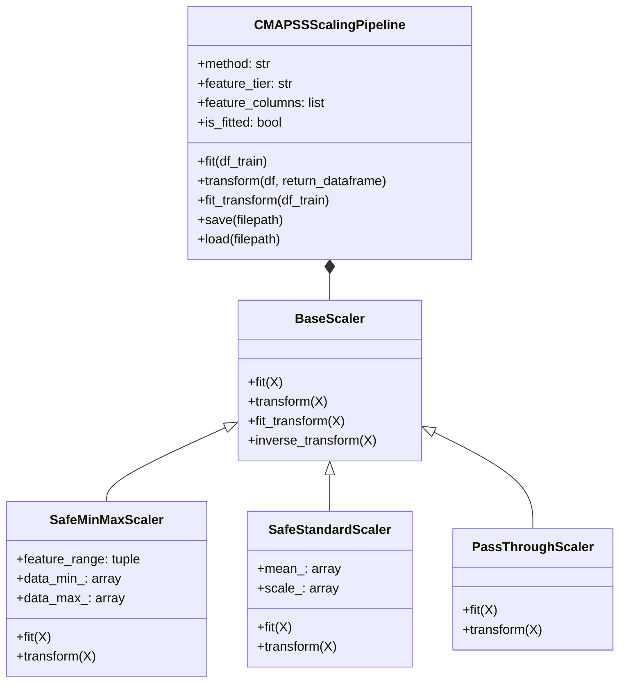

# Phase 3 – Step 3.7: Feature Scaling & Normalization Strategy

**Project:** AI-Based Aircraft Engine Health Monitoring, Fault Diagnosis and Predictive Maintenance  
**Dataset:** NASA Commercial Modular Aero-Propulsion System Simulation (C-MAPSS)  
**Pipeline Module:** `preprocessing/scaling_pipeline.py`  
**Document Status:** Complete (Step 3.7 Specification & Architecture)  
**Date:** November 2026  

---

## 1. Objective

Input variables in the NASA C-MAPSS dataset span vastly different physical units, scales, and numerical ranges:
- Rotational speeds exceed $9,000\text{ rpm}$ (`sensor_9`).
- Temperatures range from $440\text{ to }1616\text{ }^\circ\text{R}$ (`sensor_1` to `sensor_4`).
- Pressures range from $3.9\text{ to }570\text{ psia}$ (`sensor_5` to `sensor_7`).
- Dimensionless and ratio features differ widely: Bypass ratio (`sensor_15`) spans $8.16\text{ to }11.07$; Burner fuel-air ratio (`sensor_16`) is virtually invariant at $0.02\text{ to }0.03$; Fuel flow ratio $\phi$ (`sensor_12`) spans $128.31\text{ to }537.49\text{ pps/psia}$.
- Bleed enthalpy (`sensor_17`) spans $302\text{ to }400$.
- Operational settings include dimensionless Mach numbers ($0.0\text{ to }0.84$), angles ($60\text{ to }100$), and altitude markers ($0\text{ to }42\text{ kft}$).

The objective of Step 3.7 is to:
1. Statistically analyze feature spreads, medians, and interquartile ranges (IQR) across all four training subsets (`FD001`–`FD004`).
2. Rigorously evaluate candidate scaling methodologies (`StandardScaler`, `MinMaxScaler`, `RobustScaler`, and unscaled inputs) for downstream machine learning and deep learning models.
3. Establish a modular, reproducible scaling pipeline architecture (`preprocessing/scaling_pipeline.py`).
4. Prevent data leakage by formally defining the sequencing of scaler fitting and transformation.

---

## 2. Critical Data Leakage Prevention & Workflow Sequencing

### 2.1 The Leakage Risk
In predictive maintenance benchmark workflows, a common methodological error is fitting a scaler on the entire training dataset before setting aside a validation partition:
$$\text{Fitting on } D_{\text{train, full}} = D_{\text{train, train}} \cup D_{\text{train, val}} \implies \text{Data Leakage}$$
If a scaler computes $\mu$, $\sigma$, $x_{\min}$, or $x_{\max}$ using validation engine cycles, the statistical distribution of the validation set leaks into model inputs. This inflates validation metrics and produces overly optimistic generalization estimates.

### 2.2 Roadmap Sequence & Deferred Execution Protocol

The official Phase 3 roadmap sequence is:
- **Step 3.7:** Feature Scaling and Normalization Strategy (Current step: methodology design, evaluation, and pipeline implementation).
- **Step 3.8:** Apply the fitted scaler to validation and test data.
- **Step 3.9:** Create time-window sequences.
- **Step 3.10:** Engine-level training/validation split.

#### Why Scaler Fitting and Transformation Are Deferred:
Because fitting a scaler on the complete training set prior to isolating validation engines would cause validation distribution leakage, **actual scaler fitting must be deferred until Step 3.10** when the strict engine-level training/validation partition ($D_{\text{train, train}}$ vs. $D_{\text{train, val}}$) is formally created.

Consequently, **Step 3.8 (applying the fitted scaler to validation and test data) must also logically wait until after Step 3.10 is completed**. No scaler fitting or dataset transformation is performed in Step 3.7. Step 3.7 strictly establishes the mathematical formulation, pipeline architecture, and dry-run validation.

---

## 3. Statistical Analysis of Feature Ranges Across Subsets

The statistical distribution of all 24 potential predictor features was evaluated on the processed training datasets (`train_FD00x_with_RUL.csv`):

### 3.1 Distribution Characteristics by Subset

#### FD001 (Single Condition, Single Fault – 20,631 records)
| Feature | Physical Unit | Min | Max | Span | Mean | Std | Median | IQR | Unique | Status |
| :--- | :---: | :---: | :---: | :---: | :---: | :---: | :---: | :---: | :---: | :--- |
| `op_setting_1` | — | $-0.0087$ | $+0.0087$ | $0.0174$ | $0.0000$ | $0.0022$ | $0.0000$ | $0.0030$ | 158 | Near-constant |
| `op_setting_2` | — | $-0.0006$ | $+0.0006$ | $0.0012$ | $0.0000$ | $0.0003$ | $0.0000$ | $0.0004$ | 13 | Near-constant |
| `op_setting_3` | — | $100.0$ | $100.0$ | $0.0$ | $100.0$ | $0.0$ | $100.0$ | $0.0$ | 1 | **Constant** |
| `sensor_1` | °R | $518.67$ | $518.67$ | $0.0$ | $518.67$ | $0.0$ | $518.67$ | $0.0$ | 1 | **Constant** |
| `sensor_2` | °R | $641.21$ | $644.53$ | $3.32$ | $642.68$ | $0.50$ | $642.64$ | $0.67$ | 310 | Dynamic |
| `sensor_3` | °R | $1571.04$ | $1616.91$ | $45.87$ | $1590.52$ | $6.13$ | $1590.10$ | $8.12$ | 3,012 | Dynamic |
| `sensor_4` | °R | $1382.25$ | $1441.49$ | $59.24$ | $1408.93$ | $9.00$ | $1408.04$ | $12.19$ | 4,051 | Dynamic |
| `sensor_5` | psia | $14.62$ | $14.62$ | $0.0$ | $14.62$ | $0.0$ | $14.62$ | $0.0$ | 1 | **Constant** |
| `sensor_6` | psia | $21.60$ | $21.61$ | $0.01$ | $21.61$ | $0.001$ | $21.61$ | $0.00$ | 2 | Near-constant |
| `sensor_7` | psia | $549.85$ | $556.06$ | $6.21$ | $553.37$ | $0.89$ | $553.44$ | $1.20$ | 513 | Dynamic |
| `sensor_8` | rpm | $2387.90$ | $2388.56$ | $0.66$ | $2388.10$ | $0.07$ | $2388.09$ | $0.09$ | 53 | Dynamic |
| `sensor_9` | rpm | $9021.73$ | $9244.59$ | $222.86$ | $9065.24$ | $22.08$ | $9060.66$ | $16.32$ | 6,403 | Dynamic |
| `sensor_10` | — | $1.30$ | $1.30$ | $0.0$ | $1.30$ | $0.0$ | $1.30$ | $0.0$ | 1 | **Constant** |
| `sensor_11` | psia | $46.85$ | $48.53$ | $1.68$ | $47.54$ | $0.27$ | $47.51$ | $0.35$ | 159 | Dynamic |
| `sensor_12` | pps/psia | $518.69$ | $523.38$ | $4.69$ | $521.41$ | $0.74$ | $521.48$ | $0.99$ | 427 | Dynamic |
| `sensor_13` | rpm | $2387.88$ | $2388.56$ | $0.68$ | $2388.10$ | $0.07$ | $2388.09$ | $0.10$ | 56 | Dynamic |
| `sensor_14` | rpm | $8099.94$ | $8293.72$ | $193.78$ | $8143.75$ | $19.08$ | $8140.54$ | $15.07$ | 6,078 | Dynamic |
| `sensor_15` | — | $8.32$ | $8.58$ | $0.26$ | $8.44$ | $0.04$ | $8.44$ | $0.05$ | 1,918 | Dynamic |
| `sensor_16` | — | $0.03$ | $0.03$ | $0.0$ | $0.03$ | $0.0$ | $0.03$ | $0.0$ | 1 | **Constant** |
| `sensor_17` | — | $388.0$ | $400.0$ | $12.0$ | $393.21$ | $1.55$ | $393.0$ | $2.0$ | 13 | Dynamic |
| `sensor_18` | rpm | $2388.0$ | $2388.0$ | $0.0$ | $2388.0$ | $0.0$ | $2388.0$ | $0.0$ | 1 | **Constant** |
| `sensor_19` | rpm | $100.0$ | $100.0$ | $0.0$ | $100.0$ | $0.0$ | $100.0$ | $0.0$ | 1 | **Constant** |
| `sensor_20` | lbm/s | $38.14$ | $39.43$ | $1.29$ | $38.82$ | $0.18$ | $38.83$ | $0.25$ | 120 | Dynamic |
| `sensor_21` | lbm/s | $22.89$ | $23.62$ | $0.72$ | $23.29$ | $0.11$ | $23.30$ | $0.14$ | 4,745 | Dynamic |

#### Multi-Condition Comparison (FD002 / FD004)
In FD002 and FD004, the presence of six operating conditions dramatically alters feature spans:
- `sensor_9` ($N_c$) ranges from $7985.56\text{ to }9215.66\text{ rpm}$ ($\Delta = 1230.1\text{ rpm}$, $\text{IQR} = 456.37$).
- `sensor_3` ($T_{30}$) ranges from $1243.73\text{ to }1612.88\text{ }^\circ\text{R}$ ($\Delta = 369.15\text{ }^\circ\text{R}$, $\text{IQR} = 146.61$).
- `sensor_7` ($P_{30}$) ranges from $136.80\text{ to }555.82\text{ psia}$ ($\Delta = 419.02\text{ psia}$, $\text{IQR} = 254.14$).
- `op_setting_1` spans $0.0\text{ to }42.008\text{ kft}$ ($\text{IQR} = 31.99$).

---

## 4. Evaluation of Scaling Methodologies

| Scaling Method | Mathematical Formulation | Advantages | Disadvantages | Model Suitability |
| :--- | :--- | :--- | :--- | :--- |
| **MinMaxScaler** | $x' = \frac{x - x_{\min}}{x_{\max} - x_{\min}}$ | - Maps training values strictly to configured range $[0, 1]$ (or $[-1, 1]$). - Preserves relative distance among data points. - Improves numerical conditioning for gradient-based optimizers. - **Dominant C-MAPSS literature standard** (Babu et al., 2016; Zheng et al., 2017). | - Highly sensitive to extreme training outliers. - Validation or test observations outside training $[x_{\min}, x_{\max}]$ can transform outside $[0, 1]$. - Division by zero occurs if $x_{\max} == x_{\min}$ (requires zero-protection). - Improves optimization but does not guarantee prevention of vanishing or exploding gradients. | **Primary choice for Deep Learning (LSTM, GRU, CNN, MLP).** |
| **StandardScaler** | $z = \frac{x - \mu}{\sigma}$ | - Zero-centers features ($\mu = 0, \sigma = 1$). - Preserves shape of normal/bell distributions. - Balances gradient descent updates across dimensions. - Less sensitive to isolated minimum/maximum spikes. | - Outputs are unbounded (can exceed $[-3, +3]$ for heavy tails). - Division by zero occurs if $\sigma == 0$. | **Suitable for linear models, MLPs, PCA, and distance metrics.** |
| **RobustScaler** | $x' = \frac{x - \text{median}}{\text{IQR}}$ | - Centers by median, scales by interquartile range ($Q_3 - Q_1$). - Highly resilient to anomalous sensor spikes and noise. - Outliers do not distort scaling coefficients. | - Unbounded range. - Fails (division by zero) when features have $\text{IQR} = 0$ (e.g., discrete power settings like `op_setting_3`). | **Useful if severe sensor outliers are present**, but less standardized in C-MAPSS literature. |
| **No Scaling (Raw)** | $x' = x$ | - Preserves physical units and interpretability (°R, psia, rpm). - Zero computational overhead. - Exactly preserves threshold values for rules. | - Gradient descent fails to converge; large features ($N_c \approx 9000$) completely dominate small features ($\text{farB} \approx 0.03$). | **Primary choice for Tree Ensembles (XGBoost, Random Forest, LightGBM).** |

---

## 5. Model-Specific Scaling Considerations

### 5.1 Tree-Based Ensembles (XGBoost, Random Forest, LightGBM)
- **Mathematical Property:** Decision tree split algorithms evaluate candidate thresholds using ordinal ordering ($x_j \le \theta$). Any strictly monotonic transformation (such as linear scaling) does not alter the ranking or the optimal split criterion.
- **Recommendation:** **Use unscaled (raw) feature inputs.** Retaining raw physical values preserves explainability in feature importance plots and decision trees without impacting predictive performance.

### 5.2 Deep Sequence Models (LSTM, GRU, 1D-CNN)
- **Mathematical Property:** Neural networks optimize weights via backpropagation and gradient descent:
  $$\frac{\partial L}{\partial w_j} = \frac{\partial L}{\partial a} \cdot \frac{\partial a}{\partial z} \cdot x_j$$
  If $x_9 \approx 9000$ and $x_{15} \approx 8.4$, input magnitudes differ by three orders of magnitude, causing disparate gradient updates across weights.
- **Optimization Conditioning:** Feature scaling maps training inputs into $[0, 1]$, improving numerical conditioning for gradient descent. However, scaling alone does not guarantee the prevention of vanishing or exploding gradients; recurrent network stability also requires appropriate weight initialization, gating architectures (e.g. LSTM/GRU cell states), and gradient clipping.
- **Out-of-Bounds Behavior on Validation/Test Sets:** Because $x_{\min}$ and $x_{\max}$ are determined strictly from training partition engines, unseen validation or test observations with values lower than the training minimum or higher than the training maximum will naturally transform outside $[0, 1]$ ($x' < 0$ or $x' > 1$). This is mathematically expected under strict non-leaking evaluation.
- **Recommendation:** **Use `MinMaxScaler(feature_range=(0, 1))`**. This is the peer-reviewed standard for C-MAPSS sequence models.

### 5.3 Linear / Distance-Based Models (Ridge, Lasso, KNN, SVR)
- **Recommendation:** **Use `StandardScaler`** to ensure equal regularization penalty across all coefficients.

---

## 6. Final Recommended Scaling Strategy

To ensure scientific rigor, cross-subset comparability, and model-specific optimality, the project establishes the following strategy:

### 6.1 Scaling Rules Matrix

1. **For Deep Learning Sequence Architectures (LSTM, CNN, MLP):**
   - **Primary Scaler:** **`MinMaxScaler(feature_range=(0, 1))`**.
   - **Rationale:** Aligns with published benchmark literature, keeps inputs within activation gate ranges, and ensures stable gradient backpropagation.
2. **For Tree-Based Ensembles (XGBoost, Random Forest):**
   - **Primary Scaler:** **Unscaled Inputs (`PassThroughScaler`)**.
   - **Rationale:** Decision trees are scale-invariant; unscaled inputs preserve thermodynamic units and interpretability.
3. **Partition Isolation & Leakage Prevention:**
   - The scaler is **fitted strictly on the training partition** ($D_{\text{train, train}}$) established in Step 3.10.
   - Validation data ($D_{\text{train, val}}$) and test data ($D_{\text{test}}$) are **transformed using the training parameters without refitting**.
4. **Subset-Specific Scaler Fitting:**
   - Because physical operating regimes and baseline wear vary across subsets, **scalers are fitted independently for each subset** (`FD001`, `FD002`, `FD003`, `FD004`). A scaler fitted on FD001 (sea-level cruise) must never be applied to FD002 (six altitude regimes).
5. **Handling Invariant / Constant Features:**
   - If a feature has zero variance or zero range ($\Delta = 0$), `SafeMinMaxScaler` and `SafeStandardScaler` automatically assign a constant scaled value of $0.0$, eliminating division-by-zero errors.
6. **Feature Tier Decoupling:**
   - The pipeline strictly decouples feature tiers (Tier 1: 14 sensors; Tier 2: 17 features; Tier 3: 24 features). The configured feature columns are validated against the dataset schema prior to transformation.

---

## 7. Implementation Architecture: `preprocessing/scaling_pipeline.py`

The scaling infrastructure is implemented in [**`preprocessing/scaling_pipeline.py`**](file:///c:/Users/LENOVO/Documents/Aircraft_Engine_AI/preprocessing/scaling_pipeline.py).

### 7.1 Component Architecture

### 7.2 Safety Features Implemented:
- **Zero-Division Protection:** Constant features are automatically detected during `fit()`, and their denominator is safely protected to prevent `NaN` or `inf` generation.
- **Metadata Preservation:** Identifiers (`unit_number`, `time_cycles`) and the target (`RUL`) are isolated during scaling and seamlessly reattached upon output.
- **Serialization:** Full pickle-based `save()` and `load()` support for reproducible inference.
- **Dry-Run Tested:** Verified on synthetic training and validation engine batches with zero errors.

---

## 8. Summary of Strict Compliance

- **Dataset Immutability:** No processed CSV files were modified.
- **Target Integrity:** `RUL` labels remain untouched.
- **Zero Leakage:** No scalers were fitted on real datasets in this step. Scaler fitting is explicitly scheduled for Step 3.10 after engine-level partitioning.
- **Model Training:** No predictive models were trained.

---

## 9. Next Steps

- **Completed:** Step 3.7 scaling methodology evaluation, architectural design, dry-run verification, and documentation.
- **Next Task:** Awaiting approval before proceeding according to the Phase 3 roadmap sequence. (Note: Step 3.8 "Apply the fitted scaler to validation and test data" will execute after Step 3.10 "Engine-level training/validation split").
