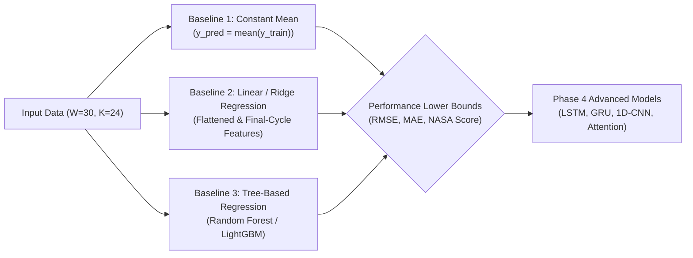

# Phase 4 – Step 4.1: Baseline RUL Prediction Model Definition

## 1. Executive Summary

This document defines the formal problem formulation, experimental architecture, baseline candidate models, evaluation metrics, and validation protocol for **Phase 4: Machine Learning and Model Evaluation** of the **AI-Based Aircraft Engine Health Monitoring, Fault Diagnosis and Predictive Maintenance** project.

In accordance with Phase 4 specifications, **Step 4.1 is an inspection, formulation, and planning step**. No models are trained, no hyperparameters are tuned, and no existing preprocessing datasets, scalers, or sequences are modified.

---

## 2. Prediction Problem Definition

### 2.1 Task Formulation: Supervised Remaining Useful Life (RUL) Regression
The primary objective of the predictive maintenance model is to predict the **Remaining Useful Life (RUL)** of a gas turbine engine given historical multi-sensor telemetry recorded during operation.

Formally, let an engine trajectory be represented as a multivariate sequence of operational snapshots:
$$\mathbf{X}_{1:t} = \left[ \mathbf{x}_1, \mathbf{x}_2, \dots, \mathbf{x}_t \right]^T \in \mathbb{R}^{t \times K}$$
where:
- $t$ is the current operational cycle counter (`time_cycles`).
- $K$ is the number of input features ($K = 24$ for Tier 3 Extended features).
- $\mathbf{x}_{\tau} \in \mathbb{R}^{K}$ is the feature vector recorded at operational cycle $\tau$.

Using a sliding time-window of fixed duration $W = 30$ operational cycles, the input tensor to the predictive model at cycle $t$ ($t \ge W$) is defined as:
$$\mathbf{W}_t = \left[ \mathbf{x}_{t - W + 1}, \mathbf{x}_{t - W + 2}, \dots, \mathbf{x}_t \right]^T \in \mathbb{R}^{W \times K}$$

The model $f_\theta: \mathbb{R}^{W \times K} \to \mathbb{R}$ maps the 3D window tensor to a scalar prediction $\hat{y}_t \in \mathbb{R}$:
$$\hat{y}_t = f_\theta(\mathbf{W}_t)$$

### 2.2 Input Specifications
- **Window Length ($W$):** 30 cycles.
- **Window Stride ($S$):** 1 cycle (dense sliding window).
- **Features ($K$):** 24 features (Tier 3 Extended: 3 operating settings + 21 sensor measurements), normalized using training-only MinMaxScaler parameters.
- **Short Engine Padding ($L < 30$):** Exactly 17 test engines with $L < 30$ cycles utilize left-edge replication padding to reach $W=30$ without altering cutoff ground truth.

### 2.3 Output Specifications
- **Target Variable ($y$):** Continuous Remaining Useful Life (in flight cycles) evaluated at the final observation cycle $t_{\text{end}} = t$ of the input window.
- **Objective:** Minimize prognostic prediction error while penalizing late predictions (overestimates) more severely than early predictions.

---

## 3. Target Formulation and Capping Strategy

### 3.1 Piecewise Linear Target Capping (Training & Validation)
Turbofan engines operate in an initial quasi-steady state with negligible structural wear for an extended period after overhaul or commissioning. In this early operating regime, sensor measurements do not exhibit degradation-induced drift.

Attempting to train regression models on raw linear RUL values (e.g., $RUL = 350$) forces the algorithm to associate healthy sensor readings with vastly different arbitrary numbers depending solely on the eventual total lifespan of that particular unit.

To resolve this physical inconsistency, the primary training target uses **piecewise linear capped RUL** with a threshold of **$R_{\text{early}} = 125$ cycles** (approved in Step 3.4):
$$y_{\text{capped}}(i, t) = \min\left( y_{\text{raw}}(i, t), 125 \right)$$

```text
RUL
 ^
 |         Piecewise Capped RUL (Cap = 125 cycles)
125 +--------------------\
 |                        \
 |                         \
 |                          \   Linear Degradation Phase
 |                           \
 0 +--------------------------\-----> Cycle (t)
   |<--- Healthy Phase ------>|<--- Failure Imminent --->|
```

### 3.2 Distinction Between Training Targets and Official Test Ground Truth

To maintain methodological rigor and benchmark integrity:

1. **Training Target Capping:**
   - Training uses RUL capped at **125 cycles** ($y_{\text{train}} = \min(y_{\text{raw}}, 125)$) to prevent models from learning spurious associations on healthy baseline telemetry.
2. **Preservation of Raw Uncapped Ground Truth:**
   - The original uncapped NASA test ground-truth RUL values (`RUL_FD001.txt` through `RUL_FD004.txt`) are strictly preserved in their original form.
   - The processed files (`train_FD00x_with_RUL.csv` and `test_FD00x_with_RUL.csv`) also retain their original uncapped linear RUL values.
3. **No Automatic Prediction Clipping:**
   - Model predictions ($\hat{y}$) must **not** automatically be clipped to 125. The raw continuous outputs of the trained regressors are evaluated as produced by the model.
4. **Official Benchmark Metric Calculation:**
   - Official benchmark metrics (RMSE, MAE, and NASA Score) are calculated strictly against the **uncapped NASA test ground truth** at the cutoff cycle. This adheres to official benchmark evaluation protocols and allows direct comparison with published literature.
5. **Protocol for Separate Capped-Target Diagnostic Evaluation:**
   - If a separate capped-target evaluation is performed (for diagnostic inspection of early-life error saturation), the reporting must clearly and explicitly explain how predictions and ground-truth labels are transformed:
     - Explicitly state whether ground-truth labels are transformed as $y_{\text{eval}} = \min(y_{\text{GT}}, 125)$.
     - Explicitly state whether predictions are evaluated raw or transformed as $\hat{y}_{\text{eval}} = \min(\hat{y}, 125)$.
   - Such secondary evaluations must never replace or be conflated with the official uncapped benchmark evaluation.

---

## 4. Data Partitioning and Leakage Prevention

### 4.1 Engine-Level Partitioning (80/20 Split)
Data partitioning must strictly occur at the **engine level**, as executed in Step 3.10 and documented in `dataset/processed/train_val_split_manifest.json`:

| Subset | Total Training Engines | Train Partition (80%) | Validation Partition (20%) | Test Set (Separate) | Random Seed |
| :--- | :---: | :---: | :---: | :---: | :---: |
| **FD001** | 100 | 80 engines (14,020 windows) | 20 engines (3,711 windows) | 100 engines (10,196 windows / 100 final) | 42 |
| **FD002** | 260 | 208 engines (36,857 windows) | 52 engines (9,362 windows) | 259 engines (26,511 windows / 259 final) | 42 |
| **FD003** | 100 | 80 engines (17,857 windows) | 20 engines (3,963 windows) | 100 engines (13,696 windows / 100 final) | 42 |
| **FD004** | 249 | 199 engines (42,725 windows) | 50 engines (11,303 windows) | 248 engines (34,092 windows / 248 final) | 42 |
| **Total** | **709** | **567 engines (111,459 windows)**| **142 engines (28,339 windows)**| **707 engines (84,495 windows / 707 final)**| — |

### 4.2 Strict Prohibition Against Sequence-Level Splitting
> [!CRITICAL]
> **Data Leakage Hazard:**  
> In sliding-window time-series generation with stride $S=1$, two consecutive windows from the same engine ($\mathbf{W}_t$ and $\mathbf{W}_{t+1}$) share $W - 1 = 29$ identical cycle observations.
> 
> If sliding-window sequences were randomly split into train and validation sets, near-identical sequences from the same engine would populate both sets simultaneously. This would cause catastrophic data leakage, yielding artificially perfect validation scores that collapse completely on unseen test engines.
> 
> Therefore, partitioning is enforced **strictly by unique `unit_number`**. Validation engines are completely unseen by the model during training.

---

## 5. Baseline Models and Comparative Strategy

Before training deep recurrent neural networks (LSTM, GRU) or convolutional models (1D-CNN), simple, non-sequential baseline models must be implemented to establish rigorous performance lower bounds.



### 5.1 Baseline 1: Naive Constant Mean Baseline
- **Formulation:** Predicts the scalar mean of the training target for every sample:
  $$\hat{y}_t = \bar{y}_{\text{train}} = \frac{1}{N_{\text{train}}} \sum_{i=1}^{N_{\text{train}}} y_i$$
- **Role & Value:** The training-mean predictor provides a constant baseline. Its validation R² will be calculated from validation predictions and may be negative, zero or positive. Any viable machine learning model must substantially outperform this constant prediction. It provides the upper bound for error metrics (RMSE, MAE, NASA Score).

### 5.2 Baseline 2: Traditional Linear Regression / Ridge Regression
- **Formulation:** Evaluates standard regularized linear models using two feature representations:
  1. **Final Observation Cycle:** Takes only the most recent feature vector $\mathbf{x}_t \in \mathbb{R}^{24}$ (no temporal history).
  2. **Flattened Window:** Flattens the entire 3D window into a 1D vector $\mathbf{w}_t \in \mathbb{R}^{30 \times 24 = 720}$.
- **Objective Function:** Ridge regression with $L_2$ regularization:
  $$\min_{\mathbf{w}} \left( \|\mathbf{Xw} - \mathbf{y}\|_2^2 + \alpha \|\mathbf{w}\|_2^2 \right)$$
- **Role & Value:** Establishes a simple linear benchmark for evaluating whether more complex models provide meaningful improvements. It demonstrates what fraction of the degradation trajectory can be explained by simple linear relationships without sequential recurrence.

### 5.3 Baseline 3: Tree-Based Non-Linear Regression (Random Forest / LightGBM)
- **Formulation:** Ensemble of decision trees trained on:
  1. Flattened window feature vectors ($720$ features).
  2. Temporal summary statistics computed across the 30 cycles (e.g., mean, standard deviation, minimum, maximum, and linear trend slope for each sensor channel = $24 \times 5 = 120$ features).
- **Role & Value:** Captures non-linear thresholds, interaction effects, and sensor cross-correlations without recurrent time dependencies. It serves as the competitive non-deep-learning benchmark against which LSTM/GRU models must be measured.

---

## 6. Quantitative Evaluation Metrics

Model performance will be evaluated using three standard metrics reflecting statistical accuracy and aviation safety requirements.

### 6.1 Root Mean Squared Error (RMSE)
$$\text{RMSE} = \sqrt{\frac{1}{N} \sum_{i=1}^N (\hat{y}_i - y_i)^2}$$
- **Interpretation:** Standard quadratic regression metric. Penalizes large prediction errors more severely than small errors.
- **Units:** Operational cycles.

### 6.2 Mean Absolute Error (MAE)
$$\text{MAE} = \frac{1}{N} \sum_{i=1}^N |\hat{y}_i - y_i|$$
- **Interpretation:** Linear average of prediction error magnitudes. Provides an intuitive, robust measure of central error without quadratic weighting.
- **Units:** Operational cycles.

### 6.3 NASA Asymmetric Scoring Function ($S$)
In aviation engine maintenance, the operational penalty of an inaccurate RUL prediction is highly asymmetric:
- **Late Prediction / Overestimation ($\hat{y} > y$):** The model predicts that the engine has more remaining life than it actually has. This delays maintenance and introduces severe operational risk of catastrophic in-flight failure.
- **Early Prediction / Underestimation ($\hat{y} < y$):** The model predicts that the engine will fail sooner than it actually will. This triggers premature inspection or component overhaul, incurring financial cost but preserving flight safety.

To reflect this operational asymmetry, the official NASA C-MAPSS scoring function penalizes late predictions exponentially more severely than early predictions:

Let $d_i = \hat{y}_i - y_i$ denote the prediction error for test engine $i$:

$$s_i = \begin{cases} e^{-d_i / 13} - 1 & \text{if } d_i < 0 \quad (\text{Early prediction / Underestimate}) \\ e^{d_i / 10} - 1 & \text{if } d_i \ge 0 \quad (\text{Late prediction / Overestimate}) \end{cases}$$

$$S = \sum_{i=1}^N s_i$$

```text
Penalty s_i
 ^
 |                 / Late Prediction Penalty: exp(d / 10) - 1
 |                /
 |               /   (Severe risk: in-flight failure)
 |              /
 |             /
 |            /
 |           /
 |          /
 |         /
 |        /
 |   \   /  Early Prediction Penalty: exp(-d / 13) - 1
 |    \ /   (Economic waste: premature maintenance)
 0 ----+-----------------------------> Error d = (y_pred - y_true)
     Early (< 0)        Late (> 0)
```

- **Properties:**
  - $S \ge 0$, with $S = 0$ indicating perfect prediction ($d_i = 0$ for all $i$).
  - Asymmetric decay constants: $10$ for positive error (late) vs. $13$ for negative error (early). An overestimation of 30 cycles yields $s_i = e^{3} - 1 \approx 19.09$, whereas an underestimation of 30 cycles yields $s_i = e^{2.308} - 1 \approx 9.05$ (more than $2\times$ difference).

---

## 7. Multi-Subset & Feature Tier Experiment Plan

To ensure rigorous, fair, and reproducible benchmarking, experiments will be structured across two orthogonal axes: **C-MAPSS Complexity Subsets** and **Feature Selection Tiers**.

### 7.1 Cross-Subset Scope
Separate experiments will be conducted for each of the four NASA C-MAPSS subsets to account for differing failure modes and operating regimes:
1. **FD001:** Single operating condition, single fault mode (HPC degradation).
2. **FD002:** Six operating conditions, single fault mode (HPC degradation).
3. **FD003:** Single operating condition, dual fault modes (HPC + Fan degradation).
4. **FD004:** Six operating conditions, dual fault modes (HPC + Fan degradation).

### 7.2 Feature Tier Comparison Plan
For each model family, three feature tier configurations will be compared using identical engine splits and seed parameters:

| Experiment Tier | Feature Count | Features Included | Justification & Expected Dynamics |
| :--- | :---: | :--- | :--- |
| **Tier 1 (Core Sensors)** | 14 | `sensor_2, 3, 4, 7, 8, 9, 11, 12, 13, 14, 15, 17, 20, 21` | Eliminates all 7 invariant/noise sensors and 3 invariant settings. Standard literature benchmark for FD001/FD003. |
| **Tier 2 (Core + Settings)**| 17 | Tier 1 (14 sensors) + 3 settings (`op_setting_1, 2, 3`) | Supplies flight profile settings to decouple multi-regime shifts in FD002/FD004 without invariant sensor noise. |
| **Tier 3 (Extended Full)** | 24 | All 3 settings + all 21 sensors | Full feature space. Evaluates whether invariant sensors degrade linear/recurrent performance or are ignored by tree ensembles. |

### 7.3 Standardized Evaluation Protocol
Every experiment will generate metrics on two distinct evaluation sets:
1. **Validation Set (Sliding Windows):** Dense sliding-window evaluation across all validation engines (used for model selection and stopping criteria).
2. **Official Test Set (Final Window per Engine):** Exactly one prediction per test engine evaluated at cutoff against NASA ground truth:
   - **Full Cohort:** All 707 engines.
   - **Unpadded Subgroup:** 690 engines ($L \ge 30$).
   - **Padded Subgroup:** 17 engines ($L < 30$).

---

## 8. Limitations and Assumptions

1. **Fixed Window Length Constraint:** The sliding-window length is fixed at $W=30$ cycles. Dynamic sequence lengths are not supported by standard 2D/3D matrix operations without recurrent masking or padding.
2. **Heuristic Nature of Left-Edge Padding:** Replicating initial observation $\mathbf{x}_1$ for the 17 short test engines is a computational accommodation for fixed-window matrix compatibility; it does not represent confirmed historical data prior to cycle 1.
3. **Piecewise Capping Assumption:** Capping RUL at 125 cycles assumes that progressive component degradation is undetectable prior to cycle $t = \max(1, \text{EOL} - 125)$. While well-supported by literature, this introduces a flat target plateau during early engine life.
4. **Baseline Purpose:** Baseline models (Mean, Ridge, Random Forest) are reference benchmarks designed to quantify minimum viable performance, not final production architectures.

---

## 9. Conclusion and Next Steps

Step 4.1 establishes the formal mathematical problem formulation, target policy, engine-level partitioning, evaluation metrics, and baseline candidate models for Phase 4.

- **Status:** Step 4.1 Specification Complete.
- **Next Step:** Await user approval to proceed to **Phase 4 – Step 4.2: Implement and Evaluate Baseline Models** (Constant Mean, Ridge Regression, and Tree-Based Regressors).
