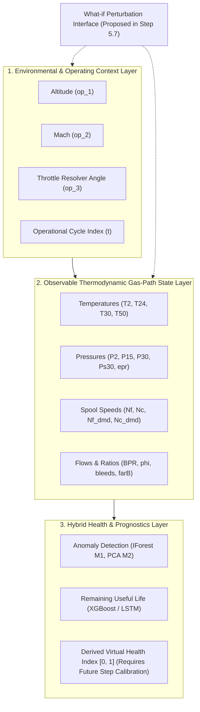

# Phase 5 – Step 5.1: Aircraft Engine Digital Twin Subsystem Scope & Boundary Definition

**Project:** AI-Based Aircraft Engine Health Monitoring, Fault Diagnosis and Predictive Maintenance  
**Reference Document:** Master Project Roadmap PDF (`Aircraft_Engine_AI_Project_Step_by_Step_Roadmap.pdf`, Page 4–5, Section 6: "Phase 5 — Aircraft engine Digital Twin")  
**Target Milestone:** Phase 5, Step 5.1: *"Define the engine subsystem represented by the Digital Twin and state what is outside its scope."*  
**Document Status:** **FINAL — REVISED & APPROVED FOR STEP 5.1**  
**Creation Date:** 2026-11-04  

---

## 1. Executive Summary & Purpose

The objective of Phase 5 is to design and implement a virtual computational counterpart—an **Aircraft Engine Digital Twin** prototype—that models the operational state, thermodynamic behavior, degradation trajectory, and remaining useful life of a commercial turbofan engine across its lifecycle.

In strict adherence to the project roadmap and scientific modeling principles, **Step 5.1 establishes the formal system boundary, physical scope, data groundings, and explicit exclusions** of the Digital Twin prototype before any simulation code, state vectors, or numerical update algorithms are implemented.

### 1.1 Four Core Digital Twin Capabilities
In alignment with modern Digital Twin engineering frameworks, the prototype is structured around four core capabilities:
1. **Current State Estimation:** Ingesting and representing the current operational and thermodynamic state of the engine gas path at discrete cycle $t$ from historical flight logs or synthetic replays.
2. **Data-Driven Model:** Leveraging calibrated Phase 4 machine learning models (XGBoost regression, LSTM sequence models, Isolation Forest, and PCA-SPE) to detect abnormal sensor behavior and map operational patterns to degradation states.
3. **Future-State Prediction:** Forecasting future degradation progression and remaining operational cycles (Remaining Useful Life, RUL) before functional maintenance thresholds are breached.
4. **What-If Simulation:** Evaluating engine response, health index trajectory deviations, and RUL impact under controlled, hypothetical operational and sensor perturbations (to be formally parameterized in Step 5.7).

---

## 2. Selected Engine Subsystem & Technical Justification

### 2.1 Selected Subsystem: Turbofan Gas-Path & Core Compression System
The Digital Twin models the **aerothermal gas-path and core degradation dynamics** of a dual-spool, high-bypass commercial turbofan engine (representative of the 90,000 lbf thrust class modeled by NASA's C-MAPSS simulator). Specifically, the virtual model focuses on the core thermodynamic gas-flow stations:
- **Low-Pressure System:** Fan and Low-Pressure Compressor (LPC / Booster) driven by the Low-Pressure Turbine (LPT) via the low-pressure spool shaft ($N_f$).
- **High-Pressure Core:** High-Pressure Compressor (HPC) driven by the High-Pressure Turbine (HPT) via the high-pressure core spool shaft ($N_c$).
- **Combustion & Expansion Interface:** Burner / Combustor fuel-air interaction, high-pressure turbine exit, and low-pressure turbine exhaust ($T_{50}$).
- **Bypass & Secondary Flow:** Bypass duct flow ratio ($BPR$) and turbine cooling bleed extractions ($W_{31}, W_{32}, htBleed$).

### 2.2 Technical Justification & Observability Boundary
1. **Direct Alignment with C-MAPSS Ground Truth Physics:**  
   The NASA C-MAPSS dataset specifically simulates degradation mechanisms occurring within this exact subsystem:
   - Subsets `FD001` and `FD002`: High-Pressure Compressor (HPC) degradation (flow capacity reduction and adiabatic efficiency loss due to blade wear and aerodynamic fouling).
   - Subsets `FD003` and `FD004`: Combined HPC and Fan degradation (dual-mode degradation involving compressor fouling and fan blade erosion/clearance enlargement).
2. **Observable Gas-Path Telemetry vs. Unobservable Internal States:**  
   The dataset provides observable gas-path thermodynamic measurements ($T_{24}, T_{30}, T_{50}, P_{30}, P_{s30}$, spool speeds, etc.), but the complete turbofan subsystem is **not fully observable**. Internal physical states such as physical component wear, material damage, microscopic crack length, blade surface roughness, and hidden simulator health parameters (e.g., true HPC efficiency deficit $\Delta \eta_{HPC}$ or flow capacity loss $\Delta \dot{m}_{HPC}$) are **not directly observable** in the dataset. The Digital Twin models the observable macroscopic gas-path responses and infers health trends indirectly through data-driven models.
3. **Avoidance of Fabricated Physics:**  
   Choosing a subsystem outside the gas path (e.g., an individual mechanical bearing, electrical generator, or fuel metering valve actuator) would force the project to invent artificial equations and fabricate ungrounded parameters, violating the project working rules. Modeling the gas-path system leverages the actual empirical evidence present in the dataset.

---

## 3. Available Dataset Inputs & Observational Grounding

The Digital Twin's virtual state is driven and bounded by the 24 operational and sensor variables available in the NASA C-MAPSS dataset:

### 3.1 Flight Operating Conditions & Regimes (3 Setting Variables)
In strict accordance with the original C-MAPSS benchmark documentation and Phase 3 preprocessing:
- **Operating Conditions (NASA C-MAPSS Classification):**
  - **Single Operating Condition:** Subsets `FD001` and `FD003` operate under **ONE** nominal flight condition (Sea Level, nominal altitude $\approx 0\text{ kft}$, Mach $\approx 0.0$, Throttle Resolver Angle $\text{TRA} = 100\%$).
  - **Multiple Operating Conditions:** Subsets `FD002` and `FD004` operate across **SIX** distinct operating condition combinations/clusters spanning sea level to high altitude ($0$ to $42\text{ kft}$), Mach numbers ($0.0$ to $0.84$), and throttle demands ($\text{TRA}$ from $20\%$ to $100\%$).
- **Distinction Between Conditions and Regimes:**  
  In turbofan terminology, an *operating condition* in C-MAPSS denotes a specific environmental and power setpoint $(\text{Altitude}, \text{Mach}, \text{TRA})$ recorded during an operational snapshot. An *operating regime* refers to the aerodynamic flight envelope and engine power phase (e.g., take-off, climb, high-altitude cruise, idle/descent). In `FD002` and `FD004`, the engine transitions across six distinct operating condition clusters, requiring regime-aware normalization to decouple atmospheric variations from physical degradation.

### 3.2 Thermodynamic Station Sensors (21 Variables)
| Sensor Identifier | Station Code | Thermodynamic Description | Engineering Units | Feature Tier |
| :--- | :--- | :--- | :--- | :--- |
| `sensor_1` | $T_2$ | Total temperature at fan inlet | $^\circ\text{R}$ | Extended (Tier 3) |
| `sensor_2` | $T_{24}$ | Total temperature at LPC outlet | $^\circ\text{R}$ | Core (Tier 1) |
| `sensor_3` | $T_{30}$ | Total temperature at HPC outlet | $^\circ\text{R}$ | Core (Tier 1) |
| `sensor_4` | $T_{50}$ | Total temperature at LPT outlet | $^\circ\text{R}$ | Core (Tier 1) |
| `sensor_5` | $P_2$ | Total pressure at fan inlet | $\text{psia}$ | Extended (Tier 3) |
| `sensor_6` | $P_{15}$ | Total pressure in bypass duct | $\text{psia}$ | Extended (Tier 3) |
| `sensor_7` | $P_{30}$ | Total pressure at HPC outlet | $\text{psia}$ | Core (Tier 1) |
| `sensor_8` | $N_f$ | Physical fan spool rotational speed | $\text{rpm}$ | Core (Tier 1) |
| `sensor_9` | $N_c$ | Physical core spool rotational speed | $\text{rpm}$ | Core (Tier 1) |
| `sensor_10` | $epr$ | Engine pressure ratio ($P_{50} / P_2$) | dimensionless | Extended (Tier 3) |
| `sensor_11` | $P_{s30}$ | Static pressure at HPC outlet | $\text{psia}$ | Core (Tier 1) |
| `sensor_12` | $\Phi$ | Ratio of fuel flow to static pressure ($W_f / P_{s30}$) | $\text{pps/psia}$ | Core (Tier 1) |
| `sensor_13` | $N_{f\_dmd}$ | Corrected fan speed | $\text{rpm}$ | Core (Tier 1) |
| `sensor_14` | $N_{c\_dmd}$ | Corrected core speed | $\text{rpm}$ | Core (Tier 1) |
| `sensor_15` | $BPR$ | Bypass ratio | dimensionless | Core (Tier 1) |
| `sensor_16` | $farB$ | Burner fuel-air ratio | dimensionless | Extended (Tier 3) |
| `sensor_17` | $htBleed$ | Bleed enthalpy | $\text{BTU/lbm}$ | Core (Tier 1) |
| `sensor_18` | $N_{f\_dmd2}$ | Demanded fan speed | $\text{rpm}$ | Extended (Tier 3) |
| `sensor_19` | $PCNfR\_dmd$| Demanded corrected fan speed | $\text{rpm}$ | Extended (Tier 3) |
| `sensor_20` | $W_{31}$ | HPT coolant bleed flow | $\text{lbm/s}$ | Core (Tier 1) |
| `sensor_21` | $W_{32}$ | LPT coolant bleed flow | $\text{lbm/s}$ | Core (Tier 1) |

### 3.3 Temporal Index
- `time_cycles`: Discrete flight cycle count ($t = 1, 2, \dots, T_{end}$). The dataset provides one steady-state aggregated record per flight cycle.

---

## 4. Intended Virtual Representation (Digital Twin Architecture)

The Digital Twin is structured as a **hybrid discrete-cycle state simulator** composed of three coupled layers:

1. **State Vector Representation:**  
   At any cycle $t$, the virtual engine state $\mathbf{S}(t)$ encapsulates:
   - Operating condition vector: $\mathbf{u}(t) = [\text{Alt}, \text{Mach}, \text{TRA}]$
   - Observable thermodynamic state: $\mathbf{x}_{obs}(t) \in \mathbb{R}^{21}$
   - Derived thermodynamic relationships: empirical station ratios supported by measurements (e.g., $P_{30}/P_2$, $T_{30}-T_{24}$, $N_c/N_f$)
   - Health assessment vector: $\mathbf{h}(t) = [\text{AnomalyScore}(t), \text{AlertFlag}(t), \text{RUL}_{pred}(t), \text{HealthIndex}(t)]$

2. **Advancement Engine:**  
   Advances the virtual engine cycle-by-cycle ($t \to t+1$) via **offline dataset replay** or **simulation-time inference** driven by recorded flight histories or user-selected scenario inputs.

3. **Thermodynamic Consistency Checks (Bounded Scope):**  
   Consistency checks are strictly limited to basic physical inequality relationships directly supported by available measurements (e.g., $T_{30} > T_{24} > T_2$, $P_{30} > P_{15} > P_2$, $N_c > N_f$). **This prototype is NOT a validated thermodynamic engine cycle simulator** (such as NASA's NPSS or full aerothermal cycle decks); it does not solve multi-station mass, momentum, and energy conservation equations across the complete flight envelope.

4. **Derived Virtual Health Index $[0, 1]$:**  
   The proposed virtual health index is strictly a **derived virtual indicator** intended to normalize multidimensional degradation into an interpretable metric. It is **not a directly measured NASA variable** and **not a certified physical health measurement**. Its mathematical calculation, baseline calibration, and empirical validation must be formally established in a downstream step (Step 5.2/5.4/5.5).

5. **Conditional Physics-Based & Hybrid Modeling:**  
   In strict accordance with Roadmap Step 5.5 (*"Implement a simplified physics-based component only where equations and parameters are available or clearly assumed"*), any physics-based component remains **strictly conditional**. If defensible equations and realistic physical parameters cannot be justified from the available data, the prototype will rely on data-driven mappings and clearly labeled empirical assumptions, rather than ungrounded mathematical inventions.

---

## 5. Scope Inclusions

The Phase 5 Digital Twin prototype **strictly includes**:
1. **Discrete Cycle-by-Cycle State Progression:** Simulation of engine health trajectories from start-of-life ($t=1$) to near-failure ($t=T_{end}$) via cycle-based offline replay.
2. **Operational Condition Normalization:** Ability to handle both single-condition flight profiles (`FD001`, `FD003`) and 6-condition multi-regime profiles (`FD002`, `FD004`) using the Phase 3 scaling pipeline.
3. **ML Model Coupling:** Seamless invocation of the 8 approved champion checkpoints (4 XGBoost models and 4 LSTM sequence models) from `models/checkpoints/` during simulation-time inference to compute RUL estimates.
4. **Anomaly Detection Pipeline:** Automated computation of Isolation Forest (M1) and PCA-SPE (M2) anomaly scores to trigger simulated condition-based alerts.
5. **Proposed What-If Scenario Categories (Subject to Step 5.7 Formalization):**  
   Exploration of controlled hypothetical perturbations:
   - *Thermal stress:* Elevated temperature offsets on $T_{30}$ or $T_{50}$.
   - *Sensor drift:* Gradual additive bias or scaling on pressure/temperature channels.
   - *Accelerated aging:* Scaled degradation progression rates.  
   *Note:* The exact perturbation magnitudes, constraints, and physical validity boundaries for these scenarios must be formally defined and validated in Step 5.7 prior to implementation.
6. **Virtual Telemetry Logging:** Structured logging of all simulated versus recorded parameters, ensuring traceability and reproducible comparisons.

---

## 6. Scope Exclusions

The following areas are **strictly and explicitly excluded** from the prototype:

1. **Microscopic Material Damage Mechanics:**  
   No modeling of blade metallurgical microstructure, high-cycle fatigue (HCF) crack propagation, thermal barrier coating (TBC) spallation area, creep rupture void growth, or blade tip clearance loss in physical millimeters. C-MAPSS provides lumped macroscopic thermodynamic outputs, not finite-element stress fields.
2. **High-Frequency / Intra-Cycle Transients:**  
   No continuous-time millisecond-level modeling of acoustic pressure oscillations, turbine blade flutter, aerodynamic compressor stall/surge transients, or fuel metering valve servo-actuator response. Data points represent cycle-averaged quasi-steady operating points.
3. **Non-Gas-Path Mechanical Subsystems:**  
   No modeling of:
   - Lubrication and scavenge oil system (oil temperature, oil pressure, metallic chip debris detection).
   - Gearboxes and bearings (vibration accelerometer spectra, gear mesh frequencies).
   - Electrical generation and starter systems (starter motor torque, alternator load).
   - Hydraulic actuators and thrust reverser deployment systems.
4. **Certified Aircraft Flight Control (FADEC):**  
   The Digital Twin is **not** an Electronic Engine Controller (EEC/FADEC). It does not execute safety-critical closed-loop fuel metering or variable bleed vane control laws.
5. **Autonomous Airworthiness Authority:**  
   The Digital Twin does not issue binding maintenance orders or release aircraft for commercial service. All health indices and RUL forecasts are advisory analytical outputs.

---

## 7. Physical Modelling Limitations

1. **Synthetic Nature of C-MAPSS Data:**  
   The observations originate from NASA's FORTRAN-based numerical simulator rather than real-world commercial flight data. While thermodynamically grounded, sensor noise is purely synthetic Gaussian noise and does not capture physical sensor fouling, wiring harness impedance degradation, or flight turbulence disturbances.
2. **Hidden Internal State Variables:**  
   True physical health parameters—specifically High-Pressure Compressor efficiency degradation ($\Delta \eta_{HPC}$), HPC flow capacity degradation ($\Delta \dot{m}_{HPC}$), Fan efficiency degradation ($\Delta \eta_{Fan}$), and Fan capacity degradation ($\Delta \dot{m}_{Fan}$)—are internal simulator variables that were not exported into the public C-MAPSS dataset. Therefore, the Digital Twin tracks health via observable gas-path manifestations rather than exact internal wear states.
3. **Irreversibility of Degradation:**  
   In the C-MAPSS dataset, degradation is strictly monotonic. Real-world maintenance actions (compressor water washes, blade blending, borescope inspection cleanings) that temporarily restore compressor efficiency are absent from the dataset and cannot be simulated with empirical ground truth.

---

## 8. Assumptions Requiring Future Validation

Before deploying this Digital Twin framework beyond an academic prototype, the following core assumptions require physical validation:
1. **Quasi-Steady Assumption:** The assumption that cycle-averaged snapshots adequately characterize engine wear without resolving transient acceleration/deceleration spikes.
2. **Sensor Calibration Stability:** The assumption that sensor calibrations remain constant across thousands of flight cycles, with zero instrumentation drift other than what is intentionally injected in scenario testing.
3. **Linearity of Perturbation Response:** When testing "what-if" scenarios, downstream thermodynamic variables are assumed to respond within empirically bounded ranges rather than triggering severe nonlinear instabilities (e.g. compressor stall).
4. **Generalizability of RUL Models:** The assumption that Phase 4 ML models remain valid when evaluated on mildly perturbed what-if trajectories that deviate slightly from recorded flight paths.

---

## 9. Relationship with Phase 4 ML Models

The Phase 5 Digital Twin prototype integrates Phase 4 outputs as its core predictive intelligence layer during **simulation-time inference**:

| Phase 4 Deliverable | Role within Phase 5 Digital Twin | Implementation Mechanism |
| :--- | :--- | :--- |
| **XGBoost Champions (`xgb_FD00x_champion.json`)** | Tabular feature RUL estimation during simulation replay | Evaluates 30-cycle summary features at cycle step $t$ |
| **LSTM Champions (`lstm_FD00x_champion.pt`)** | Temporal sequence RUL estimation tracking degradation trends | Ingests 30-cycle sequence tensors to predict continuous RUL |
| **Anomaly Detection (`run_anomaly_detection.py`)** | Condition-based anomaly and health threshold monitoring | Computes Isolation Forest M1 and PCA M2 scores; flags alerts |
| **Preprocessing Scalers (`scaler_FD00x_tier3.pkl`)** | Normalizes virtual engine telemetry to model input distribution | Transforms raw simulated sensor values into ML-ready inputs |
| **Enriched Manifests (`*_manifest.json`)** | Provides configuration metadata, thresholds, and seeds | Ensures reproducible parameterization across all runs |

---

## 10. Safety Limitations & Regulatory Boundaries

> [!CAUTION]
> **RESEARCH & SIMULATION PROTOTYPE ONLY**
> 
> 1. **Not a Flight-Control System:** This software is an academic engineering simulation designed to study predictive maintenance and machine learning workflows. It does not interface with aircraft avionics, does not transmit commands to engine actuators, and must never be connected to real-world flight control systems.
> 2. **No Airworthiness Certification:** The software, models, and simulation outputs have not been certified by the FAA, EASA, or any aviation regulatory agency under DO-178C (Software Considerations in Airborne Systems) or DO-254 (Design Assurance Guidance for Airborne Electronic Hardware).
> 3. **Advisory Simulation Only:** All virtual states, remaining life estimates, anomaly scores, and what-if scenario projections are advisory outputs intended solely for research, demonstration, and offline engineering analysis.

---

## 11. Conclusion & Readiness for Step 5.2

Step 5.1 is formally concluded with this clear scope definition:
- **Subsystem:** Turbofan Gas-Path & Core Compression System.
- **Inputs:** 3 operational settings + 21 thermodynamic sensors across discrete cycles.
- **Boundaries:** Clear segregation between observable gas-path measurements, empirical ML health estimators, and excluded unobservable wear/mechanical subsystems.
- **Modeling Paradigm:** Offline dataset replay and simulation-time inference; conditional physics components; research prototype boundaries strictly maintained.

The project is now fully prepared to advance to **Step 5.2: Define the virtual engine state variables and units**.
