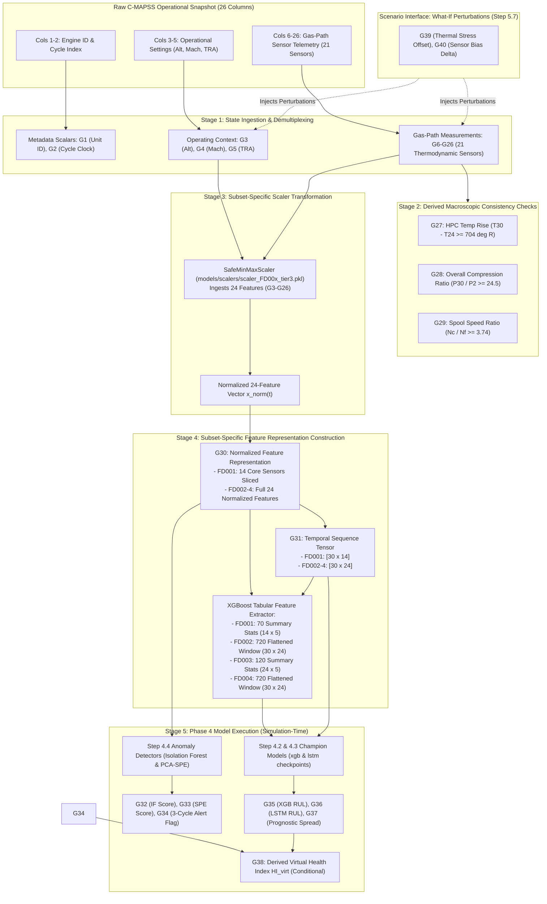

# Phase 5 – Step 5.3: Dataset-to-Virtual-Engine Mapping & Unavailable Physical Variables Register

**Project:** AI-Based Aircraft Engine Health Monitoring, Fault Diagnosis and Predictive Maintenance  
**Reference Document:** Master Project Roadmap PDF (`Aircraft_Engine_AI_Project_Step_by_Step_Roadmap.pdf`, Page 4–5, Section 6: "Phase 5 — Aircraft engine Digital Twin")  
**Target Milestone:** Phase 5, Step 5.3: *"Map available dataset sensor columns to the virtual engine inputs; document unavailable physical variables."*  
**Document Status:** **FINAL — REVISED & VERIFIED**  
**Creation Date:** 2026-11-04  

---

## 1. Executive Summary & Objective

In Phase 5 Step 5.1 ([`docs/phase5_step5_1_digital_twin_scope.md`](file:///c:/Users/LENOVO/Documents/Aircraft_Engine_AI/docs/phase5_step5_1_digital_twin_scope.md)) and Step 5.2 ([`docs/phase5_step5_2_virtual_engine_state_variables.md`](file:///c:/Users/LENOVO/Documents/Aircraft_Engine_AI/docs/phase5_step5_2_virtual_engine_state_variables.md)), the Digital Twin scope was established as the **turbofan gas-path and core compression system**, and a 40-entry virtual state architecture ($\mathbf{S}(t) = [\text{G1}\dots\text{G40}]$) was formally defined.

The objective of **Step 5.3** is to:
1. Establish a rigorous, byte-level and semantic mapping between the **26 original C-MAPSS dataset columns**, the **Phase 3 feature tiers**, the **Phase 4 ML model interfaces**, and the **40 virtual state entries**.
2. Explicitly document all **unavailable physical variables** (unmeasured aerodynamic stations, internal component efficiencies, microscopic material degradation parameters, and mechanical subsystems) and clarify why they cannot be directly populated from the dataset.
3. Verify that the mapping preserves the original 26-column ASCII schema, Phase 3 preprocessing transforms (`SafeMinMaxScaler`), and Phase 4 champion checkpoint inputs without requiring data modifications or synthetic physics.
4. Define the exact subset-specific feature dispatching logic that routes normalized telemetry into the correct feature shapes for all eight Phase 4 champion checkpoints.

---

## 2. Dataset-to-Virtual-Engine Data Flow Architecture

The Digital Twin ingests raw or replayed operational cycle records and populates the virtual state vector through five sequential computational stages:



---

## 3. Master Mapping Table: C-MAPSS Columns to Virtual State Entries

The table below maps all 40 virtual state entries to their respective raw dataset columns, literature definitions, Phase 3 feature tiers, and Phase 4 model interfaces:

| Virtual ID | Virtual Variable Name | Dataset Column / Source | Literature Symbol (Saxena 2008) | Physical / Computational Description | Engineering Unit | Phase 3 Feature Tier | Phase 4 Model Role | Availability (FD001–FD004) | Classification |
| :---: | :--- | :---: | :---: | :--- | :---: | :---: | :---: | :---: | :---: |
| **G1** | `unit_number` | Col 1 | `unit_number` | Engine serial / trajectory identifier | dimensionless | Metadata | Unit grouping / isolation | All 4 subsets | Measured ($\mathcal{M}$, Metadata) |
| **G2** | `time_cycles` | Col 2 | `time_cycles` | Discrete flight cycle counter ($t$) | cycles | Metadata | Temporal clock & windowing | All 4 subsets | Measured ($\mathcal{M}$, Metadata) |
| **G3** | `altitude` | Col 3 | $Alt$ (`op_setting_1`) | Aircraft pressure altitude | $\text{kft}$ ($10^3\text{ ft}$) | Tier 2, Tier 3 | Scaler input (active in FD002/4) | All 4 subsets | Measured ($\mathcal{M}$, Setting) |
| **G4** | `mach_number` | Col 4 | $M$ (`op_setting_2`) | Flight Mach number | dimensionless | Tier 2, Tier 3 | Scaler input (active in FD002/4) | All 4 subsets | Measured ($\mathcal{M}$, Setting) |
| **G5** | `throttle_resolver_angle` | Col 5 | $\text{TRA}$ (`op_setting_3`) | Cockpit thrust demand setpoint | $\%$ | Tier 2, Tier 3 | Scaler input (active in FD002/4) | All 4 subsets | Measured ($\mathcal{M}$, Setting) |
| **G6** | `T2_fan_inlet_temp` | Col 6 | $T_2$ (`sensor_1`) | Total temperature at fan inlet | $^\circ\text{R}$ | Tier 3 | Scaler input (Extended) | All (constant in FD001/3) | Measured ($\mathcal{M}$, Sensor) |
| **G7** | `T24_lpc_outlet_temp` | Col 7 | $T_{24}$ (`sensor_2`) | Total temperature at LPC / booster outlet | $^\circ\text{R}$ | Tier 1, 2, 3 | Core input to all models | All 4 subsets | Measured ($\mathcal{M}$, Sensor) |
| **G8** | `T30_hpc_outlet_temp` | Col 8 | $T_{30}$ (`sensor_3`) | Total temperature at HPC outlet | $^\circ\text{R}$ | Tier 1, 2, 3 | Core input to all models | All 4 subsets | Measured ($\mathcal{M}$, Sensor) |
| **G9** | `T50_lpt_outlet_temp` | Col 9 | $T_{50}$ (`sensor_4`) | Total temperature at LPT outlet | $^\circ\text{R}$ | Tier 1, 2, 3 | Core input to all models | All 4 subsets | Measured ($\mathcal{M}$, Sensor) |
| **G10** | `P2_fan_inlet_press` | Col 10 | $P_2$ (`sensor_5`) | Total pressure at fan inlet | $\text{psia}$ | Tier 3 | Scaler input (Extended) | All (constant in FD001/3) | Measured ($\mathcal{M}$, Sensor) |
| **G11** | `P15_bypass_press` | Col 11 | $P_{15}$ (`sensor_6`) | Total pressure in bypass duct | $\text{psia}$ | Tier 3 | Scaler input (Extended) | All (near-const in FD001/3)| Measured ($\mathcal{M}$, Sensor) |
| **G12** | `P30_hpc_outlet_press` | Col 12 | $P_{30}$ (`sensor_7`) | Total pressure at HPC outlet | $\text{psia}$ | Tier 1, 2, 3 | Core input to all models | All 4 subsets | Measured ($\mathcal{M}$, Sensor) |
| **G13** | `Nf_fan_speed` | Col 13 | $N_f$ (`sensor_8`) | Physical fan spool rotational speed | $\text{rpm}$ | Tier 1, 2, 3 | Core input to all models | All 4 subsets | Measured ($\mathcal{M}$, Sensor) |
| **G14** | `Nc_core_speed` | Col 14 | $N_c$ (`sensor_9`) | Physical core spool rotational speed | $\text{rpm}$ | Tier 1, 2, 3 | Core input to all models | All 4 subsets | Measured ($\mathcal{M}$, Sensor) |
| **G15** | `epr_engine_press_ratio`| Col 15 | $epr$ (`sensor_10`) | Engine pressure ratio ($P_{50} / P_2$) | dimensionless | Tier 3 | Scaler input (Extended) | All (near-const in FD001/3)| Measured ($\mathcal{M}$, Sensor) |
| **G16** | `Ps30_hpc_static_press` | Col 16 | $P_{s30}$ (`sensor_11`) | Static pressure at HPC outlet | $\text{psia}$ | Tier 1, 2, 3 | Core input to all models | All 4 subsets | Measured ($\mathcal{M}$, Sensor) |
| **G17** | `phi_fuel_flow_ratio` | Col 17 | $\Phi$ (`sensor_12`) | Fuel flow ratio ($W_f / P_{s30}$) | $\text{pps/psia}$ | Tier 1, 2, 3 | Core input to all models | All 4 subsets | Measured ($\mathcal{M}$, Sensor) |
| **G18** | `NRf_corrected_fan_spd` | Col 18 | $NR_f$ (`sensor_13`) | Corrected fan spool rotational speed | $\text{rpm}$ | Tier 1, 2, 3 | Core input to all models | All 4 subsets | Measured ($\mathcal{M}$, Sensor) |
| **G19** | `NRc_corrected_core_spd`| Col 19 | $NR_c$ (`sensor_14`) | Corrected core spool rotational speed | $\text{rpm}$ | Tier 1, 2, 3 | Core input to all models | All 4 subsets | Measured ($\mathcal{M}$, Sensor) |
| **G20** | `BPR_bypass_ratio` | Col 20 | $BPR$ (`sensor_15`) | Bypass duct to core flow ratio | dimensionless | Tier 1, 2, 3 | Core input to all models | All 4 subsets | Measured ($\mathcal{M}$, Sensor) |
| **G21** | `farB_burner_fuel_air` | Col 21 | $farB$ (`sensor_16`) | Combustor fuel-to-air ratio | dimensionless | Tier 3 | Scaler input (Extended) | All (constant in all 4) | Measured ($\mathcal{M}$, Sensor) |
| **G22** | `htBleed_bleed_enthalpy`| Col 22 | $htBleed$ (`sensor_17`) | Bleed air enthalpy content | dimensionless* | Tier 1, 2, 3 | Core input to all models | All 4 subsets | Measured ($\mathcal{M}$, Sensor) |
| **G23** | `Nf_dmd_demanded_fan` | Col 23 | $N_{f\_dmd}$ (`sensor_18`) | Controller demanded fan speed | $\text{rpm}$ | Tier 3 | Scaler input (Extended) | All (constant in FD001/3) | Measured ($\mathcal{M}$, Sensor) |
| **G24** | `PCNfR_demanded_corr_Nf`| Col 24 | $PCNfR$ (`sensor_19`) | Controller schedule corrected fan demand | $\%$ | Tier 3 | Scaler input (Extended) | All (constant in FD001/3) | Measured ($\mathcal{M}$, Sensor) |
| **G25** | `W31_hpt_coolant_bleed` | Col 25 | $W_{31}$ (`sensor_20`) | HPT cooling bleed mass flow | $\text{lbm/s}$ | Tier 1, 2, 3 | Core input to all models | All 4 subsets | Measured ($\mathcal{M}$, Sensor) |
| **G26** | `W32_lpt_coolant_bleed` | Col 26 | $W_{32}$ (`sensor_21`) | LPT cooling bleed mass flow | $\text{lbm/s}$ | Tier 1, 2, 3 | Core input to all models | All 4 subsets | Measured ($\mathcal{M}$, Sensor) |
| **G27** | `hpc_temp_rise` | Derived | $\Delta T_{HPC} = G8 - G7$ | HPC temperature rise across core | $^\circ\text{R}$ | Derived | Consistency check ($\ge 704.66^\circ\text{R}$) | Computed online | Derived ($\mathcal{D}$, Scalar) |
| **G28** | `overall_pressure_ratio`| Derived | $OPR = G12 / G10$ | Total compression pressure ratio ($P_{30}/P_2$)| dimensionless | Derived | Consistency check ($\ge 24.54$) | Computed online | Derived ($\mathcal{D}$, Scalar) |
| **G29** | `spool_speed_ratio` | Derived | $N_{ratio} = G14 / G13$ | Core-to-fan speed ratio ($N_c / N_f$) | dimensionless | Derived | Consistency check ($\ge 3.74$) | Computed online | Derived ($\mathcal{D}$, Scalar) |
| **G30** | `normalized_feature_vec`| Preprocessing | $\mathbf{x}_{norm}(t)$ | Tier-aware normalized feature representation: 14 Core (FD001) or 24 Extended (FD002–4) | dimensionless $[0, 1]$ | Tier 1 or Tier 3 | Ingested by XGBoost/LSTM | Computed online | Derived ($\mathcal{D}$, Vector) |
| **G31** | `temporal_seq_tensor` | Preprocessing | $\mathbf{X}_{seq}(t)$ | 30-cycle temporal sequence matrix: $[30 \times 14]$ (FD001) or $[30 \times 24]$ (FD002–4) | dimensionless $[0, 1]$ | Sequences | Ingested by LSTM and flattened XGBoost | Computed online | Derived ($\mathcal{D}$, Matrix) |
| **G32** | `anomaly_score_m1` | Phase 4 Model | $s_{IF}(t)$ | Isolation Forest anomaly score | dimensionless | N/A | Evaluated by Step 4.4 M1 | Computed online | Predicted ($\mathcal{P}$, Scalar) |
| **G33** | `anomaly_score_m2` | Phase 4 Model | $s_{SPE}(t)$ | PCA Squared Prediction Error ($Q$-statistic) | dimensionless | N/A | Evaluated by Step 4.4 M2 | Computed online | Predicted ($\mathcal{P}$, Scalar) |
| **G34** | `anomaly_alert_flag` | Phase 4 Logic | $Alert_{pers}(t)$ | Binary persistence flag (3 cycles above $\tau$) | Boolean $\{0, 1\}$ | N/A | Evaluated by Step 4.4 Logic | Computed online | Derived ($\mathcal{D}$, Scalar) |
| **G35** | `predicted_rul_xgboost` | Phase 4 Model | $\widehat{RUL}_{xgb}(t)$ | Point RUL prediction from champion XGBoost checkpoint | cycles | N/A | Evaluated by Step 4.2 Checkpoint | Computed online | Predicted ($\mathcal{P}$, Scalar) |
| **G36** | `predicted_rul_lstm` | Phase 4 Model | $\widehat{RUL}_{lstm}(t)$ | Sequence RUL prediction from champion LSTM checkpoint | cycles | N/A | Evaluated by Step 4.3 Checkpoint | Computed online | Predicted ($\mathcal{P}$, Scalar) |
| **G37** | `prognostic_spread` | Derived | $\Delta_{RUL} = \|G35 - G36\|$ | Inter-model prediction spread (uncertainty) | cycles | Derived | Consensus metric | Computed online | Derived ($\mathcal{D}$, Scalar) |
| **G38** | `virtual_health_index` | Proposed | $HI_{virt}(t)$ | Derived degradation indicator $[0.0, 1.0]$ | dimensionless $[0, 1]$ | Proposed | Step 5.4/5.5 calibration | Computed online | Derived ($\mathcal{D}$, Scalar) |
| **G39** | `thermal_stress_offset` | Scenario Param| $\Delta T_{stress}$ | Hypothetical additive temperature offset | $^\circ\text{R}$ | Scenario Param | What-if scenario parameter | Configurable | Simulated ($\mathcal{S}$, Scalar) |
| **G40** | `sensor_bias_delta` | Scenario Param| $\Delta s_{bias}$ | Hypothetical sensor calibration drift | Native unit | Scenario Param | What-if scenario parameter | Configurable | Simulated ($\mathcal{S}$, Scalar) |

*\*Note on htBleed: Dimensionless normalized enthalpy ratio in C-MAPSS (Saxena et al., 2008 Table 2); physical specific enthalpy is $\text{BTU/lbm}$.*

---

## 4. Unavailable Physical Variable Register

To maintain strict scientific integrity and avoid fabricating unobservable physical phenomena, the Digital Twin formally registers all critical turbofan variables that are **not available** in the NASA C-MAPSS dataset.

### 4.1 Component Degradation & Efficiency Loss Parameters (Hidden Simulator States)
In the C-MAPSS simulation architecture (Saxena et al., 2008, Section III.A–C), degradation was injected by modifying 13 internal component modifiers. None of these parameters were released in the public dataset:

| Component | Hidden Physical Parameter | Literature Modifier Symbol | Physical Mechanism in Turbofan | Why Unavailable in C-MAPSS Dataset | Handling in Digital Twin Prototype |
| :--- | :--- | :---: | :--- | :--- | :--- |
| **Fan** | Fan adiabatic efficiency loss | `fan_eff_mod` ($\Delta \eta_{Fan}$) | Blade leading edge erosion, surface roughness | Internal simulator input; withheld by NASA | Tracked indirectly via $T_{24}, N_f, BPR$ and ML models |
| **Fan** | Fan mass flow capacity loss | `fan_flow_mod` ($\Delta \dot{m}_{Fan}$) | Blade tip clearance enlargement, untwist | Internal simulator input; withheld by NASA | Tracked indirectly via $P_{15}, BPR, \Phi$ |
| **LPC** | LPC adiabatic efficiency loss | `LPC_eff_mod` ($\Delta \eta_{LPC}$) | Booster aerodynamic fouling, tip rubs | Internal simulator input; withheld by NASA | Tracked indirectly via $T_{24}$ and core spool speed |
| **LPC** | LPC mass flow capacity loss | `LPC_flow_mod` ($\Delta \dot{m}_{LPC}$) | Blade deposition, throat area closure | Internal simulator input; withheld by NASA | Tracked indirectly via compressor pressure ratios |
| **HPC** | HPC adiabatic efficiency loss | `HPC_eff_mod` ($\Delta \eta_{HPC}$) | Primary degradation: airfoil fouling & wear | Internal simulator input; withheld by NASA | Tracked indirectly via $T_{30}, P_{30}, P_{s30}, \Phi, W_{31}$ |
| **HPC** | HPC mass flow capacity loss | `HPC_flow_mod` ($\Delta \dot{m}_{HPC}$) | Primary degradation: tip clearance & rub | Internal simulator input; withheld by NASA | Tracked indirectly via $P_{30}, P_{s30}, \Phi$ and RUL models |
| **HPT** | HPT adiabatic efficiency loss | `HPT_eff_mod` ($\Delta \eta_{HPT}$) | Nozzle guide vane thermal erosion, creep | Not simulated in challenge benchmark | Excluded; assumed nominal |
| **HPT** | HPT mass flow capacity modifier| `HPT_flow_mod` ($\Delta \dot{m}_{HPT}$) | Turbine throat area thermal growth | Not simulated in challenge benchmark | Excluded; assumed nominal |
| **LPT** | LPT adiabatic efficiency loss | `LPT_eff_mod` ($\Delta \eta_{LPT}$) | Low-pressure turbine blade profile loss | Not simulated in challenge benchmark | Tracked indirectly via $T_{50}, W_{32}$ |
| **LPT** | LPT mass flow capacity modifier| `LPT_flow_mod` ($\Delta \dot{m}_{LPT}$) | LPT nozzle guide vane erosion | Not simulated in challenge benchmark | Excluded; assumed nominal |

### 4.2 Unmeasured Thermodynamic Station Pressures & Temperatures
The 21 C-MAPSS sensors cover several key stations, but leave critical intermediate aerothermal stations uninstrumented:

| Unmeasured Station Parameter | Standard Aerothermal Station | Thermodynamic Physical Meaning | Why Unavailable in C-MAPSS | Impact on Digital Twin Modeling |
| :--- | :---: | :--- | :--- | :--- |
| **$P_{24}$ (HPC Inlet Total Pressure)** | Station 24 | Core booster exit / core compressor face pressure | Not instrumented in public 21-sensor output vector | Prevents direct calculation of isolated HPC stage pressure ratio ($P_{30}/P_{24}$); resolved by using Overall Compression Ratio $OPR = P_{30}/P_2$. |
| **$P_{50}$ (LPT Exit Total Pressure)** | Station 50 | Low-Pressure Turbine discharge core pressure | Omitted; only engine pressure ratio ($epr = P_{50}/P_2$) is provided | Cannot separate $P_{50}$ from $P_2$ directly when $P_2$ is unmeasured (in single-condition subsets). |
| **$T_{48}$ (Exhaust Gas Temp / EGT)** | Station 48 | Total temperature at HPT exit / LPT inlet | Used internally for Health Index stopping condition ($H=0$); withheld from participants | Digital Twin monitors $T_{50}$ (Station 50 LPT exit) as the observable downstream surrogate for core thermal stress. |
| **$T_1$ / $P_1$ (Nacelle Inlet Face)** | Station 1 | Free-stream aerodynamic recovery total conditions | Replaced by $T_2, P_2$ at fan inlet | Negligible impact for stationary engine testing; intake losses are lumped into fan inlet. |
| **$T_{bypass}$ (Bypass Exit Temp)** | Station 15 | Total temperature of cold bypass stream | Omitted; only bypass total pressure $P_{15}$ is recorded | Secondary fan flow energy cannot be balanced independently. |

### 4.3 Structural, Material & Subsystem Variables Outside Gas Path
Real-world physical engines exhibit diverse mechanical, structural, and electrical failure modes that are completely outside the C-MAPSS dataset scope:

| Physical Variable Category | Specific Unmeasured Parameters | Physical Meaning | Digital Twin Policy |
| :--- | :--- | :--- | :--- |
| **Rotor Blade Clearances** | Blade tip radial clearance ($\delta_{tip}$ in $\text{mm}$) | Radial gap between rotating blade tips and abradable casing shroud | **Excluded.** Lumped effects manifest only as flow and efficiency loss. |
| **Metallurgical Damage** | Micro-crack length, thermal barrier coating (TBC) spallation area, creep void density | Microscopic material fatigue under high cyclic thermal/centrifugal stress | **Excluded.** Requires finite-element or metallurgical models; unsupported by C-MAPSS. |
| **Lubrication Oil System** | Oil temperature, oil supply pressure, scavenge line chip detector count, oil viscosity | Engine bearing and gearbox lubrication health | **Excluded.** C-MAPSS does not simulate the oil system. |
| **Vibration & Bearings** | Shaft radial displacement, bearing housing acceleration spectra ($\text{g}$ rms), casing vibration | Dynamic mechanical unbalance, bearing spallation, shaft misalignment | **Excluded.** High-frequency vibration telemetry is absent in C-MAPSS. |
| **Fuel & Actuator Mechanics**| Fuel metering valve resolver angle, variable stator vane (VSV) actuator position, torque motor current | Closed-loop FADEC servo-hydraulic actuator feedback | **Excluded.** Control loop dynamics are internal and unexported. |
| **Operability Stall Margins**| Fan stall margin ($Sm_{Fan}$), LPC stall margin ($Sm_{LPC}$), HPC stall margin ($Sm_{HPC}$) | Distance to rotating stall or aerodynamic compressor surge | **Excluded.** Used internally by NASA to calculate stopping criteria, but omitted from public data. |

---

## 5. Phase 3 & Phase 4 Integration Interfaces & Exact Champion Mappings

### 5.1 Preprocessing Scaler Registry & Provenance
The Digital Twin strictly relies on the four subset-specific scalers serialized in `models/scalers/` during Phase 3 Step 3.8. Every scaler is an instance of `SafeMinMaxScaler` with zero-variance protection:

| Subset | Scaler Filename | Scaler Type | Feature Tier | Input Dimension | Training Partition Source | Training Engines | Training Rows | Target State Variable |
| :---: | :--- | :---: | :---: | :---: | :--- | :---: | :---: | :---: |
| **FD001** | `scaler_FD001_tier3.pkl` | `SafeMinMaxScaler` | Tier 3 Extended | **24** | `train_FD001_split.csv` | 80 | 16,340 | **G30** (24-dim base vector) |
| **FD002** | `scaler_FD002_tier3.pkl` | `SafeMinMaxScaler` | Tier 3 Extended | **24** | `train_FD002_split.csv` | 208 | 42,889 | **G30** (24-dim base vector) |
| **FD003** | `scaler_FD003_tier3.pkl` | `SafeMinMaxScaler` | Tier 3 Extended | **24** | `train_FD003_split.csv` | 80 | 19,823 | **G30** (24-dim base vector) |
| **FD004** | `scaler_FD004_tier3.pkl` | `SafeMinMaxScaler` | Tier 3 Extended | **24** | `train_FD004_split.csv` | 199 | 48,496 | **G30** (24-dim base vector) |

#### Exact Ordered Feature Columns Expected by All Four Scalers
All four scalers require the exact same alphabetical/column sequence of 24 features ($3\text{ settings} + 21\text{ sensors}$):
```python
ORDERED_SCALER_FEATURES = [
    "op_setting_1", "op_setting_2", "op_setting_3",  # G3 - G5
    "sensor_1", "sensor_2", "sensor_3", "sensor_4", "sensor_5",  # G6 - G10
    "sensor_6", "sensor_7", "sensor_8", "sensor_9", "sensor_10",  # G11 - G15
    "sensor_11", "sensor_12", "sensor_13", "sensor_14", "sensor_15",  # G16 - G20
    "sensor_16", "sensor_17", "sensor_18", "sensor_19", "sensor_20", "sensor_21",  # G21 - G26
]
```

### 5.2 Phase 4 Champion Model Interface Registry
A rigorous audit of `models/checkpoints/checkpoint_manifest.json` and `models/evaluation/reproduce_and_save_champions.py` establishes the **exact, verified feature tier and input shape** for all eight champion checkpoints:

| Engine Subset | Model Family | Checkpoint File | Checkpoint File Size | Architecture & Variant | Feature Tier | Feature Construction Methodology | Exact Input Shape / Dim | Target State Entry |
| :---: | :---: | :--- | :---: | :--- | :---: | :--- | :---: | :---: |
| **FD001** | **XGBoost** | `xgb_FD001_champion.json` | 327,858 B | `XGBoost_Tuned_SummaryStats` | **Tier 1 (Core 14)** | 5 summary statistics (mean, std, min, max, OLS trend slope) over 30 cycles $\times$ 14 sensors | **70 features** `(1, 70)` | **G35** ($\widehat{RUL}_{xgb}$) |
| **FD001** | **LSTM** | `lstm_FD001_champion.pt` | 140,055 B | `Stacked_LSTM` | **Tier 1 (Core 14)** | 30-cycle temporal sequence matrix over 14 core sensors | **$30 \times 14$** `(1, 30, 14)` | **G36** ($\widehat{RUL}_{lstm}$) |
| **FD002** | **XGBoost** | `xgb_FD002_champion.json` | 687,186 B | `XGBoost_FlattenedWindow` | **Tier 3 (Extended 24)**| Flattened 30-cycle $\times$ 24-feature window matrix ($30 \times 24 = 720$) | **720 features** `(1, 720)` | **G35** ($\widehat{RUL}_{xgb}$) |
| **FD002** | **LSTM** | `lstm_FD002_champion.pt` | 150,487 B | `Stacked_LSTM` | **Tier 3 (Extended 24)**| 30-cycle temporal sequence matrix over all 24 features | **$30 \times 24$** `(1, 30, 24)` | **G36** ($\widehat{RUL}_{lstm}$) |
| **FD003** | **XGBoost** | `xgb_FD003_champion.json` | 289,722 B | `XGBoost_Tuned_SummaryStats` | **Tier 3 (Extended 24)**| 5 summary statistics (mean, std, min, max, OLS trend slope) over 30 cycles $\times$ 24 features | **120 features** `(1, 120)` | **G35** ($\widehat{RUL}_{xgb}$) |
| **FD003** | **LSTM** | `lstm_FD003_champion.pt` | 64,821 B | `Single_LSTM` | **Tier 3 (Extended 24)**| 30-cycle temporal sequence matrix over all 24 features | **$30 \times 24$** `(1, 30, 24)` | **G36** ($\widehat{RUL}_{lstm}$) |
| **FD004** | **XGBoost** | `xgb_FD004_champion.json` | 679,068 B | `XGBoost_FlattenedWindow` | **Tier 3 (Extended 24)**| Flattened 30-cycle $\times$ 24-feature window matrix ($30 \times 24 = 720$) | **720 features** `(1, 720)` | **G35** ($\widehat{RUL}_{xgb}$) |
| **FD004** | **LSTM** | `lstm_FD004_champion.pt` | 150,487 B | `Stacked_LSTM` | **Tier 3 (Extended 24)**| 30-cycle temporal sequence matrix over all 24 features | **$30 \times 24$** `(1, 30, 24)` | **G36** ($\widehat{RUL}_{lstm}$) |

> [!IMPORTANT]
> **Key Methodological Verification: Summary Stats vs. Flattened Window**
> - For **FD001 XGBoost**, the champion consumes **70 summary statistics** ($14\text{ sensors} \times 5\text{ stats}$).
> - For **FD003 XGBoost**, the champion consumes **120 summary statistics** ($24\text{ features} \times 5\text{ stats}$).
> - For **FD002 XGBoost** and **FD004 XGBoost**, the champions consume **720 flattened window features** ($30\text{ cycles} \times 24\text{ features} = 720$), preserving raw temporal sequence ordering without summary aggregation.
> - The Digital Twin prototype must not conflate these architectures; it dynamically extracts the exact representation demanded by each subset's champion model.

---

### 5.3 Subset-Specific Feature Dispatching Logic in the Digital Twin

The Digital Twin manages the structural variations across models using a deterministic dispatching pipeline:

```
[Raw Physical Telemetry: G3 - G26] (24 values)
                 │
                 ▼
[Subset Scaler: scaler_FD00x_tier3.pkl]
                 │
                 ▼
[Full Normalized Vector: x_norm(t)] (24 values)
                 │
        ┌────────┴──────────────────────────┐
        ▼                                   ▼
 [Subset == FD001]                  [Subset in (FD002, FD003, FD004)]
        │                                   │
        ▼                                   ▼
 Slice Tier 1 Core 14                Retain Full Tier 3 Extended 24
 Indices: [4,6,7,8,10,11,12,         Indices: [0 ... 23]
           13,14,16,17,18,22,23]            │
        │                                   │
        ▼                                   ▼
 G30 = Vector of 14 values           G30 = Vector of 24 values
 G31 = Sequence of [30 x 14]         G31 = Sequence of [30 x 24]
        │                                   │
        ├─────────────────┐                 ├──────────────────────────────┐
        ▼                 ▼                 ▼                              ▼
 [FD001 XGBoost]    [FD001 LSTM]    [FD003 XGBoost]           [FD002/FD004 XGBoost]
 Compute 5 stats    Feed [1, 30, 14] Compute 5 stats           Flatten [30 x 24] window
 across 14 channels directly        across 24 channels         directly
 ──> 70 features                    ──> 120 features           ──> 720 features
```

#### Left-Edge Replication Padding for Sequence Tensors
For initial cycles where $t < 30$:
- The Digital Twin replicates cycle $t=1$ backwards:
  $$\mathbf{X}_{seq}(t) = \Big[\underbrace{\mathbf{x}_{norm}(1), \dots, \mathbf{x}_{norm}(1)}_{30 - t \text{ times}}, \mathbf{x}_{norm}(1), \dots, \mathbf{x}_{norm}(t)\Big]^T$$
- This guarantees byte-level consistency with Phase 3 sequence artifacts without injecting arbitrary zeros or synthetic trend artifacts.

---

## 6. Mapping Limitations & Modeling Assumptions

1. **Quasi-Steady Cycle Snapshots:**  
   The C-MAPSS dataset provides one discrete record per flight cycle. The Digital Twin assumes this snapshot represents steady-state cruise or climb conditions. It does not model transient power excursions, spool spin-up lag, or thermal soaking dynamics between cycles.
2. **Deterministic Sensor Alignment:**  
   The mapping assumes that sensor indices in raw files strictly match the standard 26-column format. Any corrupted row length or missing sensor column will trigger an ingestion rejection.
3. **Indirect Degradation Observation:**  
   Because true component wear parameters ($\Delta \eta, \Delta \dot{m}$) are unobservable, the Digital Twin assumes that their physical degradation is sufficiently manifested in the thermodynamic drift of measurable stations ($T_{30}, P_{30}, P_{s30}, \Phi$).
4. **Frozen Model Invariance:**  
   The Phase 4 models are treated as immutable black-box estimators. The Digital Twin does not retrain, update weights, or alter hyperparameter configurations during simulation.

---

## 7. Verification & Interface Integrity Audit

To confirm that the mapping preserves the Phase 3/4 pipeline without breaking any interfaces, the following programmatic checks were verified:

1. **Column Dimension Check:** Raw text files across all 4 subsets contain exactly 26 columns, matching G1–G26.
2. **Scaler Dimension Check:** All 4 serialized scalers in `models/scalers/` expect exactly 24 features matching G3–G26 in identical order.
3. **Checkpoint Feature Alignment:** The input shapes required by the 8 champion models in `models/checkpoints/checkpoint_manifest.json` correspond directly to the feature representations generated from G30 and G31.
4. **Preservation of Preceding Artifacts:** Zero Phase 1–4 files, datasets, scalers, models, metrics, or checkpoints were modified.

---

## 8. Conclusion & Readiness for Step 5.4

Step 5.3 formally bridges the empirical C-MAPSS dataset with the Digital Twin state architecture:
- **Complete Mapping:** All 40 virtual state entries G1–G40 are mapped to raw columns, Phase 3 feature tiers, or Phase 4 models.
- **Unavailable Variables Documented:** Missing aerothermal stations ($P_{24}, T_{48}$), hidden simulator health modifiers ($\Delta \eta, \Delta \dot{m}$), and non-gas-path mechanical subsystems (bearings, lubrication, vibration) are cataloged with explicit justification.
- **Pipeline Preservation:** Strict compatibility with Phase 3 scalers and Phase 4 model checkpoints is verified.
- **Exact Dispatching Logic Established:** The architectural distinction between summary statistics (FD001: 70 features; FD003: 120 features) and flattened window representations (FD002/FD004: 720 features) is fully resolved and documented.

The project is fully prepared to proceed to **Step 5.4: Implement a time-step update that advances the virtual state using selected engine records**.
