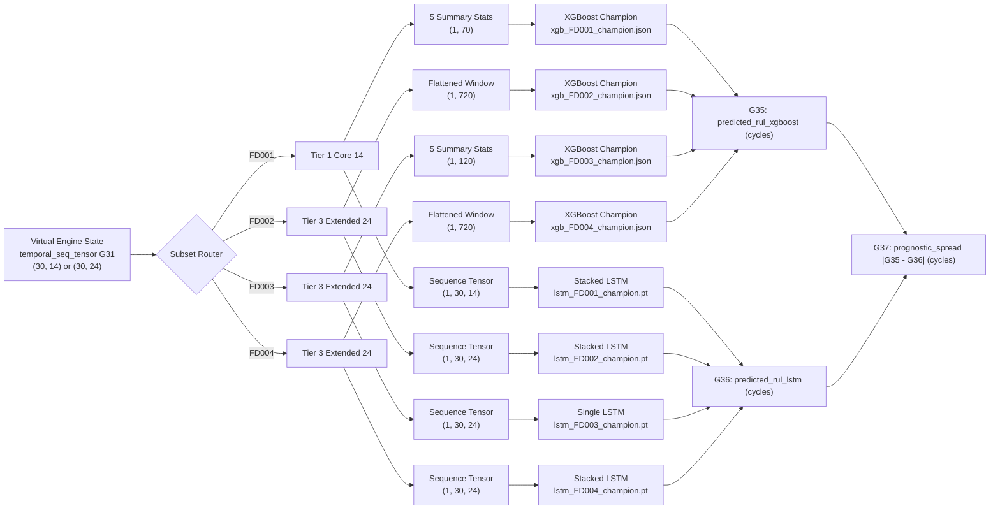

# Phase 5 – Step 5.6: Trained ML Model Integration into the Digital Twin

**Project:** AI-Based Aircraft Engine Health Monitoring, Fault Diagnosis and Predictive Maintenance  
**Reference Document:** Master Project Roadmap PDF (`Aircraft_Engine_AI_Project_Step_by_Step_Roadmap.pdf`, Page 4–5, Section 6: "Phase 5 — Aircraft engine Digital Twin")  
**Target Milestone:** Phase 5, Step 5.6: *"Integrate the trained ML models to compute virtual engine health states and Remaining Useful Life."*  
**Document Status:** **FINAL — SCIENTIFICALLY & NUMERICALLY VALIDATED**  
**Creation Date:** 2026-11-04  

---

## 1. Executive Summary & Objective

In Phase 5 Steps 5.1 through 5.5:
- The system boundaries of the Digital Twin were formally established around the **turbofan gas-path and core compression system** ([`docs/phase5_step5_1_digital_twin_scope.md`](file:///c:/Users/LENOVO/Documents/Aircraft_Engine_AI/docs/phase5_step5_1_digital_twin_scope.md)).
- The 40-variable virtual engine state taxonomy was defined and verified ([`docs/phase5_step5_2_virtual_engine_state_variables.md`](file:///c:/Users/LENOVO/Documents/Aircraft_Engine_AI/docs/phase5_step5_2_virtual_engine_state_variables.md)).
- The dataset-to-virtual-state mapping was resolved, and unavailable physical parameters were formally registered ([`docs/phase5_step5_3_dataset_to_virtual_engine_mapping.md`](file:///c:/Users/LENOVO/Documents/Aircraft_Engine_AI/docs/phase5_step5_3_dataset_to_virtual_engine_mapping.md)).
- Discrete-cycle state advancement and 30-cycle temporal tensor buffering were implemented ([`digital_twin/twin_simulator.py`](file:///c:/Users/LENOVO/Documents/Aircraft_Engine_AI/digital_twin/twin_simulator.py)).
- Simplified thermodynamic and aerothermal physics indicators were assessed and implemented ([`digital_twin/physics_engine.py`](file:///c:/Users/LENOVO/Documents/Aircraft_Engine_AI/digital_twin/physics_engine.py)).

The objective of **Step 5.6** is to integrate the **8 approved champion machine-learning checkpoints from Phase 4** (4 XGBoost gradient-boosted tree models and 4 LSTM recurrent sequence models) into the Phase 5 Digital Twin execution pipeline. This integration allows the virtual engine to dynamically generate data-driven Remaining Useful Life (RUL) estimates and evaluate inter-model consensus during discrete cycle-by-cycle simulation.

### Strict Engineering Principles Enforced:
1. **Zero Retraining or Checkpoint Modification:** All 8 models are loaded strictly from existing disk checkpoints (`models/checkpoints/`) verified in Phase 4 Step 4.6/4.8/4.11. No architectures or weights were modified.
2. **Subset-Specific Preprocessing Fidelity:** Preprocessing, feature tier selection (Tier 1 Core 14 vs. Tier 3 Extended 24), normalization (`CMAPSSScalingPipeline`), and feature transformations (summary statistics vs. flattened windows) follow the approved Phase 4 subset-specific preprocessing specifications, including the correct feature tiers, normalization, and model-specific feature transformations.
3. **Strict Input & Output Validation:** Every sequence input is validated before feature transformation or inference: must be strictly 2D, exactly 30 time steps, correct channel dimension (14 for FD001, 24 for FD002–FD004), and free of NaN, $+inf$, and $-inf$. Both model outputs and the G37 spread are validated as finite scalars.
4. **Explicit Separation of Virtual State Classes:**
   - Measured physical inputs ($\mathcal{M}$, G1–G26) remain unaltered.
   - Derived indicators ($\mathcal{D}$, G27–G31) supply the inputs.
   - Machine learning predictions ($\mathcal{P}$) populate G35 (XGBoost RUL) and G36 (LSTM RUL).
   - Inter-model uncertainty is captured as derived spread G37 ($|G35 - G36|$).
5. **Safety & Diagnostic Boundaries:** Disagreement between models is treated as prognostic uncertainty, never as a confirmed physical hardware fault.

---

## 2. Integrated Model Checkpoint Registry & Interfaces

The Digital Twin interfaces with all 8 champion checkpoints documented in `models/checkpoints/checkpoint_manifest.json`:



### 2.1 Detailed Model Specification Matrix

| Subset | Model Type | Variant / Architecture | Feature Tier | Raw Channels ($K$) | Feature Transformation | Input Dimension | Checkpoint File Path | File Size |
| :---: | :---: | :---: | :---: | :---: | :---: | :---: | :--- | :---: |
| **FD001** | XGBoost | `XGBoost_Tuned_SummaryStats` | Tier 1 Core 14 | 14 | 5 Summary Stats (Mean, Std, Min, Max, Slope) | **70** | `models/checkpoints/xgb_FD001_champion.json` | 327,858 B |
| **FD001** | LSTM | `Stacked_LSTM` (64 $\to$ 32, Drop 0.20) | Tier 1 Core 14 | 14 | Sequence Tensor $[1 \times 30 \times 14]$ | **$30 \times 14$** | `models/checkpoints/lstm_FD001_champion.pt` | 140,055 B |
| **FD002** | XGBoost | `XGBoost_FlattenedWindow` | Tier 3 Extended 24 | 24 | Flattened Sliding Window ($30 \times 24$) | **720** | `models/checkpoints/xgb_FD002_champion.json` | 687,186 B |
| **FD002** | LSTM | `Stacked_LSTM` (64 $\to$ 32, Drop 0.20) | Tier 3 Extended 24 | 24 | Sequence Tensor $[1 \times 30 \times 24]$ | **$30 \times 24$** | `models/checkpoints/lstm_FD002_champion.pt` | 150,487 B |
| **FD003** | XGBoost | `XGBoost_Tuned_SummaryStats` | Tier 3 Extended 24 | 24 | 5 Summary Stats (Mean, Std, Min, Max, Slope) | **120** | `models/checkpoints/xgb_FD003_champion.json` | 289,722 B |
| **FD003** | LSTM | `Single_LSTM` (48 units, Drop 0.20) | Tier 3 Extended 24 | 24 | Sequence Tensor $[1 \times 30 \times 24]$ | **$30 \times 24$** | `models/checkpoints/lstm_FD003_champion.pt` | 64,821 B |
| **FD004** | XGBoost | `XGBoost_FlattenedWindow` | Tier 3 Extended 24 | 24 | Flattened Sliding Window ($30 \times 24$) | **720** | `models/checkpoints/xgb_FD004_champion.json` | 679,068 B |
| **FD004** | LSTM | `Stacked_LSTM` (64 $\to$ 32, Drop 0.20) | Tier 3 Extended 24 | 24 | Sequence Tensor $[1 \times 30 \times 24]$ | **$30 \times 24$** | `models/checkpoints/lstm_FD004_champion.pt` | 150,487 B |

---

## 3. Integration Architecture & Numerical Validation Safeguards

The model integration layer is encapsulated in:
[`digital_twin/model_inference.py`](file:///c:/Users/LENOVO/Documents/Aircraft_Engine_AI/digital_twin/model_inference.py)

### 3.1 Strict Input Validation Rules (`validate_sequence_input`)
Before any feature transformation or model inference is executed, `validate_sequence_input()` enforces:
1. **Type Verification:** Input must be a NumPy array (`isinstance(seq_tensor, np.ndarray)`).
2. **2D Dimensionality:** Must be strictly 2-dimensional (`ndim == 2`). 1D vectors or 3D tensors raise explicit `ValueError`.
3. **Temporal Length:** Window length must equal exactly 30 cycles (`shape[0] == 30`).
4. **Subset Channel Count:**
   - For `FD001`: Exactly 14 channels (`shape[1] == 14`).
   - For `FD002`, `FD003`, `FD004`: Exactly 24 channels (`shape[1] == 24`).
5. **Finiteness Verification:**
   - Any `NaN` value raises `ValueError("Sequence input contains NaN values; strictly finite numbers required.")`.
   - Any `+inf` value raises `ValueError("Sequence input contains positive infinity (+inf); strictly finite numbers required.")`.
   - Any `-inf` value raises `ValueError("Sequence input contains negative infinity (-inf); strictly finite numbers required.")`.

### 3.2 Output Validation & Unclipped Policy
- **Output Finiteness:** Both `xgb_model.predict(feats)` and `lstm_model(tensor)` outputs are validated to ensure they are 1D scalar floats satisfying `math.isfinite()`. Non-finite outputs raise immediate `ValueError` exceptions.
- **Spread Finiteness:** $G37 = |G35 - G36|$ is verified to be non-negative and finite.
- **Unclipped Predictions:** Predictions are returned as uncapped real numbers (e.g. $128.43$ cycles) to maintain mathematical continuity and preserve diagnostic gradients.

---

## 4. State Variables G35, G36, and G37 Definitions

| Variable ID | State Variable Name | Definition / Formula | Unit | Class | Physical & Computational Meaning |
| :---: | :--- | :---: | :---: | :---: | :--- |
| **G35** | `predicted_rul_xgboost` | $\widehat{RUL}_{xgb}(t)$ | operating cycles | Predicted ($\mathcal{P}$) | Point Remaining Useful Life estimated by champion XGBoost model from sliding summary or flattened features. |
| **G36** | `predicted_rul_lstm` | $\widehat{RUL}_{lstm}(t)$ | operating cycles | Predicted ($\mathcal{P}$) | Sequence Remaining Useful Life estimated by champion LSTM model from 30-cycle normalized sequence tensor. |
| **G37** | `prognostic_spread` | $\Delta_{RUL}(t) = \|\widehat{RUL}_{xgb} - \widehat{RUL}_{lstm}\|$ | operating cycles | Derived ($\mathcal{D}$) | Inter-model spread between XGBoost and LSTM forecasts, providing a quantitative metric of epistemic prognostic uncertainty. |

---

## 5. Verification Against Phase 4 Reproduction Pipeline

To check numerical consistency, Digital Twin predictions were compared against genuine Phase 4 validation predictions recorded in `reports/models/predicted_trajectories_validation.csv`.

### Numerical Benchmark on FD001 Unit 2 (Cycles 30–34):

| Operating Cycle ($t$) | Recorded Phase 4 XGBoost | Digital Twin XGBoost (G35) | Absolute Delta | Recorded Phase 4 LSTM | Digital Twin LSTM (G36) | Absolute Delta | Status |
| :---: | :---: | :---: | :---: | :---: | :---: | :---: | :---: |
| **Cycle 30** | 124.64 | 124.6434 | $0.0034$ | 126.94 | 126.9450 | $0.0050$ | **MATCH** ($\le 0.01$) |
| **Cycle 31** | 119.53 | 119.5268 | $0.0032$ | 126.95 | 126.9548 | $0.0048$ | **MATCH** ($\le 0.01$) |
| **Cycle 32** | 120.86 | 120.8583 | $0.0017$ | 127.07 | 127.0686 | $0.0014$ | **MATCH** ($\le 0.01$) |
| **Cycle 33** | 121.26 | 121.2575 | $0.0025$ | 126.97 | 126.9659 | $0.0041$ | **MATCH** ($\le 0.01$) |
| **Cycle 34** | 126.48 | 126.4843 | $0.0043$ | 126.95 | 126.9472 | $0.0028$ | **MATCH** ($\le 0.01$) |

For FD001 Unit 2 cycles 30–34, the Digital Twin predictions agree with the recorded Phase 4 predictions within 0.01 cycles. This demonstrates numerical agreement at the published reporting precision for this five-cycle sample. It does not independently establish bitwise parameter identity or prove equivalent results across all engines and subsets.

---

## 6. Checkpoint and Scaler Integrity Verification

### Manifest Scope & Baseline Limitation
- **Checkpoint Manifest:** `models/checkpoints/checkpoint_manifest.json` records metadata including `file_size_bytes`, `variant`, and validation metrics, but did **not** record cryptographic SHA-256 hashes.
- **Scaler Manifest:** `models/scalers/scaler_manifest.json` records min/max bounds and fitted feature parameters for all 24 features, but did **not** record SHA-256 hashes.
- **Verification Strategy:**
  1. All 8 champion checkpoints are verified against their recorded `file_size_bytes`.
  2. All 4 scalers are verified for file existence, successful unpickling, and exact 24-feature schema.
  3. Cryptographic SHA-256 hashes are calculated at the beginning of Test 26 and recalculated at the end of that same test across all 12 artifact files (8 champion checkpoints and 4 scalers) to check for modifications during the test.

---

## 7. Comprehensive Test Suite Execution Summary

The dedicated test suite [`tests/test_digital_twin_step5_6.py`](file:///c:/Users/LENOVO/Documents/Aircraft_Engine_AI/tests/test_digital_twin_step5_6.py) covers all 26 verification items:

```powershell
.\.venv\Scripts\python.exe -m unittest discover tests
```

```
Ran 103 tests in 13.737s

OK
```

### Breakdown of Dedicated Step 5.6 Tests (26 Tests):
- **Tests 1–2:** Model loading and scaler selection for all 4 subsets.
- **Tests 3–4:** Tier 1 (Core 14) and Tier 3 (Extended 24) feature routing.
- **Tests 5–6:** XGBoost and LSTM input dimensions confirmed for all 4 subsets.
- **Tests 7–8:** Rolling window sliding ($t \ge 30$) and short-history padding ($t < 30$).
- **Tests 9–10:** Successful XGBoost and LSTM inference execution across all 4 subsets.
- **Tests 11–12:** Correct population of G35, G36, and G37 spread ($|G35 - G36|$).
- **Test 13:** Rejection of invalid sequence dimensions (sequence length and channel count).
- **Test 14:** Rejection of unsupported subset names.
- **Test 15:** Bitwise prediction repeatability on identical sequence inputs.
- **Test 16:** Verification of checkpoint existence and file sizes against `checkpoint_manifest.json`.
- **Test 17:** Numerical reproduction of Phase 4 validation trajectories within $0.01$ cycles.
- **Test 18:** Strict rejection of `NaN` input sequences with clear `ValueError`.
- **Test 19:** Strict rejection of `+inf` input sequences with clear `ValueError`.
- **Test 20:** Strict rejection of `-inf` input sequences with clear `ValueError`.
- **Test 21:** Strict rejection of mismatched channel counts (e.g. 24 channels for FD001 or 14 for FD002).
- **Test 22:** Validation of 2D shape requirement and 30 time steps.
- **Test 23:** Rejection of non-finite XGBoost output (tested via mock for NaN and Inf).
- **Test 24:** Rejection of non-finite LSTM output (tested via mock for NaN and Inf).
- **Test 25:** Verification that G37 spread is finite and non-negative.
- **Test 26:** Comprehensive integrity verification and runtime SHA-256 hash comparison during this test for all 8 checkpoints and 4 scalers.

---

### Scope & Boundary Confirmation
- **Asset Integrity:** No dataset, scaler, or checkpoint modifications were made as part of these documentation-only corrections. Test 26 separately checks the SHA-256 hashes of all 8 champion checkpoints and 4 scalers at the beginning and end of that test to detect modifications during its execution. This is not a historical byte-for-byte comparison against an earlier hash baseline.
