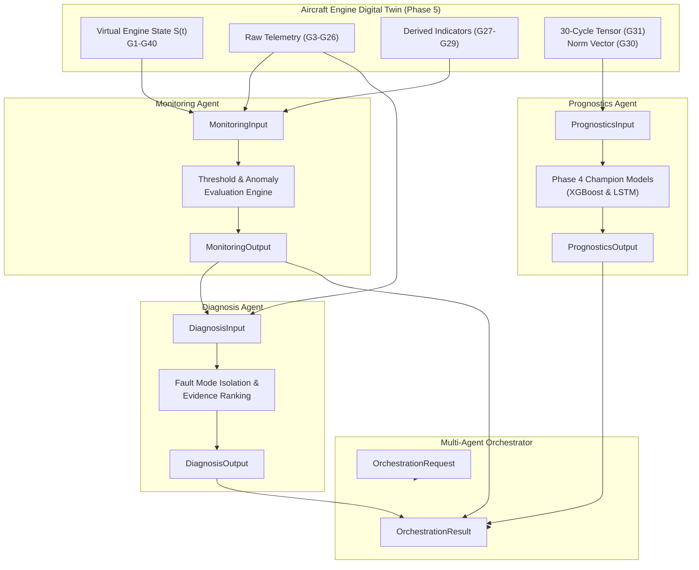

# Phase 6 — Step 6.1: Multi-Agent System Input and Output Schemas

**Project:** AI-Based Aircraft Engine Health Monitoring, Fault Diagnosis and Predictive Maintenance  
**Dataset:** NASA C-MAPSS Turbofan Engine Degradation Dataset (FD001, FD002, FD003, FD004)  
**Milestone:** Phase 6 — Step 6.1: Define the Input and Output Schema for Every Agent  
**Roadmap Reference:** Master Project Roadmap PDF, Section 7, Step 6.1: *"Define the input and output schema for every agent."*  
**Status:** **Completed, Validated, and Formally Verified**

---

## 1. Architectural Overview & Context

Phase 6 transitions the core Digital Twin simulation architecture (developed in Phase 5) into an interactive, multi-agent supervisory and prognostic intelligence platform. In an industrial mission-critical aircraft engine monitoring environment, distinct analytical responsibilities are separated into specialized autonomous agents:

1. **Monitoring Agent:** Evaluates streaming engine telemetry in real time, compares current sensor readings against physical operating thresholds, tracks statistical anomaly detection scores, and flags multi-cycle persistent degradation.
2. **Diagnosis Agent:** Ingests anomalous monitoring alerts, isolates affected engine modules (HPC, HPT, LPT, combustor, or sensors), synthesizes contributing physical sensor evidence, and ranks root-cause fault hypotheses with calibrated confidence scores.
3. **Prognostics Agent:** Ingests temporal sliding sequence tensors, executes Phase 4 champion machine learning models (XGBoost and LSTM), estimates Remaining Useful Life (RUL), quantifies epistemic prediction uncertainty, and computes the virtual engine health index.
4. **Master Orchestrator:** Coordinates agent lifecycle execution, ensures pipeline data contracts are respected, aggregates execution timing timelines, and delivers standardized diagnostics to the user-facing cockpit dashboard.

The objective of Step 6.1 is to define the strict, strongly-typed data contracts (schemas) governing communication between all agents and the Digital Twin, ensuring complete JSON serializability, runtime type validation, and epistemic honesty.

---

## 2. Multi-Agent Dataflow Architecture

The diagram below illustrates the end-to-end dataflow contract between the Digital Twin, specialized agents, and the central Orchestrator:



---

## 3. Schema Specifications

All schemas are implemented as Python dataclasses with native `.validate()`, `.to_dict()`, `.to_json()`, `.from_dict()`, and `.from_json()` methods in [`agents/schemas.py`](file:///c:/Users/LENOVO/Documents/Aircraft_Engine_AI/agents/schemas.py).

### 3.1 Common & Orchestration Schemas

#### `AgentExecutionStatus` (Enum)
Standardized invocation statuses:
- `PENDING`: Task queued or awaiting dispatch.
- `SUCCESS`: Task completed with valid outputs and zero violations.
- `WARNING`: Task completed but surfaced advisory warnings or threshold alerts.
- `FAILED`: Task raised an unrecoverable exception or encountered malformed data.
- `SKIPPED`: Task bypassed based on orchestrator execution mode (e.g. `monitoring_only`).

#### `SeverityLevel` (Enum)
Macro-level severity classifications:
- `NOMINAL`: Normal steady-state operation within nominal design bands.
- `ADVISORY`: Minor deviation observed; logged for maintenance trending.
- `CAUTION`: Degradation detected; requires inspection before next flight cycle.
- `WARNING`: Severe degradation or impending limit exceedance; immediate maintenance action required.

#### `AgentMetadata`
Standard execution provenance tracked across all agent outputs:
```python
@dataclass
class AgentMetadata:
    agent_id: str                # Unique agent identifier
    execution_timestamp: str     # ISO 8601 UTC timestamp
    execution_time_ms: float     # Invocational wall-clock latency (ms >= 0.0)
    status: AgentExecutionStatus # Execution status enum
    error_message: Optional[str] # Error details if status == FAILED
    version: str = "1.0.0"       # Agent implementation version
```

#### `OrchestrationRequest` & `OrchestrationResult`
Master request and aggregated multi-agent response:
```python
@dataclass
class OrchestrationRequest:
    engine_id: int               # Engine serial number (> 0)
    flight_cycle: int            # Target flight cycle (> 0)
    subset: str = "FD001"        # C-MAPSS subset identifier
    execution_mode: str = "full" # "full", "monitoring_only", "prognostics_only", "dry_run"
    enable_what_if: bool = False # Whether a what-if scenario is active
    what_if_scenario_id: Optional[str] = None

@dataclass
class OrchestrationResult:
    run_id: str
    engine_id: int
    cycle: int
    subset: str
    status: AgentExecutionStatus
    monitoring_result: Optional[MonitoringOutput] = None
    diagnosis_result: Optional[DiagnosisOutput] = None
    prognostics_result: Optional[PrognosticsOutput] = None
    execution_timeline_ms: Dict[str, float] = field(default_factory=dict)
    metadata: Optional[AgentMetadata] = None
```

---

### 3.2 Monitoring Agent Schemas

The Monitoring Agent acts as the first line of defense, evaluating real-time operational limits and data-driven anomaly scores.

#### `ThresholdBreach`
Captures single-sensor threshold exceedances:
- `sensor_name`: Gas-path sensor station ID (e.g., `T30`, `P30`, `Nf`).
- `observed_value`: Physical measurement recorded at cycle $t$.
- `threshold_limit`: Permissible operational boundary.
- `direction`: `"HIGH"` (exceeded ceiling) or `"LOW"` (dropped below floor).
- `breach_margin`: Magnitude of violation ($|\text{observed} - \text{limit}|$).
- `severity`: Associated `SeverityLevel`.

#### `MonitoringInput`
```python
@dataclass
class MonitoringInput:
    unit_number: int
    time_cycles: int
    operating_context: Dict[str, float]   # altitude (G3), Mach (G4), TRA (G5)
    raw_telemetry: Dict[str, float]       # G6 - G26 gas-path sensors
    derived_indicators: Dict[str, float]  # G27 (delta_T_HPC), G28 (OPR), G29 (spool_ratio)
    anomaly_scores: Dict[str, Optional[float]] # G32 (Isolation Forest), G33 (PCA-SPE)
```

#### `MonitoringOutput`
```python
@dataclass
class MonitoringOutput:
    unit_number: int
    time_cycles: int
    operational_state: OperationalState     # HEALTHY, DEGRADED, ANOMALOUS, CRITICAL
    threshold_breaches: List[ThresholdBreach]
    model_anomaly_flag: bool                # True if statistical anomaly detected
    isolation_forest_breach: bool
    pca_spe_breach: bool
    persistence_count: int                  # Consecutive anomalous cycle count
    persistence_alert: bool                 # True if persistence >= 3 cycles
    anomaly_severity: SeverityLevel
    summary_message: str
    metadata: Optional[AgentMetadata] = None
```

---

### 3.3 Diagnosis Agent Schemas

The Diagnosis Agent consumes monitoring alerts, isolates affected engine modules, and produces ranked diagnostic hypotheses.

#### `FaultEvidence` & `FaultCandidate`
```python
@dataclass
class FaultEvidence:
    sensor_name: str         # Sensor exhibiting anomalous behavior
    observed_value: float    # Measured value
    baseline_reference: float# Nominal expected baseline for operating regime
    delta: float             # Deviation from nominal reference
    direction: str           # "HIGH", "LOW", "DRIFT", "OSCILLATING"
    description: str         # Physical interpretation of symptom

@dataclass
class FaultCandidate:
    fault_type: str          # e.g., "THERMAL_DISTRESS", "HPC_DEGRADATION", "SENSOR_BIAS"
    component: str           # e.g., "HPC", "HPT", "COMBUSTOR", "FAN", "SENSOR"
    likelihood: float        # Calibrated probability [0.0, 1.0]
    contributing_evidence: List[FaultEvidence]
    recommended_action: str  # Actionable maintenance recommendation
```

#### `DiagnosisInput` & `DiagnosisOutput`
```python
@dataclass
class DiagnosisInput:
    unit_number: int
    time_cycles: int
    monitoring_output: MonitoringOutput
    telemetry_snapshot: Dict[str, float]
    flight_regime: Optional[int] = None     # Regime cluster index (0 to 5)
    operating_context: Dict[str, float] = field(default_factory=dict)
    historical_persistence_count: int = 0

@dataclass
class DiagnosisOutput:
    unit_number: int
    time_cycles: int
    diagnostic_hypotheses: List[str]
    fault_candidates: List[FaultCandidate]
    primary_fault: Optional[str] = None
    confidence_score: float = 0.0           # Strictly bounded in [0.0, 1.0]
    contributing_evidence: List[FaultEvidence]
    severity: SeverityLevel = SeverityLevel.NOMINAL
    requires_maintenance_action: bool = False
    diagnostic_summary: str = ""
    metadata: Optional[AgentMetadata] = None
```

---

### 3.4 Prognostics Agent Schemas

The Prognostics Agent executes Phase 4 champion models and quantifies epistemic prediction uncertainty.

#### `PrognosticsInput` & `PrognosticsOutput`
```python
@dataclass
class PrognosticsInput:
    unit_number: int
    time_cycles: int
    subset: str                             # "FD001" - "FD004"
    normalized_feature_vec: List[float]     # G30 (14-dim or 24-dim scaled features)
    temporal_seq_tensor: List[List[float]]  # G31 (30 x 14 or 30 x 24 sliding tensor)
    feature_tier: str = "Tier1_Core14"
    is_padded: bool = False

@dataclass
class PrognosticsOutput:
    unit_number: int
    time_cycles: int
    subset: str
    predicted_rul_xgboost: float            # G35 (cycles >= 0.0)
    predicted_rul_lstm: float               # G36 (cycles >= 0.0)
    ensemble_rul_estimate: float            # Combined multi-model forecast
    prognostic_spread: float                # G37 = |G35 - G36| (epistemic uncertainty)
    virtual_health_index: float             # G38 in [0.0, 1.0]
    uncertainty_classification: str         # "LOW", "MODERATE", "HIGH"
    cycles_to_caution_threshold: Optional[float] = None
    prognostic_summary: str = ""
    metadata: Optional[AgentMetadata] = None
```

---

## 4. Strict Validation & Epistemic Integrity Rules

In compliance with aerospace AI safety standards, every schema enforces rigorous mathematical and domain validation:

1. **Strict Confidence Bounding ($[0.0, 1.0]$):**
   - The Diagnosis Agent must never produce confidence scores exceeding $1.0$ or below $0.0$.
   - The agent must **NOT claim unvalidated certainty ($100\%$ certainty)** on ambiguous or early-stage anomalies.
2. **Non-Negative Remaining Useful Life ($RUL \ge 0.0$):**
   - Negative RUL predictions are rejected by `PrognosticsOutput.validate()`. If raw model inference outputs negative numbers due to unconstrained extrapolation, it must be clipped to $0.0$.
3. **Epistemic Uncertainty Spread ($Spread \ge 0.0$):**
   - Inter-model spread $Spread = |RUL_{xgb} - RUL_{lstm}|$ is mathematically non-negative and explicitly exposed as an epistemic uncertainty metric.
4. **Health Index Bounds ($H(t) \in [0.0, 1.0]$):**
   - Virtual health index $H(t)$ is strictly bounded in $[0.0, 1.0]$, where $1.0$ represents pristine nominal health and $0.0$ represents total life exhaustion.
5. **Non-Finite Value Rejection:**
   - Any `NaN`, $+\infty$, or $-\infty$ values in sensor inputs, telemetry snapshots, or derived indicators raise explicit, graceful `ValueError` exceptions.

---

## 5. Test Suite Verification

A dedicated test suite was implemented in [`tests/test_agent_schemas_step6_1.py`](file:///c:/Users/LENOVO/Documents/Aircraft_Engine_AI/tests/test_agent_schemas_step6_1.py), containing 10 rigorous unit and integration tests:

| Test ID | Test Method Name | Verification Scope | Status |
| :---: | :--- | :--- | :---: |
| **01** | `test_01_metadata_instantiation_and_validation` | AgentMetadata creation, execution time non-negativity, and JSON roundtrip | **PASS** |
| **02** | `test_02_monitoring_input_instantiation_and_json_roundtrip` | MonitoringInput validation, NaN rejection, and dictionary serialization | **PASS** |
| **03** | `test_03_monitoring_output_and_threshold_breach_serialization` | ThresholdBreach and MonitoringOutput persistence alert verification | **PASS** |
| **04** | `test_04_diagnosis_input_and_output_confidence_bounds` | DiagnosisOutput confidence bounds $[0.0, 1.0]$ and candidate evidence ranking | **PASS** |
| **05** | `test_05_prognostics_input_tensor_dimension_validation` | 30-cycle tensor length enforcement and 14/24 channel dimensionality check | **PASS** |
| **06** | `test_06_prognostics_output_validation_and_epistemic_spread` | Non-negative RUL, epistemic spread, and $[0.0, 1.0]$ health index validation | **PASS** |
| **07** | `test_07_pipeline_data_contract_passing` | End-to-end data passing: DigitalTwin -> Monitoring -> Diagnosis & Prognostics | **PASS** |
| **08** | `test_08_orchestration_request_and_result_schemas` | OrchestrationRequest execution mode checks and OrchestrationResult aggregation | **PASS** |
| **09** | `test_09_raw_dataset_before_and_after_immutability` | Validates SHA-256 cryptographic hashes of all 12 raw C-MAPSS dataset files | **PASS** |
| **10** | `test_10_model_scalers_and_checkpoints_immutability` | Validates SHA-256 cryptographic hashes of 4 scalers and 8 champion checkpoints | **PASS** |

### Test Suite Execution Output
```powershell
.\.venv\Scripts\python.exe -m unittest tests/test_agent_schemas_step6_1.py
..........
----------------------------------------------------------------------
Ran 10 tests in 0.253s

OK
```

Full project-wide unit test discovery:
```powershell
.\.venv\Scripts\python.exe -m unittest discover tests
...........................................................................................................................................................
----------------------------------------------------------------------
Ran 155 tests in 33.223s

OK
```

---

## 6. Conclusion & Next Steps

Step 6.1 has successfully established the foundational data contracts and typed schemas for the multi-agent system. All agents can now be developed against verified, serialized, and strongly-typed interfaces.

In strict compliance with instructions:
- **Step 6.2 (Monitoring Agent Implementation)** remains untouched pending user instruction.
- Zero Git commits or pushes were performed.
