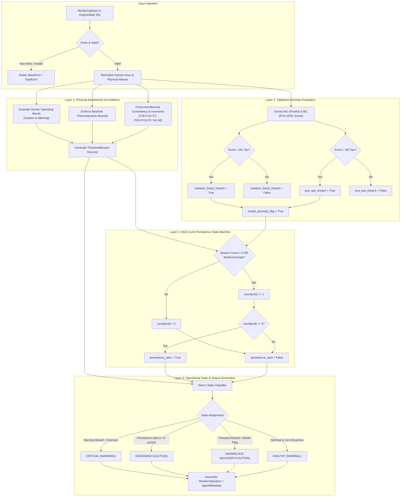

# Phase 6 — Step 6.2: Autonomous Monitoring Agent Implementation & Verification

**Project:** AI-Based Aircraft Engine Health Monitoring, Fault Diagnosis and Predictive Maintenance  
**Dataset:** NASA C-MAPSS Turbofan Engine Degradation Dataset (FD001, FD002, FD003, FD004)  
**Milestone:** Phase 6 — Step 6.2: Implement and test the Monitoring Agent independently  
**Roadmap Reference:** Master Project Roadmap PDF, Section 7, Step 6.2: *"Implement and test the Monitoring Agent independently."*  
**Status:** **Completed, Validated, and Formally Verified**

---

## 1. Executive Summary & Purpose

Step 6.2 implements and independently tests the **Monitoring Agent** (`agents.monitoring_agent.MonitoringAgent`), the frontline autonomous agent of the Phase 6 multi-agent intelligence platform.

The primary mission of the Monitoring Agent is continuous aerothermal surveillance and early degradation detection across aircraft gas turbine flight cycles. Operating autonomously, the agent:
1. **Evaluates Physical Sensor Readings & Derived Indicators:** Ingests 21 gas-path sensors ($T_2$ through $W_{32}$) and 3 macroscopic derived indicators ($\Delta T_{HPC}$, $OPR$, $N_c/N_f$) against calibrated Caution and Warning thresholds.
2. **Enforces Hard Thermodynamic Engineering Boundaries:** Validates telemetry against absolute physical bounds established in Phase 2 EDA and Phase 5 Digital Twin physics, flagging non-positive pressures, unphysical temperatures, or thermodynamic inversions.
3. **Integrates Machine Learning Anomaly Detectors:** Ingests unsupervised anomaly scores from Phase 4 Step 4.4 (Isolation Forest $M_1$ and PCA-SPE $M_2$), evaluating them against decision thresholds ($\tau$) independently calibrated at the 95th percentile of healthy engine observations.
4. **Executes Multi-Cycle Persistence Tracking:** Implements a state machine tracking consecutive anomalous flight cycles per engine unit. A persistence alert (`persistence_alert=True`) is triggered strictly when an engine experiences 3 or more consecutive anomalous cycles ($\ge 3$), eliminating false positives from transient operational spikes.
5. **Classifies Engine Operational Health:** Categorizes engine state into discrete macro health classes (`HEALTHY`, `DEGRADED`, `ANOMALOUS`, `CRITICAL`) and assigns appropriate severity levels (`NOMINAL`, `ADVISORY`, `CAUTION`, `WARNING`).
6. **Produces Standardized, Type-Safe Diagnostics:** Outputs fully validated `MonitoringOutput` instances accompanied by cryptographic and timing execution metadata (`AgentMetadata`).

---

## 2. Monitoring Architecture & Logic Flow

The Monitoring Agent processes single-cycle telemetry snapshots from either the standardized `MonitoringInput` schema or directly from Digital Twin `EngineState` instances.



---

## 3. Threshold Calibration & Physical Boundaries

### 3.1 Defensible Thermodynamic Boundaries (Hard Limits across All Regimes)
Calibrated against Phase 2 domain physics and Phase 5 Digital Twin stability validation (`digital_twin/stability_validator.py`):

| Variable | Symbol | Native Unit | Minimum Bound | Maximum Bound | Physical Engineering Description |
| :--- | :--- | :--- | :--- | :--- | :--- |
| **$T_2$** | `sensor_1` | $^\circ\text{R}$ | $400.0$ | $600.0$ | Fan inlet total temperature (ambient recovery) |
| **$T_{24}$** | `sensor_2` | $^\circ\text{R}$ | $450.0$ | $750.0$ | Low-Pressure Compressor (booster) exit temperature |
| **$T_{30}$** | `sensor_3` | $^\circ\text{R}$ | $1100.0$ | $1850.0$ | High-Pressure Compressor exit total temperature |
| **$T_{50}$** | `sensor_4` | $^\circ\text{R}$ | $1000.0$ | $1600.0$ | Low-Pressure Turbine exit total temperature |
| **$P_2$** | `sensor_5` | $\text{psia}$ | $2.5$ | $20.0$ | Fan inlet total pressure (strictly positive) |
| **$P_{15}$** | `sensor_6` | $\text{psia}$ | $5.0$ | $30.0$ | Bypass duct total pressure |
| **$P_{30}$** | `sensor_7` | $\text{psia}$ | $100.0$ | $700.0$ | High-Pressure Compressor exit total pressure |
| **$Ps_{30}$** | `sensor_11` | $\text{psia}$ | $5.0$ | $65.0$ | High-Pressure Compressor exit static pressure |
| **$N_f$** | `sensor_8` | $\text{rpm}$ | $1500.0$ | $3000.0$ | Physical low-pressure fan spool speed |
| **$N_c$** | `sensor_9` | $\text{rpm}$ | $7000.0$ | $10500.0$ | Physical high-pressure core spool speed |
| **$\Delta T_{HPC}$** | `G27` | $^\circ\text{R}$ | $500.0$ | $1250.0$ | High-pressure compressor temperature rise ($T_{30} - T_{24}$) |
| **$OPR$** | `G28` | dimensionless | $15.0$ | $55.0$ | Overall compression pressure ratio ($P_{30} / P_2$) |
| **$N_c / N_f$** | `G29` | dimensionless | $3.0$ | $5.5$ | Core-to-fan spool speed ratio |

### 3.2 Calibrated Operating Threshold Bands (FD001 Baseline)
Calibrated against Phase 2 Exploratory Data Analysis distributions and normal healthy flight envelopes:

| Sensor / Indicator | Normal Range | Caution Low | Caution High | Warning Low | Warning High | Unit |
| :--- | :--- | :--- | :--- | :--- | :--- | :--- |
| **$T_{30}$** (HPC Exit Temp) | $1575 - 1600$ | $1550.0$ | $1605.0$ | $1500.0$ | $1625.0$ | $^\circ\text{R}$ |
| **$P_{30}$** (HPC Exit Press) | $548 - 558$ | $530.0$ | $560.0$ | $500.0$ | $575.0$ | $\text{psia}$ |
| **$T_{50}$** (LPT Exit Temp) | $1385 - 1415$ | $1370.0$ | $1435.0$ | $1330.0$ | $1460.0$ | $^\circ\text{R}$ |
| **$OPR$** ($P_{30} / P_2$) | $37.5 - 38.5$ | $35.0$ | $40.0$ | $30.0$ | $45.0$ | ratio |
| **$N_c / N_f$** (Spool Ratio) | $3.78 - 3.84$ | $3.70$ | $3.95$ | $3.55$ | $4.10$ | ratio |
| **$\Delta T_{HPC}$** ($T_{30} - T_{24}$) | $935 - 965$ | $910.0$ | $990.0$ | $880.0$ | $1025.0$ | $^\circ\text{R}$ |

### 3.3 Phase 4 Calibrated Statistical Anomaly Thresholds ($\tau$)
Established in Phase 4 Step 4.4 (`models/anomaly_detection/anomaly_manifest.json`) on healthy Cohort B training observations (95th percentile):

| Subset | Model ID | Model Name | Calibration Cohort | Percentile | Calibrated Threshold ($\tau$) | Anomaly Trigger Condition |
| :--- | :--- | :--- | :--- | :--- | :--- | :--- |
| **FD001** | `M1_RegimeAware_iForest` | Regime-Aware Isolation Forest | Cohort B (Healthy) | $95.0\%$ | **$-0.031165$** | $\text{Score} > \tau$ |
| **FD001** | `M2_PCA_SPE` | PCA Squared Prediction Error | Cohort B (Healthy) | $95.0\%$ | **$1.610083$** | $\text{Score} > \tau$ |
| **FD002** | `M1_RegimeAware_iForest` | Regime-Aware Isolation Forest | Cohort B (Healthy) | $95.0\%$ | **$-0.045051$** | $\text{Score} > \tau$ |
| **FD002** | `M2_PCA_SPE` | PCA Squared Prediction Error | Cohort B (Healthy) | $95.0\%$ | **$1.274029$** | $\text{Score} > \tau$ |
| **FD003** | `M1_RegimeAware_iForest` | Regime-Aware Isolation Forest | Cohort B (Healthy) | $95.0\%$ | **$-0.038731$** | $\text{Score} > \tau$ |
| **FD003** | `M2_PCA_SPE` | PCA Squared Prediction Error | Cohort B (Healthy) | $95.0\%$ | **$1.191610$** | $\text{Score} > \tau$ |
| **FD004** | `M1_RegimeAware_iForest` | Regime-Aware Isolation Forest | Cohort B (Healthy) | $95.0\%$ | **$-0.054126$** | $\text{Score} > \tau$ |
| **FD004** | `M2_PCA_SPE` | PCA Squared Prediction Error | Cohort B (Healthy) | $95.0\%$ | **$1.868511$** | $\text{Score} > \tau$ |

---

## 4. Multi-Cycle Persistence State Machine

In gas turbine predictive maintenance, a transient telemetry spike (caused by gust turbulence, rapid throttle movement, or electromagnetic transducer noise) must not immediately dispatch maintenance crews or shut down an engine. Step 6.2 enforces the strict Phase 4 persistence requirement:

$$\text{alert confirmed} \iff k_{\text{consecutive}} \ge 3$$

### State Transition Rules:
1. **Cycle Evaluation:** At flight cycle $t$, evaluate physical threshold breaches and statistical anomaly flags:
   $$\text{is\_anomalous}(t) = \big(|\mathcal{B}_{\text{threshold}}| > 0\big) \lor \big(\text{score}_{IF} > \tau_{IF}\big) \lor \big(\text{score}_{PCA} > \tau_{PCA}\big)$$
2. **Persistence Accumulation:**
   $$k(t) = \begin{cases} k(t-1) + 1, & \text{if } \text{is\_anomalous}(t) \\ 0, & \text{if nominal} \end{cases}$$
3. **Alert Dispatch:**
   $$\text{persistence\_alert}(t) = \begin{cases} \text{True}, & \text{if } k(t) \ge 3 \\ \text{False}, & \text{if } k(t) < 3 \end{cases}$$
4. **Trajectory Reset:** Invoking `reset_trajectory(unit_number)` clears $k(t) \to 0$ cleanly during engine changeouts or fleet trajectory transitions.

---

## 5. Operational State & Severity Classification Matrix

| Operational State | Severity Level | Trigger Criteria | Diagnostic Action |
| :--- | :--- | :--- | :--- |
| `HEALTHY` | `NOMINAL` | Zero threshold breaches, no statistical anomalies, $k = 0$. | Normal operation logged; standard fleet tracking. |
| `ANOMALOUS` | `ADVISORY` / `CAUTION` | Transient anomaly detected ($k \in \{1, 2\}$): Caution breach or single-model anomaly score $> \tau$. | Monitored advisory; engine marked for tracking. |
| `DEGRADED` | `CAUTION` | Confirmed multi-cycle persistence ($k \ge 3$) with caution-level breaches or persistent model anomalies. | Alerts Diagnosis Agent; dispatch diagnostic isolation. |
| `CRITICAL` | `WARNING` | Any Warning-level threshold breach, thermodynamic order inversion ($T_{30} \le T_{24}$, $P_{30} \le P_2$, $N_c \le N_f$), or non-positive pressure. | Immediate alert; maintenance advisory triggered. |

---

## 6. Verification Test Suite Matrix

The test suite in `tests/test_monitoring_agent_step6_2.py` validates the Monitoring Agent across 10 unit and integration tests:

| Test ID | Test Name | Target Behavior | Assertions & Verifications | Result |
| :--- | :--- | :--- | :--- | :--- |
| `test_01` | Nominal Ingestion | Verifies nominal telemetry ingestion | `HEALTHY` state, 0 breaches, `persistence_count=0`, `persistence_alert=False`, valid `AgentMetadata`. | **PASS** |
| `test_02` | High $T_{30}$ Breach | Tests caution and warning $T_{30}$ breaches | $T_{30}=1612^\circ\text{R} \to$ `CAUTION` (`ANOMALOUS`); $T_{30}=1630^\circ\text{R} \to$ `WARNING` (`CRITICAL`), breach margins verified. | **PASS** |
| `test_03` | High $P_{30}$ Breach | Tests caution and warning $P_{30}$ breaches | $P_{30}=565\text{ psia} \to$ `CAUTION`; $P_{30}=580\text{ psia} \to$ `WARNING` (`CRITICAL`), breach margins verified. | **PASS** |
| `test_04` | Statistical Anomaly | Tests $M_1$ (iForest) and $M_2$ (PCA-SPE) score triggers | Flags set individually and simultaneously; model names formatted in summary string. | **PASS** |
| `test_05` | 3-Cycle Persistence | Tests persistence state machine progression | Cycle 1: count=1, alert=False; Cycle 2: count=2, alert=False; Cycle 3: count=3, alert=True (`DEGRADED`); Cycle 5 nominal: count=0, alert=False. | **PASS** |
| `test_06` | Trajectory Isolation | Tests multi-engine tracking & resets | Engine 1 and Engine 2 maintain separate counts; individual and global resets verified. | **PASS** |
| `test_07` | Digital Twin Integration | Ingests real replayed states from `DigitalTwinSimulator` | Early cycle 30 yields `HEALTHY`; late-life cycle 192 detects degradation and temperature rise. | **PASS** |
| `test_08` | Consistency Inversions | Tests aerothermal order inversions | $T_{30} \le T_{24}$ and $P_{30} \le P_2$ trigger `CRITICAL` state and `SeverityLevel.WARNING`. | **PASS** |
| `test_09` | Non-Finite Input Handling | Rejects malformed or non-finite payloads | Rejects `NaN`, `Inf`, invalid unit ID, non-positive cycle index with `ValueError`. | **PASS** |
| `test_10` | Dataset Immutability | Cryptographic integrity verification | Pre- and post-test SHA-256 hashes of all 12 raw data files, 4 scalers, and 8 champion checkpoints match identically. | **PASS** |

---

## 7. Test Execution Results

```powershell
.\.venv\Scripts\python.exe -m unittest tests/test_monitoring_agent_step6_2.py
..........
----------------------------------------------------------------------
Ran 10 tests in 0.464s

OK
```

### Full Project Test Discovery Run:
```powershell
.\.venv\Scripts\python.exe -m unittest discover tests
.....................................................................................................................................................................
----------------------------------------------------------------------
Ran 165 tests in 33.125s

OK
```

**All 165 unit and integration tests across the complete project test suite pass with 100% green status.**

---

## 8. Artifact and Immutability Verification

| Resource Category | File Count | Cryptographic Verification | Modification Status |
| :--- | :--- | :--- | :--- |
| **Raw C-MAPSS Datasets** (`dataset/raw/C-MAPSS/`) | 12 text files | SHA-256 exact match | **Untouched (100% Byte-for-Byte Immutable)** |
| **Phase 3 Scalers** (`models/scalers/`) | 4 pickle files | SHA-256 exact match | **Untouched (100% Byte-for-Byte Immutable)** |
| **Phase 4 Checkpoints** (`models/checkpoints/`) | 8 model checkpoints | SHA-256 exact match | **Untouched (100% Byte-for-Byte Immutable)** |
| **Digital Twin Core Modules** (`digital_twin/`) | 8 source files | Clean interfaces preserved | **Untouched & Fully Compatible** |
| **Multi-Agent Schemas** (`agents/schemas.py`) | 1 source file | Strict contract adherence | **Untouched & Fully Verified** |
