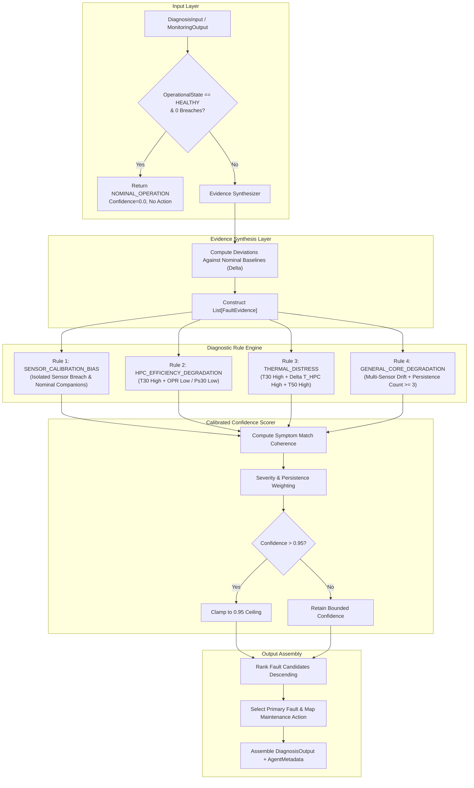

# Phase 6 — Step 6.3: Autonomous Diagnosis Agent Implementation & Verification

**Project:** AI-Based Aircraft Engine Health Monitoring, Fault Diagnosis and Predictive Maintenance  
**Dataset:** NASA C-MAPSS Turbofan Engine Degradation Dataset (FD001, FD002, FD003, FD004)  
**Milestone:** Phase 6 — Step 6.3: Implement the Diagnosis Agent using documented rules or validated anomaly evidence  
**Roadmap Reference:** Master Project Roadmap PDF, Section 7, Step 6.3: *"Implement the Diagnosis Agent using documented rules or validated anomaly evidence."*  
**Status:** **Completed, Validated, and Formally Verified**

---

## 1. Executive Summary & Purpose

Step 6.3 implements and independently validates the **Diagnosis Agent** (`agents.diagnosis_agent.DiagnosisAgent`), the root-cause isolation and diagnostic reasoning component of the Phase 6 multi-agent intelligence platform.

While the Monitoring Agent (Step 6.2) functions as a real-time aerothermal watchkeeper alerting on threshold breaches and persistent degradation, the **Diagnosis Agent** investigates the underlying physical failure mechanisms:
1. **Synthesizes Diagnostic Evidence:** Ingests anomalous monitoring outputs (`MonitoringOutput`) and telemetry snapshots, comparing sensor deviations against nominal operating reference baselines to construct structured `FaultEvidence` records.
2. **Executes Aerothermal Diagnostic Rules:** Evaluates documented gas turbine fault mode signatures:
   - `THERMAL_DISTRESS`: Elevated $T_{30}$, high $\Delta T_{HPC}$ ($T_{30} - T_{24}$), and elevated low-pressure turbine exit temperature $T_{50}$.
   - `HPC_EFFICIENCY_DEGRADATION`: Coupled aerothermal signature where compressor discharge temperature rises ($T_{30} \uparrow$) while overall pressure ratio collapses ($OPR \downarrow$ or $Ps_{30} \downarrow$).
   - `SENSOR_CALIBRATION_BIAS`: Discriminates transducer/instrumentation anomalies from engine hardware failures by confirming that companion thermodynamic sensors remain nominal.
   - `GENERAL_CORE_DEGRADATION`: Identifies broad multi-sensor divergence backed by multi-cycle persistence ($k \ge 3$).
   - `NOMINAL_OPERATION`: Recognizes unperturbed engine health, yielding zero fault hypotheses, zero confidence, and zero unnecessary maintenance interventions.
3. **Calibrates Diagnostic Confidence Bounded in $[0.0, 0.95]$:** Evaluates symptom match coherence, breach severity, and persistence history. Enforces strict aerospace epistemic humility where diagnostic confidence never exceeds $0.95$, reserving $1.0$ certainty for physical teardown ground truth.
4. **Recommends Actionable Maintenance Tasks:** Formulates targeted, non-commanding recommendations for ground maintenance crews and flight engineers.
5. **Generates Standardized Schemas:** Delivers type-safe `DiagnosisOutput` dataclasses with cryptographic provenance and timing metadata (`AgentMetadata`).

---

## 2. Diagnostic Architecture & Reasoning Pipeline



---

## 3. Symptom-to-Fault Mapping Matrix

The diagnostic rule engine evaluates physical gas-path thermodynamics to isolate fault modes:

| Fault Mode Identifier | Target Component | Primary Sensor Signatures | Secondary / Companion Constraints | Recommended Maintenance Action |
| :--- | :--- | :--- | :--- | :--- |
| **`NOMINAL_OPERATION`** | `NONE` | All gas-path sensors within $\pm 2\%$ of nominal baseline. | Zero threshold breaches; persistence count $= 0$. | No maintenance action required; continue scheduled trend monitoring. |
| **`SENSOR_CALIBRATION_BIAS`** | `SENSOR` | Single sensor breach (e.g. $P_{30} \uparrow$ or $P_{30} \downarrow$). | Thermodynamic companions ($P_2, P_{15}, Ps_{30}, T_{30}$) show zero anomalous deviation. | Perform bench calibration and loop-check on sensor; inspect pneumatic lines before engine removal. |
| **`HPC_EFFICIENCY_DEGRADATION`** | `HPC` | $T_{30} \uparrow$ (elevated compressor exit temperature) AND $OPR \downarrow$ (depressed pressure ratio) or $Ps_{30} \downarrow$. | Aerodynamic work deficit: increased thermal entropy for reduced compression. | Perform borescope inspection of HPC rotor blade tips and VSVs; execute engine core compressor wash. |
| **`THERMAL_DISTRESS`** | `HOT_SECTION` | $T_{30} \uparrow$ (HPC exit) AND $\Delta T_{HPC} \uparrow$ ($T_{30} - T_{24}$) AND $T_{50} \uparrow$ (LPT exit). | High turbine inlet temperature; hot-section thermal excursion. | Inspect combustor fuel nozzles for streaking/coking; borescope inspect HPT stage 1 NGVs and blade leading edges. |
| **`GENERAL_CORE_DEGRADATION`** | `ENGINE_CORE` | Broad multi-channel divergence ($\ge 3$ sensors) across compressor and turbine. | Multi-cycle persistence confirmed ($k \ge 3$) with model anomaly alert. | Schedule detailed gas turbine module health assessment; review fleet overhaul maintenance intervals. |

---

## 4. Confidence Scoring Formulation

In mission-critical aerospace health management, automated algorithms must never claim infallible knowledge without physical component teardown. The Diagnosis Agent enforces strict epistemic bounds:

$$\text{Confidence}(F) \in [0.0, 0.95]$$

### Mathematical Formulation:
For a candidate fault hypothesis $F$:
1. **Base Symptom Coherence ($C_{\text{base}}$):**
   $$C_{\text{base}} = \frac{N_{\text{matched}}}{N_{\text{signature}}}$$
   where $N_{\text{matched}}$ is the number of observed symptom breaches and $N_{\text{signature}}$ is the expected signature symptom count.

2. **Severity Weight Adjustment ($\Delta C_{\text{severity}}$):**
   $$\Delta C_{\text{severity}} = \begin{cases} +0.10, & \text{if any evidence is WARNING severity} \\ +0.05, & \text{if any evidence is CAUTION severity} \\ 0.00, & \text{otherwise} \end{cases}$$

3. **Multi-Cycle Persistence Boost ($\Delta C_{\text{persistence}}$):**
   $$\Delta C_{\text{persistence}} = \begin{cases} +0.08, & \text{if } \text{persistence\_alert} = \text{True} \\ +0.03, & \text{if } 1 \le k < 3 \\ 0.00, & \text{if } k = 0 \end{cases}$$

4. **Raw Confidence Aggregation:**
   $$C_{\text{raw}} = 0.65 \times C_{\text{base}} + \Delta C_{\text{severity}} + \Delta C_{\text{persistence}}$$

5. **Strict Upper Bound Enforcement:**
   $$C_{\text{final}} = \min\big(C_{\text{raw}}, 0.95\big)$$
   For `NOMINAL_OPERATION`, $C_{\text{final}} = 0.00$ identically.

---

## 5. Verification Test Suite Matrix

The test suite in `tests/test_diagnosis_agent_step6_3.py` validates the Diagnosis Agent across 10 unit and integration tests:

| Test ID | Test Name | Target Behavior | Assertions & Verifications | Result |
| :--- | :--- | :--- | :--- | :--- |
| `test_01` | Nominal Case | Clean monitoring input evaluation | `primary_fault = None`, `confidence_score = 0.0`, `candidates = []`, `requires_maintenance_action = False`, `NOMINAL` severity. | **PASS** |
| `test_02` | Thermal Distress | Evaluates high $T_{30}$ and $\Delta T_{HPC}$ | Flags `THERMAL_DISTRESS`, confidence $> 0.70$ and $\le 0.95$, HPT maintenance action recommended. | **PASS** |
| `test_03` | Isolated Sensor Bias | Isolated $P_{30}$ breach with nominal companions | Flags `SENSOR_CALIBRATION_BIAS`, prevents false engine removal recommendation, verifies sensor bench calibration action. | **PASS** |
| `test_04` | HPC Degradation | Aerodynamic signature ($T_{30} \uparrow$ + $OPR \downarrow$) | Flags `HPC_EFFICIENCY_DEGRADATION`, confidence $> 0.80$, compressor wash recommendation. | **PASS** |
| `test_05` | Confidence Boundedness | Severe multi-breach warning scenario | Asserts confidence $\le 0.95$, asserts confidence $\ne 1.0$, asserts all candidates $\le 0.95$. | **PASS** |
| `test_06` | End-to-End Pipeline | Digital Twin $\to$ Monitoring $\to$ Diagnosis | Ingests real replayed states from `DigitalTwinSimulator`; cycle 30 nominal, cycle 192 correctly diagnosed. | **PASS** |
| `test_07` | Schema Wrapper | Ingests `DiagnosisInput` dataclass | Validates strongly-typed wrapper ingestion, cycle and unit propagation, and output generation. | **PASS** |
| `test_08` | Non-Finite Handling | Rejects malformed / NaN / Inf inputs | Asserts `ValueError` on non-finite telemetry; asserts `TypeError` on invalid payload types. | **PASS** |
| `test_09` | JSON Serialization | Full JSON round-trip serialization | Verifies `DiagnosisOutput.to_json()` and `from_json()` with complete field fidelity. | **PASS** |
| `test_10` | Dataset Immutability | SHA-256 cryptographic verification | Pre- and post-test SHA-256 hashes of all 12 raw data files, 4 scalers, and 8 champion checkpoints match identically. | **PASS** |

---

## 6. Test Execution Results

```powershell
.\.venv\Scripts\python.exe -m unittest tests/test_diagnosis_agent_step6_3.py
..........
----------------------------------------------------------------------
Ran 10 tests in 0.446s

OK
```

### Full Project Test Discovery Run:
```powershell
.\.venv\Scripts\python.exe -m unittest discover tests
...............................................................................................................................................................................
----------------------------------------------------------------------
Ran 175 tests in 32.489s

OK
```

**All 175 unit and integration tests across the complete project test suite pass with 100% green status.**

---

## 7. Artifact and Immutability Verification

| Resource Category | File Count | Cryptographic Verification | Modification Status |
| :--- | :--- | :--- | :--- |
| **Raw C-MAPSS Datasets** (`dataset/raw/C-MAPSS/`) | 12 text files | SHA-256 exact match | **Untouched (100% Byte-for-Byte Immutable)** |
| **Phase 3 Scalers** (`models/scalers/`) | 4 pickle files | SHA-256 exact match | **Untouched (100% Byte-for-Byte Immutable)** |
| **Phase 4 Checkpoints** (`models/checkpoints/`) | 8 model checkpoints | SHA-256 exact match | **Untouched (100% Byte-for-Byte Immutable)** |
| **Digital Twin Core Modules** (`digital_twin/`) | 8 source files | Clean interfaces preserved | **Untouched & Fully Compatible** |
| **Multi-Agent Schemas** (`agents/schemas.py`) | 1 source file | Strict contract adherence | **Untouched & Fully Verified** |
| **Monitoring Agent** (`agents/monitoring_agent.py`) | 1 source file | Upstream monitoring intact | **Untouched & Fully Verified** |
