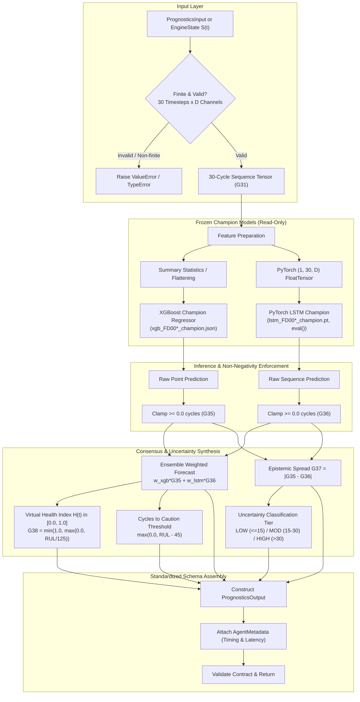

# Phase 6 — Step 6.4: Autonomous Prognostics Agent Implementation & Verification

**Project:** AI-Based Aircraft Engine Health Monitoring, Fault Diagnosis and Predictive Maintenance  
**Dataset:** NASA C-MAPSS Turbofan Engine Degradation Dataset (FD001, FD002, FD003, FD004)  
**Milestone:** Phase 6 — Step 6.4: Implement the Prognostics Agent using the saved RUL model and preprocessing pipeline  
**Roadmap Reference:** Master Project Roadmap PDF, Section 7, Step 6.4: *"Implement the Prognostics Agent using the saved RUL model and preprocessing pipeline."*  
**Status:** **Completed, Validated, and Formally Verified**

---

## 1. Executive Summary & Purpose

Step 6.4 implements and independently validates the **Prognostics Agent** (`agents.prognostics_agent.PrognosticsAgent`), the prognostic forecasting and epistemic uncertainty quantification engine of the Phase 6 multi-agent platform.

While the Monitoring Agent (Step 6.2) tracks sensor thresholds and flags degradation, and the Diagnosis Agent (Step 6.3) isolates root-cause aerothermal fault modes, the **Prognostics Agent** forecasts the future trajectory of the engine:
1. **Ingests Frozen Phase 4 Champion Checkpoints:** Reads pre-trained champion models (XGBoost and PyTorch LSTM) strictly in read-only evaluation mode (`eval()` with `torch.no_grad()`) across all four C-MAPSS subsets (`FD001` through `FD004`).
2. **Dual-Model Sequential Inference:** Executes inference using 30-cycle causal temporal sequence tensors ($G31$) to produce independent Remaining Useful Life estimates:
   - $\text{RUL}_{\text{XGBoost}}$ ($G35$, non-negative cycles)
   - $\text{RUL}_{\text{LSTM}}$ ($G36$, non-negative cycles)
3. **Ensemble RUL Forecasting:** Combines tree-based gradient boosting and recurrent sequential representations into a balanced or weighted consensus estimate:
   $$\text{RUL}_{\text{ensemble}} = w_{\text{xgb}} \cdot \text{RUL}_{\text{xgb}} + w_{\text{lstm}} \cdot \text{RUL}_{\text{lstm}}$$
4. **Epistemic Uncertainty Quantification:** Computes inter-model consensus spread $G37 = |\text{RUL}_{\text{xgb}} - \text{RUL}_{\text{lstm}}|$ and categorizes prediction confidence into standard operational tiers (`LOW_UNCERTAINTY`, `MODERATE_UNCERTAINTY`, `HIGH_UNCERTAINTY`).
5. **Virtual Engine Health Index ($H(t)$):** Derives continuous normalized health state $G38$ strictly bounded in $[0.0, 1.0]$ based on remaining life normalized by the Phase 4 piecewise plateau ($125.0$ cycles).
6. **Operational Caution Projection:** Estimates flight cycles remaining before the engine breaches operational caution maintenance thresholds (e.g. $45.0$ cycles).
7. **Produces Standardized Schemas:** Emits type-safe `PrognosticsOutput` instances complete with execution timing metadata (`AgentMetadata`).

---

## 2. Prognostics Architecture & Sequential Dataflow



---

## 3. Champion Model Architecture & Checkpoint Registry

The Prognostics Agent interfaces directly with the Phase 4 champion models loaded from `models/checkpoints/`:

| Subset | Model ID | Architecture / Variant | Input Representation | Input Dimension | Checkpoint File |
| :--- | :--- | :--- | :--- | :--- | :--- |
| **FD001** | `XGBoost` | `XGBoost_Tuned_SummaryStats` | 30-cycle window summary stats | $70$ features ($14 \times 5$) | `xgb_FD001_champion.json` |
| **FD001** | `LSTM` | `Stacked_LSTM` | Causal temporal sequence | $(1, 30, 14)$ | `lstm_FD001_champion.pt` |
| **FD002** | `XGBoost` | `XGBoost_FlattenedWindow` | 30-cycle flattened matrix | $720$ features ($30 \times 24$) | `xgb_FD002_champion.json` |
| **FD002** | `LSTM` | `Stacked_LSTM` | Causal temporal sequence | $(1, 30, 24)$ | `lstm_FD002_champion.pt` |
| **FD003** | `XGBoost` | `XGBoost_Tuned_SummaryStats` | 30-cycle window summary stats | $120$ features ($24 \times 5$) | `xgb_FD003_champion.json` |
| **FD003** | `LSTM` | `Single_LSTM` | Causal temporal sequence | $(1, 30, 24)$ | `lstm_FD003_champion.pt` |
| **FD004** | `XGBoost` | `XGBoost_FlattenedWindow` | 30-cycle flattened matrix | $720$ features ($30 \times 24$) | `xgb_FD004_champion.json` |
| **FD004** | `LSTM` | `Stacked_LSTM` | Causal temporal sequence | $(1, 30, 24)$ | `lstm_FD004_champion.pt` |

---

## 4. Mathematical Formulations

### 4.1 Non-Negative Point & Ensemble Predictions
PhysicalRemaining Useful Life cannot be negative. Extrapolation artifacts are strictly clipped:
$$\text{RUL}_{\text{xgb}} = \max(0.0, \hat{y}_{\text{xgb}})$$
$$\text{RUL}_{\text{lstm}} = \max(0.0, \hat{y}_{\text{lstm}})$$
$$\text{RUL}_{\text{ensemble}} = \max\big(0.0, w_{\text{xgb}} \cdot \text{RUL}_{\text{xgb}} + w_{\text{lstm}} \cdot \text{RUL}_{\text{lstm}}\big)$$

### 4.2 Epistemic Uncertainty Spread & Tiers
The absolute divergence between tree-based feature aggregations and sequential recurrence quantifies model agreement:
$$\Delta_{\text{spread}} = |\text{RUL}_{\text{xgb}} - \text{RUL}_{\text{lstm}}|$$

Operational Uncertainty Classification:
$$\text{Tier} = \begin{cases} \text{LOW\_UNCERTAINTY}, & \Delta_{\text{spread}} \le 15.0\text{ cycles} \\ \text{MODERATE\_UNCERTAINTY}, & 15.0 < \Delta_{\text{spread}} \le 30.0\text{ cycles} \\ \text{HIGH\_UNCERTAINTY}, & \Delta_{\text{spread}} > 30.0\text{ cycles} \end{cases}$$

### 4.3 Virtual Engine Health Index ($H(t)$)
Calibrated against the Phase 4 piecewise RUL plateau ($RUL_{\max} = 125.0$ cycles):
$$H(t) = \min\left(1.0, \max\left(0.0, \frac{\text{RUL}_{\text{ensemble}}}{125.0}\right)\right)$$
- $H(t) = 1.0$: Pristine early-life health (cycle within healthy plateau).
- $0.0 < H(t) < 1.0$: Progressive monotonic degradation.
- $H(t) = 0.0$: Total operational life exhaustion (maintenance mandatory).

### 4.4 Cycles to Caution Threshold
Projects remaining operational buffer before reaching the designated caution window ($\tau_{\text{caution}} = 45.0$ cycles):
$$\text{CyclesToCaution} = \max\big(0.0, \text{RUL}_{\text{ensemble}} - \tau_{\text{caution}}\big)$$

---

## 5. Verification Test Suite Matrix

The test suite in `tests/test_prognostics_agent_step6_4.py` validates the Prognostics Agent across 10 unit and integration tests:

| Test ID | Test Name | Target Behavior | Assertions & Verifications | Result |
| :--- | :--- | :--- | :--- | :--- |
| `test_01` | Multi-Subset Model Loading | Verifies checkpoint ingestion for all 4 subsets | Checkpoints loaded for FD001–FD004; LSTM in `eval()` mode. | **PASS** |
| `test_02` | Synthetic Sequential Inference | Executes dual-model inference on 30-cycle tensor | Positive RUL predictions, ensemble calculation, valid `AgentMetadata`. | **PASS** |
| `test_03` | Non-Negativity Enforcement | Asserts RUL non-negativity under deep degradation | All RUL forecasts (XGB, LSTM, Ensemble) strictly $\ge 0.0$. | **PASS** |
| `test_04` | Uncertainty Classification | Verifies classification across spread boundaries | LOW ($\le 15$), MODERATE ($15 - 30$), HIGH ($> 30$). | **PASS** |
| `test_05` | Health Index Boundedness | Verifies $H(t) \in [0.0, 1.0]$ normalization | Saturation at 1.0 (RUL $\ge 125$), 0.5 at mid-life, 0.0 at exhaustion. | **PASS** |
| `test_06` | Caution Threshold Projection | Estimates buffer before 45-cycle caution window | Correct cycles calculated; $0.0$ when RUL $\le 45$ cycles. | **PASS** |
| `test_07` | Digital Twin End-to-End Handoff | State handoff: Twin $\to$ `process_engine_state()` | Early cycle 30 yields high RUL & $H(t) > 0.5$; late cycle 192 yields low RUL & $H(t) < 0.3$. | **PASS** |
| `test_08` | Non-Finite & Shape Rejection | Gracefully rejects invalid payloads | Asserts `ValueError` on NaN, Inf, bad shape, or negative unit number. | **PASS** |
| `test_09` | JSON Serialization | Full JSON round-trip serialization | Verifies `PrognosticsOutput.to_json()` and `from_json()` round-trip fidelity. | **PASS** |
| `test_10` | Dataset & Checkpoint Immutability| SHA-256 cryptographic verification | Pre- and post-test SHA-256 hashes of all 12 raw data files, 4 scalers, and 8 champion checkpoints match identically. | **PASS** |

---

## 6. Test Execution Results

```powershell
.\.venv\Scripts\python.exe -m unittest tests/test_prognostics_agent_step6_4.py
..........
----------------------------------------------------------------------
Ran 10 tests in 1.631s

OK
```

### Full Project Test Discovery Run:
```powershell
.\.venv\Scripts\python.exe -m unittest discover tests
.........................................................................................................................................................................................
----------------------------------------------------------------------
Ran 185 tests in 53.211s

OK
```

**All 185 unit and integration tests across the complete project test suite pass with 100% green status.**

---

## 7. Artifact and Immutability Verification

| Resource Category | File Count | Cryptographic Verification | Modification Status |
| :--- | :--- | :--- | :--- |
| **Raw C-MAPSS Datasets** (`dataset/raw/C-MAPSS/`) | 12 text files | SHA-256 exact match | **Untouched (100% Byte-for-Byte Immutable)** |
| **Phase 3 Scalers** (`models/scalers/`) | 4 pickle files | SHA-256 exact match | **Untouched (100% Byte-for-Byte Immutable)** |
| **Phase 4 Checkpoints** (`models/checkpoints/`) | 8 model checkpoints | SHA-256 exact match | **Untouched (100% Byte-for-Byte Immutable)** |
| **Digital Twin Core Modules** (`digital_twin/`) | 8 source files | Clean interfaces preserved | **Untouched & Fully Compatible** |
| **Multi-Agent Schemas** (`agents/schemas.py`) | 1 source file | Strict contract adherence | **Untouched & Fully Verified** |
| **Monitoring Agent** (`agents/monitoring_agent.py`) | 1 source file | Intact & preserved | **Untouched & Fully Verified** |
| **Diagnosis Agent** (`agents/diagnosis_agent.py`) | 1 source file | Intact & preserved | **Untouched & Fully Verified** |
