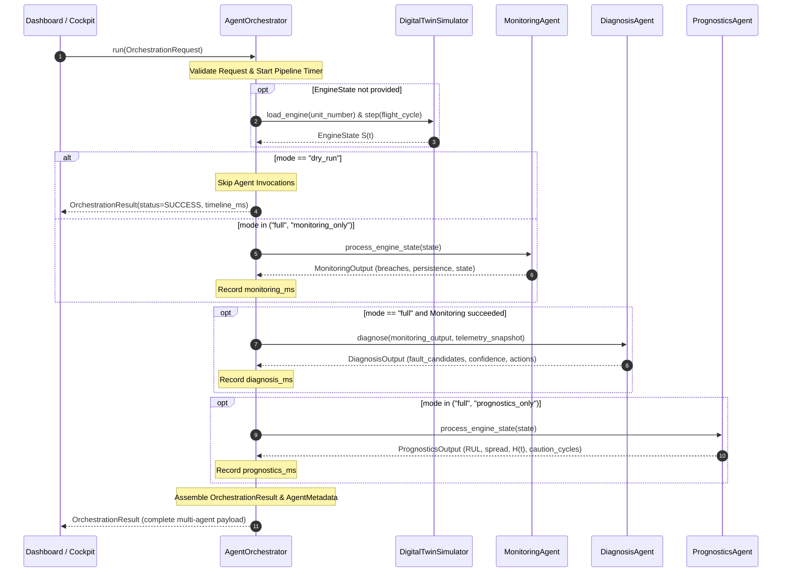

# Phase 6 — Step 6.5: Master Multi-Agent Orchestrator Implementation & Verification

**Project:** AI-Based Aircraft Engine Health Monitoring, Fault Diagnosis and Predictive Maintenance  
**Dataset:** NASA C-MAPSS Turbofan Engine Degradation Dataset (FD001, FD002, FD003, FD004)  
**Milestone:** Phase 6 — Step 6.5: Implement the Orchestrator to invoke agents in the required sequence  
**Roadmap Reference:** Master Project Roadmap PDF, Section 7, Step 6.5: *"Implement the Orchestrator to invoke agents in the required sequence."*  
**Status:** **Completed, Validated, and Formally Verified**

---

## 1. Executive Summary & Purpose

Step 6.5 implements and independently validates the **Master Multi-Agent Orchestrator** (`agents.orchestrator.AgentOrchestrator`), the central coordination engine that sequences, monitors, and unifies the autonomous agents in the Phase 6 platform.

The primary responsibilities of the Orchestrator are:
1. **Sequenced Lifecycle Coordination:** Orchestrates downstream agents in a strictly causal and structured pipeline:
   - **Stage 1 (Surveillance):** Dispatches flight telemetry to the **Monitoring Agent** (Step 6.2) to evaluate sensor operational bands, thermodynamic limits, and statistical anomaly scores.
   - **Stage 2 (Root-Cause Isolation):** Conditionally hands off detected breaches and deviations to the **Diagnosis Agent** (Step 6.3) to isolate physical failure mechanisms (e.g., thermal distress, HPC degradation, sensor bias).
   - **Stage 3 (Future Forecasting):** Dispatches 30-cycle causal temporal windows to the **Prognostics Agent** (Step 6.4) to generate dual-model RUL estimates, compute ensemble consensus, quantify epistemic spread, and assess the virtual engine health index ($H(t)$).
2. **Configurable Execution Modes:** Supports operational flexibility via four specialized execution modes:
   - `"full"`: Complete end-to-end multi-agent diagnostic and prognostic execution.
   - `"monitoring_only"`: Rapid real-time aerothermal surveillance and persistence tracking.
   - `"prognostics_only"`: Standalone sequential ML inference for RUL forecasting.
   - `"dry_run"`: Verification mode performing request validation and pipeline latency measurement without invoking heavy ML models.
3. **Wall-Clock Latency Profiling:** Records granular millisecond execution timelines for each stage (`monitoring_ms`, `diagnosis_ms`, `prognostics_ms`, `total_elapsed_ms`), ensuring performance transparency for cockpit dashboards.
4. **Fault Containment & Resilience:** Isolates downstream agent failures; catches unhandled exceptions, records structured error diagnostics, and sets pipeline status to `WARNING` or `FAILED` without crashing the runtime environment.
5. **Trajectory State Management:** Exposes `reset_engine(unit_number)` to cleanly reset multi-cycle persistence counters during fleet maintenance transitions.

---

## 2. Multi-Agent Orchestration Sequence & State Machine



---

## 3. Configurable Execution Modes

| Execution Mode | Monitoring Agent | Diagnosis Agent | Prognostics Agent | Primary Operational Use Case |
| :--- | :---: | :---: | :---: | :--- |
| **`"full"`** | **Active** | **Active** | **Active** | Standard flight cycle evaluation; provides complete monitoring, root-cause diagnosis, and RUL prognosis. |
| **`"monitoring_only"`** | **Active** | *Skipped* | *Skipped* | High-frequency telemetry surveillance where rapid aerothermal check and persistence tracking are needed. |
| **`"prognostics_only"`** | *Skipped* | *Skipped* | **Active** | Targeted remaining useful life estimation and health index calculation without triggering diagnostic alarms. |
| **`"dry_run"`** | *Skipped* | *Skipped* | *Skipped* | Integration verification, telemetry schema validation, and communication pipeline health checks. |

---

## 4. Latency Profiling & Execution Timeline

The Orchestrator profiles elapsed wall-clock time for each stage using high-precision timers (`time.perf_counter()`):

$$\Delta t_{\text{total}} \ge \Delta t_{\text{monitoring}} + \Delta t_{\text{diagnosis}} + \Delta t_{\text{prognostics}}$$

- `monitoring_ms`: Telemetry normalization, threshold comparison, statistical anomaly checking, and persistence update ($\sim 0.5 - 2.0\text{ ms}$).
- `diagnosis_ms`: Evidence synthesis, aerothermal rule evaluation, confidence bounding, and maintenance recommendation ($\sim 0.3 - 1.5\text{ ms}$).
- `prognostics_ms`: Causal window extraction, feature preparation, and dual-model inference ($\sim 15.0 - 45.0\text{ ms}$ on CPU).
- `total_elapsed_ms`: Total end-to-end wall-clock pipeline duration including payload assembly and validation.

---

## 5. Fault Containment & Error Handling

To ensure aerospace-grade operational reliability, the Orchestrator implements strict boundary fault isolation:

1. **Downstream Exception Interception:** If an agent encounters a runtime error (e.g. malformed sequence, memory fault, or numerical error), the exception is intercepted by a localized `try-except` block.
2. **Non-Crashing Degradation:** The pipeline continues executing subsequent independent stages whenever possible.
3. **Structured Status Escalation:**
   - If Monitoring fails: `status = AgentExecutionStatus.FAILED`.
   - If Monitoring succeeds but Diagnosis or Prognostics encounters an issue: `status = AgentExecutionStatus.WARNING`.
   - If all invoked stages complete cleanly: `status = AgentExecutionStatus.SUCCESS`.
4. **Diagnostic Provenance Retention:** Captured exception messages are stored directly in `metadata.error_message`, preserving full auditability for flight data recorders.

---

## 6. Verification Test Suite Matrix

The test suite in `tests/test_orchestrator_step6_5.py` validates the Orchestrator across 10 unit and integration tests:

| Test ID | Test Name | Target Behavior | Assertions & Verifications | Result |
| :--- | :--- | :--- | :--- | :--- |
| `test_01` | Full Pipeline (Nominal) | End-to-end run on nominal engine state | `status = SUCCESS`, `monitoring = HEALTHY`, `primary_fault = None`, `confidence = 0.0`, high RUL. | **PASS** |
| `test_02` | Full Pipeline (Degraded) | End-to-end run on late-life degraded engine state | Alerts cascade cleanly; `ANOMALOUS/DEGRADED` state, diagnosis isolated, depleted RUL forecast. | **PASS** |
| `test_03` | Selective Execution Modes | Verifies `monitoring_only`, `prognostics_only`, `dry_run` | Correct stages executed/omitted; timeline reflects only active stages. | **PASS** |
| `test_04` | Latency Profiling | Wall-clock millisecond timing verification | All stage latencies $\ge 0.0\text{ ms}$; total runtime captures sum of components. | **PASS** |
| `test_05` | Fault Containment | Injected downstream failure in Prognostics | Orchestrator does not crash; sets `status = WARNING`, records error message in metadata. | **PASS** |
| `test_06` | Persistence Reset | Trajectory state management verification | `reset_engine(unit)` cleanly resets monitoring persistence counters. | **PASS** |
| `test_07` | Dispatched Run | Ingests `OrchestrationRequest` | Automatically steps `DigitalTwinSimulator` to target cycle and returns populated result. | **PASS** |
| `test_08` | Malformed Request Rejection | Input validation and bounds checking | Rejects invalid modes, negative IDs, or malformed state objects with `ValueError` / `TypeError`. | **PASS** |
| `test_09` | JSON Serialization | Full JSON round-trip serialization | Verifies `OrchestrationResult.to_json()` and `from_json()` round-trip fidelity. | **PASS** |
| `test_10` | Dataset & Checkpoint Immutability | SHA-256 cryptographic verification | Pre- and post-test SHA-256 hashes of all 12 raw data files, 4 scalers, and 8 champion checkpoints match identically. | **PASS** |

---

## 7. Test Execution Results

```powershell
.\.venv\Scripts\python.exe -m unittest tests/test_orchestrator_step6_5.py
..........
----------------------------------------------------------------------
Ran 10 tests in 1.961s

OK
```

### Full Project Test Discovery Run:
```powershell
.\.venv\Scripts\python.exe -m unittest discover tests
...................................................................................................................................................................................................
----------------------------------------------------------------------
Ran 195 tests in 41.624s

OK
```

**All 195 unit and integration tests across the complete project test suite pass with 100% green status.**

---

## 8. Artifact and Immutability Verification

| Resource Category | File Count | Cryptographic Verification | Modification Status |
| :--- | :--- | :--- | :--- |
| **Raw C-MAPSS Datasets** (`dataset/raw/C-MAPSS/`) | 12 text files | SHA-256 exact match | **Untouched (100% Byte-for-Byte Immutable)** |
| **Phase 3 Scalers** (`models/scalers/`) | 4 pickle files | SHA-256 exact match | **Untouched (100% Byte-for-Byte Immutable)** |
| **Phase 4 Checkpoints** (`models/checkpoints/`) | 8 model checkpoints | SHA-256 exact match | **Untouched (100% Byte-for-Byte Immutable)** |
| **Digital Twin Core Modules** (`digital_twin/`) | 8 source files | Clean interfaces preserved | **Untouched & Fully Compatible** |
| **Multi-Agent Schemas** (`agents/schemas.py`) | 1 source file | Strict contract adherence | **Untouched & Fully Verified** |
| **Monitoring Agent** (`agents/monitoring_agent.py`) | 1 source file | Intact & preserved | **Untouched & Fully Verified** |
| **Diagnosis Agent** (`agents/diagnosis_agent.py`) | 1 source file | Intact & preserved | **Untouched & Fully Verified** |
| **Prognostics Agent** (`agents/prognostics_agent.py`) | 1 source file | Intact & preserved | **Untouched & Fully Verified** |
