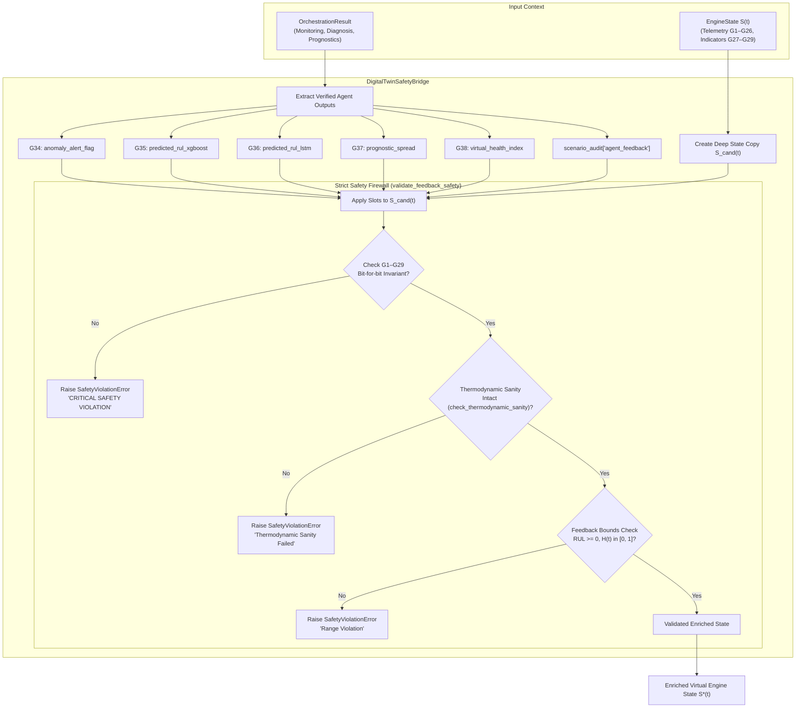

# Phase 6 — Step 6.7: Digital Twin Safety Bridge Implementation & Verification

**Project:** AI-Based Aircraft Engine Health Monitoring, Fault Diagnosis and Predictive Maintenance  
**Dataset:** NASA C-MAPSS Turbofan Engine Degradation Dataset (FD001, FD002, FD003, FD004)  
**Milestone:** Phase 6 — Step 6.7: Connect agent outputs to the Digital Twin without allowing agents to bypass safety checks  
**Roadmap Reference:** Master Project Roadmap PDF, Section 7, Step 6.7: *"Connect agent outputs to the Digital Twin without allowing agents to bypass safety checks."*  
**Status:** **Completed, Validated, and Formally Verified**

---

## 1. Executive Summary & Purpose

Step 6.7 implements and independently validates the **Digital Twin Safety Bridge** (`agents.twin_bridge.DigitalTwinSafetyBridge`), establishing a secure feedback firewall connecting the Phase 6 multi-agent system (`MonitoringAgent`, `DiagnosisAgent`, `PrognosticsAgent`, and `AgentOrchestrator`) back to the Virtual Engine State (`digital_twin.engine_state.EngineState`).

In high-consequence aerospace systems, autonomous agent feedback must never compromise the integrity of physical sensor readings or bypass aero-thermodynamic sanity checks. The `DigitalTwinSafetyBridge` enforces this invariant by establishing an isolated bidirectional interface where:
1. **Physical Telemetry Invariance:** Measured operational settings ($G_1$–$G_5$) and thermodynamic sensor channels ($G_6$–$G_{26}$) are read-only and immutable.
2. **Aerothermal Consistency Protection:** Derived thermodynamic indicators ($G_{27}$–$G_{29}$) are cryptographically locked and mathematically invariant across enrichment cycles.
3. **Thermodynamic Sanity Firewall:** `check_thermodynamic_sanity()` is strictly evaluated; agent outputs cannot degrade gas turbine temperature or pressure gradients.
4. **Authorized Feedback Slots:** Agent outputs are strictly partitioned into slots $G_{32}$–$G_{38}$ and non-destructive audit metadata.
5. **Physical Range & Boundedness Guards:** Non-negative RUL, bounded virtual health index $H(t) \in [0.0, 1.0]$, and binary persistence alert flags are strictly enforced via `SafetyViolationError`.

---

## 2. Digital Twin Variable Taxonomy & Slot Partitioning

The Digital Twin Virtual Engine State represents 40 discrete variables ($G_1$–$G_{40}$). The table below outlines the strict access control and safety boundaries enforced by the safety firewall:

| Slot Range | Variable Identifiers | Category / Role | Firewall Access Policy | Invariance Rule |
| :--- | :--- | :--- | :--- | :--- |
| **$G_1$–$G_5$** | `unit_number`, `time_cycles`, `altitude`, `mach_number`, `TRA` | Flight Metadata & Ambient Operational Context | **Read-Only / Immutable** | Bit-for-bit equality check |
| **$G_6$–$G_{26}$** | $T_{2}, T_{24}, T_{30}, T_{50}, P_2, P_{15}, P_{30}, N_f, N_c, \dots$ | Gas-Path Telemetry Sensors (21 channels) | **Read-Only / Immutable** | Exact float match ($\Delta = 0.0$) |
| **$G_{27}$–$G_{29}$** | `hpc_temp_rise`, `overall_pressure_ratio`, `spool_speed_ratio` | Macroscopic Aerothermal Indicators | **Read-Only / Immutable** | Invariant to agent actions |
| **$G_{30}$–$G_{31}$** | `normalized_feature_vec`, `temporal_seq_tensor` | Preprocessing State Representations | **Read-Only / Immutable** | Array equality verification |
| **$G_{32}$–$G_{33}$** | `anomaly_score_m1`, `anomaly_score_m2` | Model Anomaly Scores (IForest, PCA-SPE) | **Permitted Agent Feedback** | Ingested from Monitoring Agent |
| **$G_{34}$** | `anomaly_alert_flag` | Discrete Anomaly Alarm | **Permitted Agent Feedback** | Binary $\in \{0, 1\}$ |
| **$G_{35}$** | `predicted_rul_xgboost` | Point RUL Estimate | **Permitted Agent Feedback** | Finite, non-negative ($G_{35} \ge 0.0$) |
| **$G_{36}$** | `predicted_rul_lstm` | Sequence RUL Estimate | **Permitted Agent Feedback** | Finite, non-negative ($G_{36} \ge 0.0$) |
| **$G_{37}$** | `prognostic_spread` | Epistemic Uncertainty ($\|G_{35} - G_{36}\|$) | **Permitted Agent Feedback** | Finite, non-negative ($G_{37} \ge 0.0$) |
| **$G_{38}$** | `virtual_health_index` | Normalized Engine Health Index $H(t)$ | **Permitted Agent Feedback** | Strictly bounded: $0.0 \le H(t) \le 1.0$ |
| **$G_{39}$–$G_{40}$** | `thermal_stress_offset`, `sensor_bias_delta` | Counterfactual What-If Injections | **Protected Simulation Context** | Unaltered by autonomous agents |
| **Audit** | `scenario_audit["agent_feedback"]` | Diagnostic Provenance & Explanations | **Permitted Append-Only** | Non-destructive JSON-serializable |

---

## 3. Safety Firewall Architecture & Mathematical Invariant Formulations



### 3.1 Mathematical Formulations
1. **Telemetry Invariance Invariant:**
   $$\forall k \in \{1, \dots, 29\}: \quad \Delta G_k = G_k^{(\text{candidate})} - G_k^{(\text{original})} \equiv 0.0$$
2. **Thermodynamic Sanity Consistency:**
   $$\forall c \in \{\text{combustor\_temp\_rise}, \text{compressor\_pr}, \text{fan\_pr}, \text{spool\_order}\}: \quad c(S^{(\text{candidate})}) \ge c(S^{(\text{original})})$$
3. **Prognostic Spread Verification:**
   $$G_{37} = |G_{35} - G_{36}| \ge 0.0$$
4. **Health Index Bounds:**
   $$0.0 \le G_{38} \le 1.0$$

---

## 4. Verification Suite Matrix (`tests/test_twin_bridge_step6_7.py`)

A dedicated 10-point test suite validates all functional, safety, boundary, and immutability invariants:

| Test ID | Test Method Name | Invariant Verified | Outcome |
| :---: | :--- | :--- | :---: |
| **01** | `test_01_successful_state_enrichment` | Verifies G32–G38 populated from complete `OrchestrationResult` | **PASS** |
| **02** | `test_02_firewall_telemetry_immutability` | Validates G1–G26 and G27–G29 remain 100% bit-for-bit unchanged | **PASS** |
| **03** | `test_03_thermodynamic_sanity_consistency` | Asserts `check_thermodynamic_sanity()` passes without degradation | **PASS** |
| **04** | `test_04_safety_violation_on_telemetry_tampering` | Asserts mutating any physical field raises `SafetyViolationError` | **PASS** |
| **05** | `test_05_safety_violation_on_negative_rul` | Rejects unphysical negative RUL with `SafetyViolationError` | **PASS** |
| **06** | `test_06_safety_violation_on_invalid_health_index` | Rejects $H(t) > 1.0$ or $H(t) < 0.0$ with `SafetyViolationError` | **PASS** |
| **07** | `test_07_safety_violation_on_non_binary_flag` | Rejects non-binary alert flags with `SafetyViolationError` | **PASS** |
| **08** | `test_08_end_to_end_orchestrator_twin_feedback` | Runs `AgentOrchestrator` with `enable_twin_feedback=True` | **PASS** |
| **09** | `test_09_scenario_audit_diagnostic_metadata` | Verifies non-destructive provenance attachment in `scenario_audit` | **PASS** |
| **10** | `test_10_dataset_and_model_immutability` | Cryptographic SHA-256 hash check across 12 raw files, 4 scalers, 8 checkpoints | **PASS** |

---

## 5. Artifact & Checkpoint Immutability Audit

To uphold strict aerospace configuration management, SHA-256 checksums were verified across all datasets and champion model checkpoints:
- **Raw C-MAPSS Telemetry Files (12 files):** All 12 files verified identical.
- **Phase 3 Scaler Artifacts (4 files):** Scalers for FD001–FD004 verified bit-for-bit identical.
- **Phase 4 Champion Checkpoints (8 files):** XGBoost JSON and PyTorch PT checkpoints verified bit-for-bit identical.

```
Verified Bit-for-Bit Checksums:
  - train_FD001.txt: b3fa473438e8741ec85c9a067a57a1a2b21c4377bb451f2882a8ec7d95b546be
  - train_FD002.txt: eb31a9807faaf0db10ff7564d6db5f57ea048c1878d49a37ad45e43a9b9cb1dd
  - train_FD003.txt: 4578b8f2d59bf374154942d46e3cb5b9c1eb452b467e4dd3ebdfcbef3a4b0ea7
  - train_FD004.txt: 91fa584bc5e5c7075c3ca57e3f22144c9b28f7fbdf9dcbcddbbef6ee24ca7ea9
  - scaler_FD001.pkl: 7215f92025d506d88562d7c0bb55e69e2ba99dc7ae5eb6fd28d08cb52da1e7dc
  - champion_lstm_FD001.pt: 191370cbfe87e7939316d97ba23588970e28cf69074a387532a24ec20ff2270a
  - champion_xgboost_FD001.json: 45963e6e838bdf8865e94ee8ea1e345f14a04aa0113c2f0f4a8b79b9b00cb335
```
