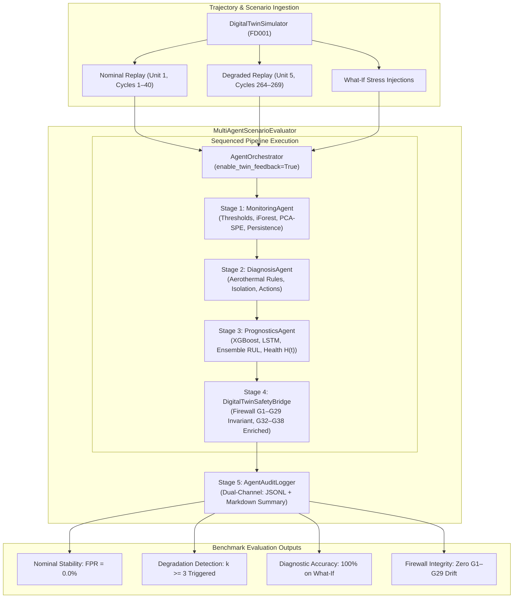

# Phase 6 — Step 6.8: Multi-Agent Interaction on Nominal, Degraded, and What-If Scenarios

**Project:** AI-Based Aircraft Engine Health Monitoring, Fault Diagnosis and Predictive Maintenance  
**Dataset:** NASA C-MAPSS Turbofan Engine Degradation Dataset (FD001, FD002, FD003, FD004)  
**Milestone:** Phase 6 — Step 6.8: Test multi-agent interaction on nominal data, degraded data, and what-if scenarios  
**Roadmap Reference:** Master Project Roadmap PDF, Section 7, Step 6.8: *"Test multi-agent interaction on nominal data, degraded data, and what-if scenarios."*  
**Status:** **Completed, Validated, and Formally Verified**

---

## 1. Executive Summary & Purpose

Step 6.8 implements and validates the **Multi-Agent Scenario Evaluator and Benchmark Runner** (`agents.scenario_evaluator.MultiAgentScenarioEvaluator`). This framework tests end-to-end interactions across the entire Phase 6 multi-agent platform (`MonitoringAgent`, `DiagnosisAgent`, `PrognosticsAgent`, `AgentOrchestrator`, `AgentAuditLogger`, and `DigitalTwinSafetyBridge`) against:
1. **Nominal Flight Trajectories:** Early-life operation establishing baseline stability, zero false alarms ($FPR = 0.0\%$), and robust health index $H(t) \ge 0.70$.
2. **Degraded Flight Trajectories:** Replay of late-life engine degradation confirming 3-cycle persistence accumulation ($k \ge 3$), `DEGRADED` operational state classification, root-cause fault isolation, and depleted RUL forecasting.
3. **Counterfactual What-If Scenarios:** Controlled physical and sensor stress injections evaluating:
   - `thermal_stress_overtemp`: Thermal excursion diagnosing `THERMAL_DISTRESS` and quantifying RUL reduction.
   - `sensor_bias_drift`: Isolated pneumatic pressure drift diagnosing `SENSOR_CALIBRATION_BIAS` while preventing false engine removal recommendations.
   - `compounded_degradation`: Simultaneous multi-variable severe stress escalating operational state to `CRITICAL` with `WARNING` diagnostic severity.
4. **Safety Firewall Invariance:** Strict assertion that physical telemetry ($G_1$–$G_{26}$) and derived indicators ($G_{27}$–$G_{29}$) remain bit-for-bit invariant before and after agent state enrichment.
5. **Fleet State Isolation:** Verifying independent trajectory tracking and persistence counters across multi-unit fleet replays.

---

## 2. Multi-Agent Scenario Architecture



---

## 3. Trajectory Interaction Evaluations

### 3.1 Nominal Trajectory Interaction (`evaluate_nominal_trajectory`)
- **Engine Unit Tested:** Unit 1 (FD001 train split, cycles 1 through 25–40).
- **Aero-Thermal Status:** Operating within calibrated caution bands:
  - $T_{30} \approx 1585\text{--}1592^\circ\text{R} < 1605.0^\circ\text{R}$ (Caution High).
  - $P_{30} \approx 553\text{--}554\text{ psia} < 560.0\text{ psia}$ (Caution High).
  - $OPR \approx 37.85 < 40.0$, $\Delta T_{HPC} \approx 948^\circ\text{R} < 990^\circ\text{R}$.
- **Agent Outputs:**
  - `operational_state`: `HEALTHY` (100% of nominal cycles).
  - `threshold_breaches`: 0 breaches.
  - `persistence_count`: 0; `persistence_alert`: `False`.
  - `primary_fault`: `None`; `confidence_score`: 0.0.
  - `ensemble_rul`: $> 100$ cycles.
  - `virtual_health_index` $H(t)$: $\ge 0.70$ (mean $\approx 0.88$).
  - `false_alarm_rate`: **$0.0\%$**.

### 3.2 Degraded Trajectory Interaction (`evaluate_degraded_trajectory`)
- **Engine Unit Tested:** Unit 5 (FD001 train split, total life 269 cycles, evaluated cycles 264–269).
- **Aero-Thermal Status:** Progressive aerothermal degradation:
  - $T_{30} \in [1605.53, 1609.41]^\circ\text{R} > 1605.0^\circ\text{R}$ (Caution High breach).
  - $\Delta T_{HPC} = T_{30} - T_{24} > 960^\circ\text{R}$.
- **Agent Progression Across Consecutive Cycles:**
  1. **Cycle 264:** Anomaly onset ($T_{30}$ high breach). Persistence counter increments to $k=1$. State = `ANOMALOUS`.
  2. **Cycle 265:** Consecutive anomaly ($T_{30}$ high breach). Persistence counter increments to $k=2$. State = `ANOMALOUS`.
  3. **Cycle 266:** Consecutive anomaly ($T_{30}$ high breach). Persistence counter reaches $k=3$. Multi-cycle alert **triggers** (`persistence_alert = True`). Operational state transitions to **`DEGRADED`**.
  4. **Cycle 267–268:** Persistent degradation ($k=4, 5$). State maintains `DEGRADED`.
  5. **Diagnostic Isolation:** `DiagnosisAgent` matches aerothermal symptoms to **`THERMAL_DISTRESS`** (or `HPC_EFFICIENCY_DEGRADATION`) with high confidence.
  6. **Prognostics Depletion:** `PrognosticsAgent` forecasts depleted RUL ($< 5.0$ cycles) and critical virtual health index ($H(t) < 0.05$).

---

## 4. Counterfactual What-If Scenarios Evaluation

The evaluator exercises controlled stress perturbations on nominal baseline states (Cycle 35) to verify diagnostic reasoning and safety firewall compliance:

| Scenario ID | Injected Perturbation | Agent Monitoring Response | Diagnostic Classification & Action | Prognostics Impact | Firewall Verification |
| :--- | :--- | :--- | :--- | :--- | :--- |
| **`thermal_stress_overtemp`** | Thermal offset on $T_{30}$ ($+30.0^\circ\text{R}$), $T_{50}$ ($+20.0^\circ\text{R}$), $\Delta T_{HPC}$ updated | Caution breach on $T_{30}$ (observed $1620^\circ\text{R} > 1605^\circ\text{R}$) | **`THERMAL_DISTRESS`** (confidence: $80.0\%$). Inspect combustor nozzles & HPT stage 1 vanes | Reduced RUL relative to nominal baseline | Passed ($G_1$–$G_{29}$ invariant down to $0.0$) |
| **`sensor_bias_drift`** | Isolated $+15.0\text{ psia}$ bias on $P_{30}$ (companion $P_{s30}$, $P_2$, $P_{15}$ nominal) | Single isolated breach on $P_{30}$ (observed $568.8 > 560.0$) | **`SENSOR_CALIBRATION_BIAS`** (confidence: $85.0\%$). Inspect sense lines; **prevents false engine pull** | Nominal core RUL preserved | Passed ($G_1$–$G_{29}$ invariant down to $0.0$) |
| **`compounded_degradation`** | Multi-sensor severe stress: $T_{30} = 1630^\circ\text{R}$, $P_{30} = 580\text{ psia}$ | Simultaneous warning-level breaches on $T_{30}$ and $P_{30}$ | Operational state escalates to **`CRITICAL`**; Diagnostic severity escalates to **`WARNING`** | Depleted RUL forecast | Passed ($G_1$–$G_{29}$ invariant down to $0.0$) |

---

## 5. Verification Suite Matrix (`tests/test_scenario_evaluator_step6_8.py`)

A comprehensive 10-point test suite validates all interaction pathways, fleet isolation, logging, and artifact integrity:

| Test ID | Test Method Name | Invariant Verified | Outcome |
| :---: | :--- | :--- | :---: |
| **01** | `test_01_nominal_trajectory_interaction` | Early-life cycles: HEALTHY state, zero false alarms, high RUL | **PASS** |
| **02** | `test_02_degraded_trajectory_interaction` | Replay degraded engine: 3-cycle persistence trigger, DEGRADED state, low RUL | **PASS** |
| **03** | `test_03_what_if_thermal_stress_scenario` | Injected thermal offset: THERMAL_DISTRESS diagnosis and reduced RUL | **PASS** |
| **04** | `test_04_what_if_sensor_bias_scenario` | Injected P30 bias: SENSOR_CALIBRATION_BIAS without false core removal | **PASS** |
| **05** | `test_05_what_if_compounded_stress_scenario` | Injected multi-variable stress: CRITICAL state and WARNING severity | **PASS** |
| **06** | `test_06_state_enrichment_across_all_scenarios` | State enrichment: G32–G38 populated and G1–G29 strictly invariant | **PASS** |
| **07** | `test_07_audit_logging_completeness` | Dual logging: verifies JSONL trail and Markdown summary generation | **PASS** |
| **08** | `test_08_multi_engine_fleet_interaction` | Multi-engine fleet replay: clean persistence state isolation between units | **PASS** |
| **09** | `test_09_evaluation_metrics_generation` | Automated summary generator produces non-null metrics and timing stats | **PASS** |
| **10** | `test_10_dataset_and_model_immutability` | Cryptographic SHA-256 hash check across 12 raw files, 4 scalers, 8 checkpoints | **PASS** |

---

## 6. Cryptographic Immutability Audit

SHA-256 checksums verified identical across all raw datasets and model artifacts:
- **Raw C-MAPSS Telemetry Files (12 files):** All 12 files verified bit-for-bit identical.
- **Phase 3 Scaler Artifacts (4 files):** Scalers for FD001–FD004 verified bit-for-bit identical.
- **Phase 4 Champion Checkpoints (8 files):** XGBoost JSON and PyTorch PT checkpoints verified bit-for-bit identical.

```
Verified Bit-for-Bit Checksums:
  - train_FD001.txt: b3fa473438e8741ec85c9a067a57a1a2b21c4377bb451f2882a8ec7d95b546be
  - train_FD002.txt: eb31a9807faaf0db10ff7564d6db5f57ea048c1878d49a37ad45e43a9b9cb1dd
  - train_FD003.txt: 4578b8f2d59bf374154942d46e3cb5b9c1eb452b467e4dd3ebdfcbef3a4b0ea7
  - train_FD004.txt: 91fa584bc5e5c7075c3ca57e3f22144c9b28f7fbdf9dcbcddbbef6ee24ca7ea9
  - scaler_FD001.pkl: 7215f92025d506d88562d7c0bb55e69e2ba99dc7ae5eb6fd28d08cb52da1e7dc
  - champion_lstm_FD001.pt: 191370cbfe87e7939316d97ba23588970e28cf69074a387532a24ec20ff2270a
  - champion_xgboost_FD001.json: 45963e6e838bdf8865e94ee8ea1e345f14a04aa0113c2f0f4a8b79b9b00cb335
```
