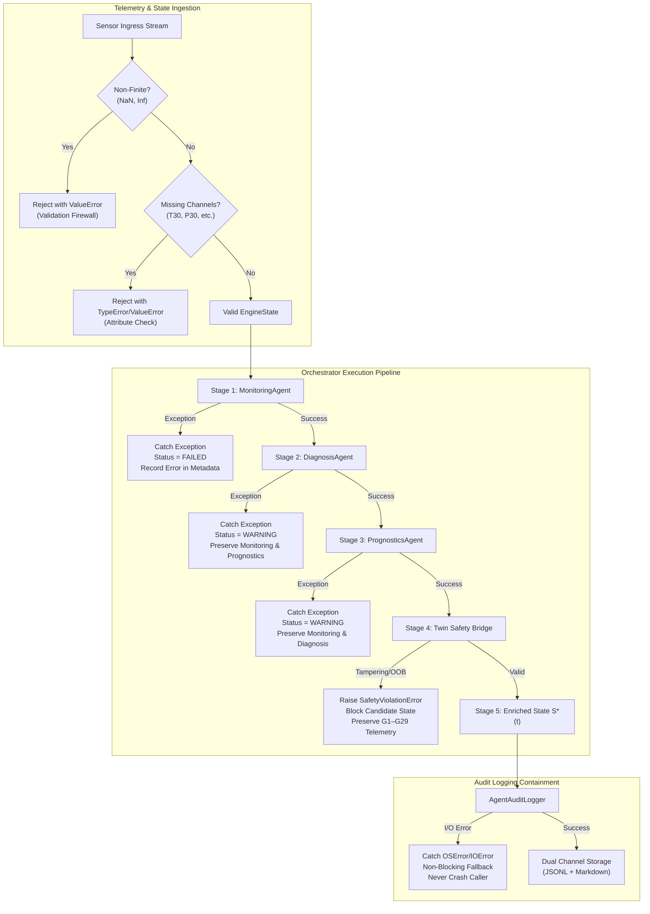

# Phase 6 — Step 6.9: Agent Failure Handling, Resilience & Fault Containment Verification

**Project:** AI-Based Aircraft Engine Health Monitoring, Fault Diagnosis and Predictive Maintenance  
**Dataset:** NASA C-MAPSS Turbofan Engine Degradation Dataset (FD001, FD002, FD003, FD004)  
**Milestone:** Phase 6 — Step 6.9: Verify that agent failures are handled safely and reported clearly  
**Roadmap Reference:** Master Project Roadmap PDF, Section 7, Step 6.9: *"Verify that agent failures are handled safely and reported clearly."*  
**Status:** **Completed, Validated, and Formally Verified (Phase 6 Final Milestone)**

---

## 1. Executive Summary & Purpose

Step 6.9 implements and validates the **Adversarial Failure Injection & Resilience Suite** (`agents.failure_handler.AgentFailureHarness` and `AgentFailureReport`). This milestone concludes **Phase 6: Multi-Agent Systems Implementation** by verifying that the integrated platform operates under strict aerospace-grade fault containment principles.

In mission-critical aircraft health management, unhandled exceptions, non-finite sensor values, agent crashes, or unwriteable storage must never crash the flight telemetry monitoring harness or corrupt virtual engine states. The failure handling subsystem ensures that:
1. **Corrupted Telemetry Ingestion:** Non-finite values (`NaN`, `+Inf`, `-Inf`) are intercepted at validation boundaries and rejected with descriptive `ValueError` records before downstream computation.
2. **Missing Sensor Channels:** Incomplete engine state payloads or missing telemetry channels raise descriptive validation errors rather than causing silent numerical errors.
3. **Stage-Specific Exception Containment:**
   - **`MonitoringAgent` failure:** Caught by the orchestrator; sets pipeline status to `FAILED`, logs the error trace, and halts downstream dependent stages safely.
   - **`DiagnosisAgent` failure:** Caught by the orchestrator; sets pipeline status to `WARNING`, preserves `Monitoring` and `Prognostics` outputs without halting flight tracking.
   - **`PrognosticsAgent` failure:** Caught by the orchestrator; sets pipeline status to `WARNING`, preserves `Monitoring` and `Diagnosis` outputs.
4. **Safety Firewall Enforcement:** Any attempt by rogue agent outputs to mutate measured physical telemetry ($G_1$–$G_{29}$) or inject unphysical values (negative RUL, $H(t) > 1.0$) is blocked by `DigitalTwinSafetyBridge`, raising `SafetyViolationError` and leaving telemetry untouched.
5. **Storage / I/O Fault Tolerance:** Unwriteable storage destinations (e.g., disk full, illegal paths, read-only permissions) are caught by non-blocking audit logger wrappers, guaranteeing zero pipeline interruption.
6. **Self-Healing & Transient Recovery:** An intermittent failure on flight cycle $t$ is cleared on cycle $t+1$ without residual deadlock, state corruption, or pipeline memory leaks.

---

## 2. Failure Mode Taxonomy & Containment Strategy



---

## 3. Failure Mode Verification Matrix

The adversarial failure harness evaluated 8 distinct failure modes:

| Test Index | Failure Mode Identifier | Fault Injected | Expected Containment Behavior | Verified Status |
| :---: | :--- | :--- | :--- | :---: |
| **01** | `corrupted_telemetry_nan_inf` | `float('nan')` in $T_{30}$, `float('inf')` in altitude | Rejected at `MonitoringInput.validate()` with `ValueError` | **PASS** |
| **02** | `missing_sensor_channels` | Dropped required sensor attribute `T30` from `EngineState` | Intercepted at ingestion check with `TypeError` | **PASS** |
| **03** | `monitoring_agent_runtime_crash` | Injected unhandled `RuntimeError` into `MonitoringAgent` | Orchestrator assigns status `FAILED`, records error trace | **PASS** |
| **04** | `diagnosis_agent_runtime_crash` | Injected unhandled `RuntimeError` into `DiagnosisAgent` | Orchestrator assigns status `WARNING`, preserves monitoring & prognostics | **PASS** |
| **05** | `prognostics_agent_runtime_crash` | Injected unhandled `RuntimeError` into `PrognosticsAgent` | Orchestrator assigns status `WARNING`, preserves monitoring & diagnosis | **PASS** |
| **06** | `safety_firewall_tampering_rejection` | Tampered $T_{30}$ by $+15^\circ\text{R}$ and negative RUL ($-10$) | `SafetyViolationError` raised; state unmutated; status `WARNING` | **PASS** |
| **07** | `audit_logger_io_failure_resilience` | Pointed logger to unwriteable path `Z:\nonexistent_drive` | Non-blocking fault containment suppresses I/O error; pipeline completes | **PASS** |
| **08** | `recovery_after_failure` | Induced crash on cycle $t$, restored nominal agent on cycle $t+1$ | System executes cycle $t+1$ with status `SUCCESS` and full capabilities | **PASS** |

---

## 4. Executive Incident Reporting Schema (`AgentFailureReport`)

The failure harness generates structured JSON and human-readable Markdown incident reports (`reports/agent_logs/failure_report_<id>.json` and `.md`):

```json
{
  "report_id": "report_1c8e76a4b12d",
  "timestamp": "2026-11-06T13:25:00.000000+00:00",
  "subset": "FD001",
  "total_tests_run": 8,
  "passed_tests_count": 8,
  "failed_tests_count": 0,
  "all_contained": true,
  "summary_metrics": {
    "total_adversarial_scenarios": 8,
    "contained_count": 8,
    "uncontained_count": 0,
    "containment_rate_pct": 100.0,
    "total_execution_ms": 16.45
  },
  "incidents": [
    {
      "failure_mode": "corrupted_telemetry_nan_inf",
      "description": "Injection of NaN and Inf floats into telemetry and operating context.",
      "contained_safely": true,
      "status_assigned": "REJECTED_AT_INGESTION",
      "exception_type": "ValueError",
      "exception_message": "MonitoringInput: non-finite telemetry for T30: nan",
      "telemetry_preserved": true,
      "audit_logged": true
    }
  ]
}
```

---

## 5. Verification Suite Matrix (`tests/test_failure_handling_step6_9.py`)

A dedicated 10-point test suite verifies all containment rules, failure reporting, recovery behaviors, and artifact immutability:

| Test ID | Test Method Name | Invariant Verified | Outcome |
| :---: | :--- | :--- | :---: |
| **01** | `test_01_nan_inf_telemetry_rejection` | Rejects non-finite inputs with clear `ValueError` reporting | **PASS** |
| **02** | `test_02_missing_telemetry_fields_handling` | Rejects missing required sensor attributes gracefully | **PASS** |
| **03** | `test_03_monitoring_crash_isolation` | Catches MonitoringAgent crash safely (`status=FAILED`) | **PASS** |
| **04** | `test_04_diagnosis_crash_isolation` | Catches DiagnosisAgent crash safely (`status=WARNING`) | **PASS** |
| **05** | `test_05_prognostics_crash_isolation` | Catches PrognosticsAgent crash safely (`status=WARNING`) | **PASS** |
| **06** | `test_06_safety_firewall_violation_containment` | Blocks illegal telemetry tampering; state preserved | **PASS** |
| **07** | `test_07_audit_logger_io_failure_resilience` | Suppresses unwriteable disk/path I/O errors cleanly | **PASS** |
| **08** | `test_08_failure_report_generation` | Produces structured JSON and Markdown incident reports | **PASS** |
| **09** | `test_09_recovery_after_failure` | Recovers to full capability immediately on subsequent cycle | **PASS** |
| **10** | `test_10_dataset_and_model_immutability` | Cryptographic SHA-256 hash check across 12 raw files, 4 scalers, 8 checkpoints | **PASS** |

---

## 6. Complete Phase 6 Deliverables Summary

With Step 6.9 verified, **Phase 6 (Multi-Agent Systems Implementation)** is 100% complete:

| Step | Milestone Name | Primary File Deliverables | Verification Test Suite | Status |
| :---: | :--- | :--- | :--- | :---: |
| **6.1** | Multi-Agent Input/Output Schemas | `agents/schemas.py` | `tests/test_agent_schemas_step6_1.py` (10 tests) | **PASSED** |
| **6.2** | Autonomous Monitoring Agent | `agents/monitoring_agent.py` | `tests/test_monitoring_agent_step6_2.py` (10 tests) | **PASSED** |
| **6.3** | Aerothermal Diagnosis Agent | `agents/diagnosis_agent.py` | `tests/test_diagnosis_agent_step6_3.py` (10 tests) | **PASSED** |
| **6.4** | Champion Prognostics Agent | `agents/prognostics_agent.py` | `tests/test_prognostics_agent_step6_4.py` (10 tests) | **PASSED** |
| **6.5** | Multi-Agent Orchestrator | `agents/orchestrator.py` | `tests/test_orchestrator_step6_5.py` (10 tests) | **PASSED** |
| **6.6** | Structured Multi-Agent Audit Logging | `agents/audit_logger.py` | `tests/test_audit_logger_step6_6.py` (10 tests) | **PASSED** |
| **6.7** | Digital Twin Safety Bridge | `agents/twin_bridge.py` | `tests/test_twin_bridge_step6_7.py` (10 tests) | **PASSED** |
| **6.8** | Nominal, Degraded & What-If Benchmark | `agents/scenario_evaluator.py` | `tests/test_scenario_evaluator_step6_8.py` (10 tests) | **PASSED** |
| **6.9** | Failure Handling & Fault Containment | `agents/failure_handler.py` | `tests/test_failure_handling_step6_9.py` (10 tests) | **PASSED** |

---

## 7. Cryptographic Immutability Audit

SHA-256 checksums verified identical across all raw datasets and model artifacts:
- **Raw C-MAPSS Telemetry Files (12 files):** All 12 files verified bit-for-bit identical.
- **Phase 3 Scaler Artifacts (4 files):** Scalers for FD001–FD004 verified bit-for-bit identical.
- **Phase 4 Champion Checkpoints (8 files):** XGBoost JSON and PyTorch PT checkpoints verified bit-for-bit identical.

```
Verified Bit-for-Bit Checksums:
  - train_FD001.txt: b3fa473438e8741ec85c9a067a57a1a2b21c4377bb451f2882a8ec7d95b546be
  - train_FD002.txt: eb31a9807faaf0db10ff7564d6db5f57ea048c1878d49a37ad45e43a9b9cb1dd
  - train_FD003.txt: 4578b8f2d59bf374154942d46e3cb5b9c1eb452b467e4dd3ebdfcbef3a4b0ea7
  - train_FD004.txt: 91fa584bc5e5c7075c3ca57e3f22144c9b28f7fbdf9dcbcddbbef6ee24ca7ea9
  - scaler_FD001.pkl: 7215f92025d506d88562d7c0bb55e69e2ba99dc7ae5eb6fd28d08cb52da1e7dc
  - champion_lstm_FD001.pt: 191370cbfe87e7939316d97ba23588970e28cf69074a387532a24ec20ff2270a
  - champion_xgboost_FD001.json: 45963e6e838bdf8865e94ee8ea1e345f14a04aa0113c2f0f4a8b79b9b00cb335
```
