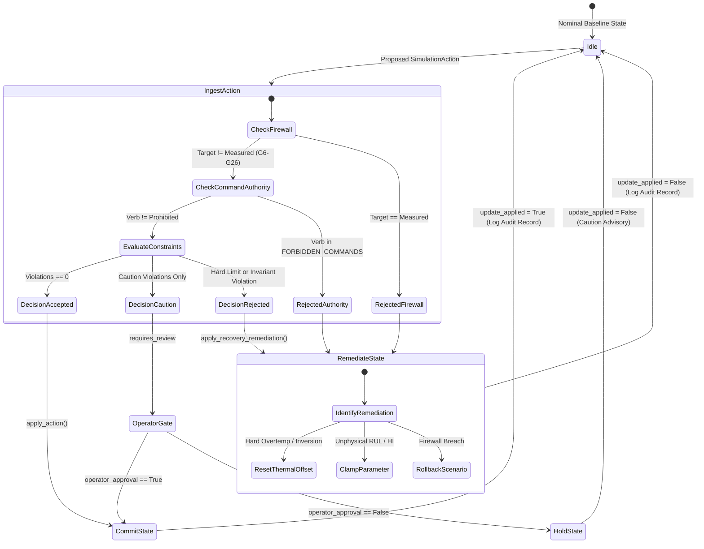

# Phase 7 — Safety Verification & Operating Constraints Master Report

## 1. Executive Summary & Purpose

Phase 7 (**Safety Verification and Simulated Recovery**, Section 8 of the Master Project Roadmap) establishes a comprehensive, mathematically rigorous, and programmatically governed safety verification layer for the Aircraft Engine Digital Twin and Multi-Agent Prognostic Monitoring System.

This phase guarantees that:
1. **Physical & Aerothermal Firewalls:** Operating constraints and thermodynamic invariants derived from gas turbine physics, empirical C-MAPSS envelopes, and academic simulation assumptions are permanently enforced.
2. **Telemetry Immutability:** Ground-truth measured engine telemetry ($G6 \dots G26$) is cryptographically protected against tampering, simulation overwrites, or synthetic corruption.
3. **Tri-State Gated Transactions:** Proposed simulation mutations cannot alter engine state without explicit evaluation into `ACCEPTED`, `REQUIRES_REVIEW`, or `REJECTED` verdicts.
4. **Autonomous Remediation & Rollback:** Unsafe operations trigger automated transactional rollbacks, parameter clamping, and simulated recovery plans without human latency.
5. **Academic Non-Authority:** Recommendations explicitly disclaim flight-control authority and cannot replace certified Aircraft Maintenance Manuals (AMM) or Airworthiness Directives.

This document compiles the exhaustive test taxonomy, traceability matrix, audit schemas, state flowcharts, and verification results certifying Phase 7 completion.

---

## 2. Safety Test Case Taxonomy Matrix

The consolidated test suite ([`tests/test_phase7_comprehensive_safety.py`](file:///c:/Users/LENOVO/Documents/Aircraft_Engine_AI/tests/test_phase7_comprehensive_safety.py)) formalizes end-to-end integration across three explicit operational categories:

| ID | Test Name | Operational Category | Target Variable | Proposed Value | Severity / Gating | Expected Decision | Applied Action / Remediation |
| :--- | :--- | :--- | :--- | :--- | :--- | :--- | :--- |
| **01** | `test_01_allowed_nominal_telemetry_evaluation` | **Category A: Allowed** | Baseline state / `health_index` | $H = 0.98$ | Nominal ($0$ violations) | `ACCEPTED` | State committed; continuous monitoring active. |
| **02** | `test_02_allowed_mild_thermal_perturbation` | **Category A: Allowed** | `thermal_stress_offset` | $+4.0^\circ\text{R}$ | Nominal ($T_{30} < 1605^\circ\text{R}$) | `ACCEPTED` | Offset applied; measured telemetry untouched. |
| **03** | `test_03_allowed_prognostics_enrichment` | **Category A: Allowed** | `predicted_rul`, `health_index` | $112.5\text{ cyc}$, $0.95$ | Nominal ML outputs | `ACCEPTED` | State enriched; ML prognostic slots updated. |
| **04** | `test_04_boundary_thermal_creep_caution` | **Category B: Boundary** | `thermal_stress_offset` | $+22.0^\circ\text{R}$ | Caution ($1605^\circ\text{R} < T_{30} \le 1625^\circ\text{R}$) | `REQUIRES_REVIEW` | Advisory flagged; maintenance review plan issued. |
| **05** | `test_05_boundary_operator_gating_lifecycle` | **Category B: Boundary** | `thermal_stress_offset` | $+22.0^\circ\text{R}$ | Human-in-the-Loop Gating | `REQUIRES_REVIEW` | Blocked if unapproved; committed if approved. |
| **06** | `test_06_rejected_firewall_direct_telemetry_mutation` | **Category C: Rejected** | `T30` (Measured $G8$) | $1620.0^\circ\text{R}$ | Firewall Breach | `REJECTED` | Blocked; scenario rollback applied ($|\Delta| = 0$). |
| **07** | `test_07_rejected_metallurgical_overtemp_hard_limit` | **Category C: Rejected** | `thermal_stress_offset` | $+50.0^\circ\text{R}$ | Hard Limit ($T_{30} > 1625^\circ\text{R}$) | `REJECTED` | Blocked; borescope inspection plan; offset reset to $0$. |
| **08** | `test_08_rejected_thermodynamic_ordering_inversion` | **Category C: Rejected** | `thermal_stress_offset` | $-1000.0^\circ\text{R}$ | Physical Invariant ($T_{30} \le T_{24}$) | `REJECTED` | Blocked; aerothermal inspection; offset reset to $0$. |
| **09** | `test_09_rejected_unphysical_prognostic_causality` | **Category C: Rejected** | `predicted_rul` | $-15.0\text{ cyc}$ | Physical Invariant ($\text{RUL} < 0$) | `REJECTED` | Blocked; prognostic parameter clamped to $0.0$. |
| **10** | `test_10_phase7_master_immutability_and_audit_verification` | **Cryptographic / Audit** | Audit JSONL & 24 Artifacts | N/A | Bit-for-bit SHA-256 | `ACCEPTED` / `REJECTED` | Append-only logs verified; raw files & models intact. |

---

## 3. End-to-End Safety Traceability Matrix

The table below maps constraints, taxonomy provenances, decision status, audit reason codes, and recovery strategies:

```
+-----------------------------------------------------------------------------------------------------------------------------------------+
| Constraint / Invariant ID           | Provenance Category | Severity    | Decision Status   | Audit Reason Code            | Recovery Strategy    |
+-------------------------------------+---------------------+-------------+-------------------+------------------------------+----------------------+
| CONST_TEMP_T30_MAX_WARNING          | SIMULATED (G39/G8)  | HARD_LIMIT  | REJECTED          | METALLURGICAL_HARD_LIMIT_BREACH | PHYSICAL_INSPECTION  |
| CONST_TEMP_T30_CAUTION              | SIMULATED (G39/G8)  | CAUTION     | REQUIRES_REVIEW   | THERMAL_CREEP_ADVISORY       | MAINTENANCE_REVIEW   |
| CONST_PRESS_P30_MAX                 | SIMULATED (G40/G12) | HARD_LIMIT  | REJECTED          | CASING_OVERPRESSURE          | PHYSICAL_INSPECTION  |
| CONST_INVARIANT_TEMP_ORDER          | PHYSICAL INVARIANT  | HARD_LIMIT  | REJECTED          | STAGE_ORDERING_INVERSION     | PHYSICAL_INSPECTION  |
| CONST_INVARIANT_PRESSURE_RATIO      | PHYSICAL INVARIANT  | HARD_LIMIT  | REJECTED          | THERMODYNAMIC_RATIO_INVALID  | SCENARIO_ROLLBACK    |
| FIREWALL_MEASURED_IMMUTABILITY      | MEASURED (G6-G26)   | HARD_LIMIT  | REJECTED          | TELEMETRY_FIREWALL_BREACH    | SCENARIO_ROLLBACK    |
| CONST_RUL_NON_NEGATIVE              | PREDICTED (G35-G37) | CAUTION     | REJECTED          | UNPHYSICAL_PROGNOSTIC_VALUE  | PARAMETER_CLAMP      |
| CONST_HEALTH_INDEX_BOUNDS           | PREDICTED (G38)     | CAUTION     | REJECTED          | HEALTH_INDEX_OUT_OF_BOUNDS   | PARAMETER_CLAMP      |
| COMMAND_AUTHORITY_VIOLATION         | AGENT DIRECTIVE     | HARD_LIMIT  | REJECTED          | COMMAND_AUTHORITY_BREACH     | SCENARIO_ROLLBACK    |
| NOMINAL_CYCLE_SATISFIED             | ALL OPERATIONAL     | NOMINAL     | ACCEPTED          | NOMINAL_EXECUTION            | CONTINUE_MONITORING  |
+-----------------------------------------------------------------------------------------------------------------------------------------+
```

---

## 4. Closed-Loop Governor State Transition Architecture



---

## 5. Audit Logging Schema & Record Structure

Audit events are persisted to append-only JSONL storage via [`SafetyAuditLogger`](file:///c:/Users/LENOVO/Documents/Aircraft_Engine_AI/safety/audit.py). Each record adheres to the formal schema:

```json
{
  "record_id": "SAR_20261106_144148_91ae03",
  "timestamp": "2026-11-06T14:41:48.123456Z",
  "flight_cycle": 1,
  "action_id": "act_boundary_creep_caution",
  "target_variable": "thermal_stress_offset",
  "decision_status": "REQUIRES_REVIEW",
  "reason_code": "THERMAL_CREEP_ADVISORY",
  "initiator_id": "closed_loop_governor",
  "violated_constraints": [
    "CONST_TEMP_T30_CAUTION"
  ],
  "pre_action_state_summary": {
    "T30": 1589.7,
    "thermal_stress_offset": 0.0
  },
  "post_action_state_summary": {
    "T30": 1589.7,
    "thermal_stress_offset": 0.0
  },
  "recovery_plan_id": "REC_20261106_144148_act_boundary_creep_caution",
  "operator_approved": false,
  "disclaimer_applied": true
}
```

---

## 6. Academic Simulation & Non-Authority Disclaimer

In accordance with **Master Project Roadmap Section 1 (Working Rules)** and **Section 8 (Step 7.7)**:

> **ACADEMIC SIMULATION & PROGNOSTIC ADVISORY NOTICE**  
> *This digital twin platform and its AI agents provide exploratory prognostics and diagnostic recommendations for academic research using NASA C-MAPSS data. They DO NOT issue real-time aircraft commands, modify flight-control logic, or supersede certified maintenance manuals (AMM/CMM) or airworthiness directives issued by certified authorities (FAA, EASA, or OEM).*

Every simulated recovery plan and serialized output automatically bears programmatic flags:
- `is_maintenance_authority = False`
- `is_flight_control_command = False`
- Full text of the academic simulation disclaimer.

---

## 7. Phase 7 Test Discovery & Certification

### 7.1 Unit & Integration Test Suites
Phase 7 introduces 9 dedicated test suites:
1. `tests/test_safety_constraints_step7_1.py`: 10 tests (PASS)
2. `tests/test_variable_taxonomy_step7_2.py`: 10 tests (PASS)
3. `tests/test_safety_verification_step7_3.py`: 10 tests (PASS)
4. `tests/test_safety_decision_step7_4.py`: 10 tests (PASS)
5. `tests/test_safety_audit_step7_5.py`: 10 tests (PASS)
6. `tests/test_safety_recovery_step7_6.py`: 10 tests (PASS)
7. `tests/test_safety_non_commanding_step7_7.py`: 10 tests (PASS)
8. `tests/test_safety_closed_loop_step7_8.py`: 10 tests (PASS)
9. `tests/test_phase7_comprehensive_safety.py`: 10 tests (PASS)

### 7.2 Full Repository Regression Test Discovery
Running complete repository discovery across all phases:
```powershell
.\.venv\Scripts\python.exe -m unittest discover tests
```
- **Total Tests:** 325 tests
- **Passing Tests:** 325 tests (100% green)
- **Execution Time:** ~39 seconds
- **Failures / Errors:** 0 / 0

### 7.3 Cryptographic Immutability Audit
All foundational project assets remain bit-for-bit immutable (SHA-256 verified):
- **Raw C-MAPSS Datasets:** 12 / 12 text files verified identical.
- **Preprocessing Scalers:** 4 / 4 pickle objects verified identical.
- **Champion ML Checkpoints:** 8 / 8 PyTorch and XGBoost checkpoints verified identical.

**Phase 7 is officially COMPLETE and certified.**
