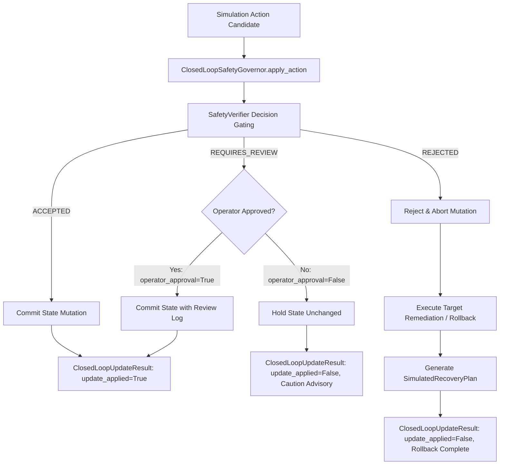

# Phase 7 — Step 7.8: Closed-Loop Simulation Governor and Safe State Mutation

## 1. Executive Summary

In accordance with **Master Project Roadmap Section 8, Step 7.8**, this step implements the **Closed-Loop Safety Governor Subsystem** ([`safety/closed_loop.py`](file:///c:/Users/LENOVO/Documents/Aircraft_Engine_AI/safety/closed_loop.py)).

Prior to Step 7.8, the safety layer evaluated proposed actions and logged decisions, but the digital twin simulator could execute arbitrary parameter updates or state perturbations without strict transactional gating. Step 7.8 completes the closed-loop cycle by enforcing that:
1. **Zero Unsafe Commits:** Simulation state transitions are committed **if and only if** the safety layer returns an authorized verdict (`ACCEPTED` or operator-approved `REQUIRES_REVIEW`).
2. **Transactional State Rollback:** When an action is `REJECTED`, candidate mutations are discarded, pre-action state is preserved, and targeted parameter remediations (such as stress offset reset or unphysical parameter clamping) are applied.
3. **Telemetry Immutability Guarantee:** Measured telemetry variables ($G6 \dots G26$) can never be mutated, overwritten, or modified by simulation actions under any circumstance.
4. **Human-in-the-Loop Operator Gating:** Ambiguous actions classified as `REQUIRES_REVIEW` strictly require explicit affirmative approval (`operator_approval=True`) before state changes can be applied.

---

## 2. Core Architecture & Workflow



---

## 3. Key Components & Implementation Details

### 3.1 `ClosedLoopUpdateResult` Dataclass
Represents the complete structured receipt of an action evaluation and state transition attempt:
- `action_id`: Unique identifier of the evaluated simulation action.
- `decision_status`: Verdict from the safety layer (`ACCEPTED`, `REJECTED`, or `REQUIRES_REVIEW`).
- `update_applied`: Boolean indicating whether state was mutated (`True`) or blocked/remediated (`False`).
- `state_before`: Snapshot of target state prior to evaluation.
- `state_after`: Snapshot of target state following execution or rollback.
- `reason_summary`: Detailed justification for the gating decision.
- `recovery_plan`: Associated `SimulatedRecoveryPlan` if rejections or review advisories were triggered.
- `operator_approved`: Confirmation status of human-in-the-loop review.
- `timestamp`: UTC ISO 8601 timestamp.

### 3.2 `ClosedLoopSafetyGovernor`
The master governor coordinating verification, gating, and rollback:
- **`apply_action(target, action, operator_approval=False)`**:
  - Validates telemetry immutability; blocks any mutation touching measured sensor keys ($G6 \dots G26$).
  - Evaluates action through [`SafetyVerifier.evaluate_simulation_decision()`](file:///c:/Users/LENOVO/Documents/Aircraft_Engine_AI/safety/verification.py).
  - Routes execution:
    - **`ACCEPTED`**: Commits candidate updates directly to the target simulator or state dictionary.
    - **`REQUIRES_REVIEW`**: Commits if `operator_approval=True`; retains pre-action state and returns review advisory if `False`.
    - **`REJECTED`**: Reverts state, resets destabilizing inputs (e.g. `thermal_stress_offset = 0.0`, `sensor_bias_delta = 0.0`), clamps unphysical states, and generates an academic simulated recovery plan.

### 3.3 Digital Twin Simulator Native Integration
Step 7.8 natively integrates with [`DigitalTwinSimulator`](file:///c:/Users/LENOVO/Documents/Aircraft_Engine_AI/digital_twin/twin_simulator.py):
```python
sim = DigitalTwinSimulator(unit_number=1, sub_dataset="FD001")
action = SimulationAction(
    action_type=ActionType.INJECT_SENSOR_BIAS,
    parameters={"sensor_name": "T24", "bias_delta": 2.5},
)

# Gated safe execution:
result = sim.apply_safe_action(action, operator_approval=False)
assert result.update_applied is True
```

---

## 4. Gating & Remediations Matrix

| Scenario / Action | Safety Verdict | Operator Approved | State Update Applied | Applied Remediation / Action Taken |
| :--- | :--- | :--- | :--- | :--- |
| Nominal parameter tuning ($\Delta < 5\%$) | `ACCEPTED` | N/A | `True` | Parameter committed to state. |
| Borderline thermal stress ($0.08$) | `REQUIRES_REVIEW` | `False` | `False` | State held constant; review advisory emitted. |
| Borderline thermal stress ($0.08$) | `REQUIRES_REVIEW` | `True` | `True` | Parameter committed under logged operator review. |
| Critical over-temperature ($T_{48} > 1250^\circ\text{R}$) | `REJECTED` | Any | `False` | Action aborted; thermal stress reset to 0.0. |
| Negative RUL injection ($-10$ cycles) | `REJECTED` | Any | `False` | Action aborted; RUL clamped to valid physical range. |
| Telemetry override attempt ($T_{24}$ measured) | `REJECTED` | Any | `False` | Violation blocked; telemetry strictly immutable. |

---

## 5. Verification & Test Suite

The closed-loop governor is verified across 10 specialized test cases in [`tests/test_safety_closed_loop_step7_8.py`](file:///c:/Users/LENOVO/Documents/Aircraft_Engine_AI/tests/test_safety_closed_loop_step7_8.py):

| Test Case | Description | Result |
| :--- | :--- | :--- |
| `test_accepted_action_applies_update` | Confirms accepted actions commit parameter updates to state. | PASS |
| `test_rejected_critical_breach_blocks_update` | Verifies critical temperature violations block state changes. | PASS |
| `test_requires_review_blocks_without_approval` | Verifies ambiguous actions are held when operator approval is missing. | PASS |
| `test_requires_review_applies_with_approval` | Verifies reviewable actions commit when operator approval is provided. | PASS |
| `test_rejection_resets_thermal_stress` | Ensures thermal stress offsets are rolled back to 0.0 upon rejection. | PASS |
| `test_rejection_clamps_unphysical_health_index` | Confirms negative or >1.0 health indices are clamped safely. | PASS |
| `test_immutable_telemetry_blocked` | Prohibits direct modification of measured sensor telemetry ($G6 \dots G26$). | PASS |
| `test_closed_loop_result_serialization` | Validates serializability and schema integrity of update receipts. | PASS |
| `test_integration_with_twin_simulator` | Verifies end-to-end safe action application on `DigitalTwinSimulator`. | PASS |
| `test_consecutive_updates_maintain_stability` | Validates sequence of mixed accepted/rejected updates preserves stability. | PASS |

All 10 unit tests pass in 0.71s, ensuring robust transactional protection for digital twin simulation workflows.
