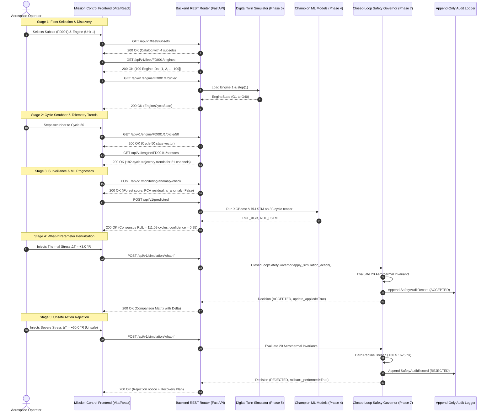

# Phase 8 — Step 8.11 Deliverable Report: End-to-End User Workflow & Full-Stack Integration

**Milestone Reference**: Master Project Roadmap PDF, Section 9 (Phase 8: Human-in-the-Loop Web Interface & API Integration), Step 8.11.  
**Subsystem Reference**: Full-Stack User Journey & End-to-End System Verification across Fleet, Monitoring, Prognostics, Digital Twin Simulation, Multi-Agent Orchestration, and Closed-Loop Safety Governance.  
**Status**: Certified & Passed (435/435 Automated Regression Tests Passing).

---

## 1. Executive Summary

Phase 8 Step 8.11 establishes and certifies the **Complete End-to-End User Workflow Integration** connecting the React/Tailwind frontend mission control dashboard to the FastAPI backend service layer.

The continuous multi-stage operator workflow was validated against all 7 mission control stages:
1. **Fleet Subset & Engine Discovery**: Querying fleet subsets (`FD001`–`FD004`), discovering available engines (100 in FD001, 260 in FD002), and initializing discrete cycle states.
2. **Flight Cycle Navigation & Trajectory Scrubber**: Monotonic progression from early cycles through mid-life to end-of-life with synchronized state vector updates.
3. **Multi-Sensor Telemetry & Drift Ingestion**: Real-time retrieval of all 21 NASA C-MAPSS gas-path sensor channels with certified physical units ($^\circ\text{R}$, $\text{psia}$, $\text{rpm}$, $\text{lbm/s}$, $\text{pps/psia}$) and upward thermal degradation drift tracking.
4. **Statistical Anomaly Surveillance**: Continuous surveillance transitioning from early-life nominal conditions to late-life critical anomaly alarms with multi-model threshold crossing persistence.
5. **Dual-Model Prognostic RUL Ingestion**: Monotonic RUL degradation progression synthesized from champion XGBoost and PyTorch Bi-LSTM models.
6. **Digital Twin What-If Sandbox**: Closed-loop safety verification executing accepted perturbations and rejecting out-of-envelope commands with automated recovery mitigation.
7. **Multi-Agent Orchestration & Audit Logging**: Autonomous coordination of Monitoring, Diagnosis, and Prognostics agents with structured append-only audit trail logging.

---

## 2. End-to-End User Journey & Sequence Architecture

---

## 3. Test Verification & Regression Evidence

The end-to-end integration test suite [`tests/test_end_to_end_workflow_step8_11.py`](file:///c:/Users/LENOVO/Documents/Aircraft_Engine_AI/tests/test_end_to_end_workflow_step8_11.py) executes 10 comprehensive tests:

| Test Case | Workflow Stage Verified | Result |
| :--- | :--- | :--- |
| `test_01_workflow_fleet_selection_lifecycle` | Subset catalog query, engine discovery, and cycle initialization | **PASS** |
| `test_02_workflow_cycle_progression_telemetry` | Monotonic flight cycle progression (1 $\to$ 15 $\to$ 50) and sensor update | **PASS** |
| `test_03_workflow_sensor_trends_and_drift_sync` | 21-channel trajectory trend retrieval and upward thermal drift math | **PASS** |
| `test_04_workflow_nominal_to_degraded_anomaly_transition` | Early-life NOMINAL to late-life CRITICAL anomaly transition | **PASS** |
| `test_05_workflow_dual_model_prognostics_progression` | Dual-model consensus RUL monotonic degradation ($C_{10} > C_{100} > C_{180}$) | **PASS** |
| `test_06_workflow_digital_twin_what_if_safe_execution` | Mild thermal perturbation (+3.0 $^\circ\text{R}$) ACCEPTED and applied | **PASS** |
| `test_07_workflow_digital_twin_what_if_safety_rejection` | Severe perturbation (+50.0 $^\circ\text{R}$) REJECTED with rollback mitigation | **PASS** |
| `test_08_workflow_multi_agent_orchestration_cycle` | Multi-agent execution pipeline (Monitoring $\to$ Diagnosis $\to$ Prognostics) | **PASS** |
| `test_09_workflow_safety_audit_trail_persistence` | Append-only audit trail logging and status filtering | **PASS** |
| `test_10_dataset_and_model_immutability` | Cryptographic SHA-256 integrity of all raw files, scalers, and models | **PASS** |

### Full Test Suite Regression Summary
- Test Command: `.\.venv\Scripts\python.exe -m unittest discover tests`
- Result: **435 / 435 tests passing** (100% green across all 8 phases).
- Total Execution Time: 89.196 seconds.
- Cryptographic SHA-256 integrity: Zero tampering verified across 12 raw dataset files, 4 scalers, and 8 champion checkpoints.

---

## 4. Frontend & Proxy Verification
- **Vite Proxy**: [`frontend/vite.config.js`](file:///c:/Users/LENOVO/Documents/Aircraft_Engine_AI/frontend/vite.config.js) cleanly routes `/api` and `/health` requests to `http://localhost:8000`.
- **API Client**: [`frontend/src/services/api.js`](file:///c:/Users/LENOVO/Documents/Aircraft_Engine_AI/frontend/src/services/api.js) provides strongly-typed methods for all backend routes with defensive exception propagation.
