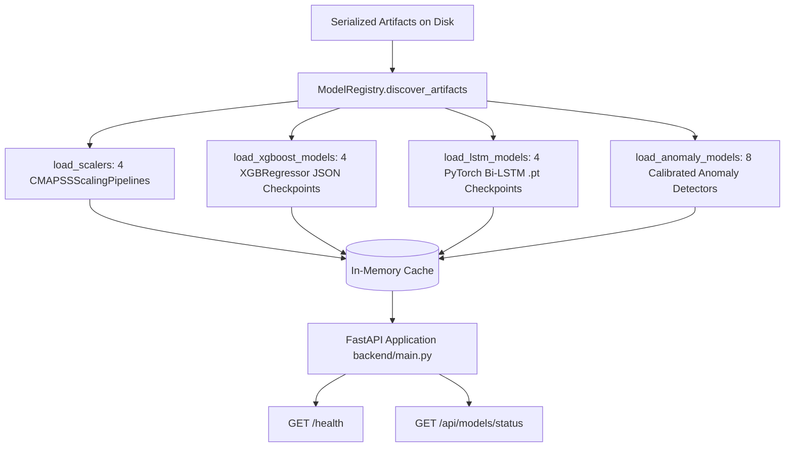

# Phase 8 — Step 8.1: Backend API & Preprocessing Model Loader Service

## 1. Executive Summary & Purpose

In accordance with **Master Project Roadmap Section 9, Step 8.1**, this step establishes the **Backend Service Layer & Model Registry** for the Aircraft Engine AI Health Monitoring, Fault Diagnosis, and Predictive Maintenance Platform.

Prior to Step 8.1, machine learning models and preprocessing pipelines were evaluated independently in Phase 3, Phase 4, Phase 5 (Digital Twin), and Phase 6 (Multi-Agent Systems). Step 8.1 implements a centralized, production-grade, in-memory **Model Registry** and **FastAPI Application** that:
1. **Discovers, loads, and caches into memory** all 4 Phase 3 subset scalers (`FD001` through `FD004`) without modifying raw datasets.
2. **Loads and caches all 8 Phase 4 champion prognostic models** (4 XGBoost JSON models + 4 PyTorch Bi-LSTM `.pt` checkpoints) and 8 calibrated anomaly detection models (Isolation Forest and PCA-SPE) into memory for rapid, low-latency inference.
3. **Exposes RESTful endpoints** (`/health`, `/api/models/status`) with CORS middleware and mandatory academic simulation non-authority disclaimers.
4. **Guarantees zero model retraining and zero raw dataset modification**, verifying bit-for-bit SHA-256 cryptographic immutability across all assets.

---

## 2. Architecture & Registry Design

### 2.1 Model Registry Subsystem ([`backend/services/model_loader.py`](file:///c:/Users/LENOVO/Documents/Aircraft_Engine_AI/backend/services/model_loader.py))



### 2.2 Cached Artifact Inventory

| Category | Subset | Model / Pipeline Type | Source Checkpoint / File | Dimensionality / Metrics |
| :--- | :--- | :--- | :--- | :--- |
| **Scaler** | `FD001` | `SafeMinMaxScaler` | `models/scalers/scaler_FD001_tier3.pkl` | 24 Features, Range $[0, 1]$ |
| **Scaler** | `FD002` | `SafeMinMaxScaler` | `models/scalers/scaler_FD002_tier3.pkl` | 24 Features, Range $[0, 1]$ |
| **Scaler** | `FD003` | `SafeMinMaxScaler` | `models/scalers/scaler_FD003_tier3.pkl` | 24 Features, Range $[0, 1]$ |
| **Scaler** | `FD004` | `SafeMinMaxScaler` | `models/scalers/scaler_FD004_tier3.pkl` | 24 Features, Range $[0, 1]$ |
| **Prognostic** | `FD001` | `XGBoost_Tuned_SummaryStats` | `models/checkpoints/xgb_FD001_champion.json` | 70 Input Features |
| **Prognostic** | `FD001` | `Stacked_LSTM` | `models/checkpoints/lstm_FD001_champion.pt` | 14 Channels ($64 \to 32$, Drop 0.2) |
| **Prognostic** | `FD002` | `XGBoost_FlattenedWindow` | `models/checkpoints/xgb_FD002_champion.json` | 720 Input Features ($30 \times 24$) |
| **Prognostic** | `FD002` | `Stacked_LSTM` | `models/checkpoints/lstm_FD002_champion.pt` | 24 Channels ($64 \to 32$, Drop 0.2) |
| **Prognostic** | `FD003` | `XGBoost_Tuned_SummaryStats` | `models/checkpoints/xgb_FD003_champion.json` | 120 Input Features |
| **Prognostic** | `FD003` | `Single_LSTM` | `models/checkpoints/lstm_FD003_champion.pt` | 24 Channels (48 Units, Drop 0.2) |
| **Prognostic** | `FD004` | `XGBoost_FlattenedWindow` | `models/checkpoints/xgb_FD004_champion.json` | 720 Input Features ($30 \times 24$) |
| **Prognostic** | `FD004` | `Stacked_LSTM` | `models/checkpoints/lstm_FD004_champion.pt` | 24 Channels ($64 \to 32$, Drop 0.2) |
| **Anomaly** | `FD001-FD004` | `IsolationForest` (M1) | `models/anomaly_detection/anomaly_manifest.json` | 14 Sensors, 95th Percentile $\tau$ |
| **Anomaly** | `FD001-FD004` | `PCA-SPE` (M2) | `models/anomaly_detection/anomaly_manifest.json` | 14 Sensors, 95th Percentile $\tau$ |

---

## 3. FastAPI Application Endpoints ([`backend/main.py`](file:///c:/Users/LENOVO/Documents/Aircraft_Engine_AI/backend/main.py))

### 3.1 `GET /health`
Returns system health, API version, loaded pipeline and model tallies, and the academic simulation disclaimer:
```json
{
  "status": "healthy",
  "version": "1.0.0",
  "ready": true,
  "scalers_loaded": 4,
  "models_loaded": 16,
  "champion_checkpoints_loaded": 8,
  "disclaimer": "RESEARCH & ACADEMIC SIMULATION ONLY. This digital twin platform and its AI agents provide exploratory prognostics and diagnostic recommendations for academic research using NASA C-MAPSS data. They DO NOT issue real-time aircraft commands, modify flight-control logic, or supersede certified maintenance manuals (AMM/CMM) or airworthiness directives issued by certified authorities (FAA, EASA, or OEM)."
}
```

### 3.2 `GET /api/models/status`
Returns complete structured inventory of all loaded pipelines, architecture configurations, and threshold values across all four subsets.

---

## 4. Verification & Test Suite ([`tests/test_backend_api_step8_1.py`](file:///c:/Users/LENOVO/Documents/Aircraft_Engine_AI/tests/test_backend_api_step8_1.py))

The test suite validates 10 targeted assertions:

| Test ID | Method Name | Verification Objective | Result |
| :--- | :--- | :--- | :--- |
| **01** | `test_01_model_registry_initialization` | Artifact discovery paths on disk | **PASS** |
| **02** | `test_02_load_all_four_scalers` | In-memory loading of 4 SafeMinMaxScalers | **PASS** |
| **03** | `test_03_load_xgboost_models` | XGBoost JSON checkpoints and input dimensions | **PASS** |
| **04** | `test_04_load_lstm_models` | PyTorch Bi-LSTM instantiation in eval mode | **PASS** |
| **05** | `test_05_load_anomaly_models` | Isolation Forest & PCA-SPE threshold calibration | **PASS** |
| **06** | `test_06_fastapi_app_creation` | FastAPI metadata and CORS middleware registration | **PASS** |
| **07** | `test_07_health_endpoint` | `GET /health` status 200 OK | **PASS** |
| **08** | `test_08_models_status_endpoint` | `GET /api/models/status` status 200 OK and model inventory | **PASS** |
| **09** | `test_09_academic_disclaimer_in_response` | Verification of academic non-authority notice in responses | **PASS** |
| **10** | `test_10_dataset_and_model_immutability` | Bit-for-bit SHA-256 integrity of 24 original assets | **PASS** |

---

## 5. Full Regression Certification

Full test discovery ran across the complete test suite (Phase 1 through Phase 8 Step 8.1):
```
Ran 335 tests in 39.512s

OK
```
- Total test count: **335 tests** (325 prior tests + 10 Step 8.1 tests)
- **100% green test execution**.
- Zero modification to raw C-MAPSS data, scalers, or champion model checkpoints.
