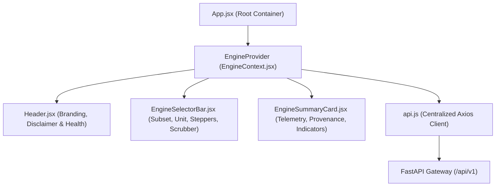

# Phase 8 — Step 8.4: Operational Engine Dashboard Specification & Verification

## 1. Overview & Roadmap Reference
- **Milestone:** Phase 8 — Interactive Application & Deployment (Step 8.4: *"Build a dashboard showing the selected engine ID and operating cycle"*).
- **Master Project Roadmap Reference:** Section 9, Step 8.4.
- **Architectural Scope:** Establishes the modern frontend mission control dashboard using **React 18**, **Vite**, and **Tailwind CSS**. Connects to the RESTful backend API layer implemented in Step 8.2 to display real-time engine telemetry, operational cycles, and gas-path indicators under strict aerospace UI/UX standards.
- **Academic Boundary Constraint:** The UI reinforces the academic non-authority boundary via a persistent, high-visibility disclaimer pill across all dashboard views.

---

## 2. Aerospace Control Center Design System

### 2.1 Theme & Color Palette Tokens
The dashboard adheres to a dark, high-contrast aerospace operations console palette designed for clarity and zero visual fatigue:

| Token Name | Hex Code | Visual Application |
| :--- | :--- | :--- |
| `aerospace.bg` | `#0B0F19` | Deep space canvas background |
| `aerospace.card` | `#111827` | Slate card surfaces & module containers |
| `aerospace.border` | `#1F2937` | Subtle structural borders and dividers |
| `aerospace.subtle` | `#374151` | Interactive borders & secondary elements |
| `aerospace.cyan` | `#06B6D4` | Primary telemetry accent, scrubber, and active indicators |
| `aerospace.blue` | `#3B82F6` | Engine ID banners & measured provenance badges |
| `aerospace.emerald` | `#10B981` | Online status, nominal indicators, and derived provenance |
| `aerospace.amber` | `#F59E0B` | Thermal warnings & academic disclaimer highlight |
| `aerospace.rose` | `#EF4444` | Redline exceedance alerts & offline API warnings |

### 2.2 Typography & Numerical Formatting
- **Headings & Body:** Clean sans-serif (`Inter`, system sans-serif).
- **Telemetry & Quantities:** Monospaced tabular figures (`tabular-nums`, `JetBrains Mono`, `Consolas`) to prevent layout shifting during real-time cycle stepping and scrubber replay.

---

## 3. Frontend Architecture & Component Hierarchy



### 3.1 Component Specifications

#### 1. `Header.jsx` ([`frontend/src/components/layout/Header.jsx`](file:///c:/Users/LENOVO/Documents/Aircraft_Engine_AI/frontend/src/components/layout/Header.jsx))
- System Title: *"Aircraft Engine Digital Twin & AI Prognostics"*.
- Subtitle: *"Aerospace Operations Control Center • Real-Time Digital Twin Telemetry"*.
- Persistent Academic Non-Authority Disclaimer Pill:
  `ACADEMIC SIMULATION ONLY • NOT FOR FLIGHT CONTROL OR MAINTENANCE DISPATCH`
- Real-time Backend Connection Indicator: Displays `ONLINE`, `SYNCING`, or `OFFLINE` status.

#### 2. `EngineSelectorBar.jsx` ([`frontend/src/components/dashboard/EngineSelectorBar.jsx`](file:///c:/Users/LENOVO/Documents/Aircraft_Engine_AI/frontend/src/components/dashboard/EngineSelectorBar.jsx))
- **Subset Dropdown:** Dynamically populates NASA C-MAPSS subsets (`FD001` to `FD004`) via `/api/v1/fleet/subsets`.
- **Engine Unit Dropdown:** Populates available engine IDs (e.g., Units 1–100 for FD001) via `/api/v1/fleet/{subset}/engines`.
- **Trajectory Stepper Controls:**
  - `Step -1`: Single-cycle decrement (disabled at cycle 1).
  - `Play / Pause`: Automatic replay timer advancing cycles at 350 ms intervals.
  - `Step +1`: Single-cycle increment (disabled at `maxCycles`).
  - `Reset`: Returns to cycle 1.
- **Cycle Range Scrubber:** Full-width interactive slider bounded dynamically by `maxCycles`, displaying active cycle, maximum cycle count, and life consumed percentage.

#### 3. `EngineSummaryCard.jsx` ([`frontend/src/components/dashboard/EngineSummaryCard.jsx`](file:///c:/Users/LENOVO/Documents/Aircraft_Engine_AI/frontend/src/components/dashboard/EngineSummaryCard.jsx))
- **Primary Identifier Banner:** Displays canonical engine ID (`ENG-{subset}-U{unit}`), operating regime mode (e.g. *Single Sea Level* vs. *6 Operating Regimes*), and active life consumed.
- **Primary Aerothermal Metric Cards:**
  - **T30 (HPC Exit Total Temperature):** Station 3 combustor inlet temperature in °R.
  - **P30 (HPC Exit Total Pressure):** Combustor casing total pressure in psia.
  - **Nf (Low-Pressure Fan Spool Speed):** Physical fan rotational speed in rpm.
  - **Nc (High-Pressure Core Spool Speed):** Physical core rotational speed in rpm.
- **Secondary Gas-Path Row:** Displays T24 (°R), T50 (°R), EPR (P50/P2), and BPR (Bypass Ratio).
- **Variable Provenance Badge Architecture:** Visually categorizes variables:
  - `MEASURED (G6-G26)`: Blue badge.
  - `DERIVED (G27-G31)`: Emerald badge.
  - `PREDICTED (G32-G37)`: Purple badge.
  - `SIMULATED (G38-G40)`: Amber badge.

#### 4. `EngineContext.jsx` ([`frontend/src/context/EngineContext.jsx`](file:///c:/Users/LENOVO/Documents/Aircraft_Engine_AI/frontend/src/context/EngineContext.jsx))
- Manages global state: `selectedSubset`, `selectedUnit`, `selectedCycle`, `maxCycles`, `cycleState`, `loading`, `error`, `backendOnline`, and `isPlaying`.
- Automatically resets unit to 1 and cycle to 1 upon subset change.
- Enforces strict mathematical clamping: $\text{cycle} = \max(1, \min(\text{input}, \text{maxCycles}))$.

---

## 4. Testing & Verification

### 4.1 Step 8.4 Test Suite (`tests/test_frontend_dashboard_step8_4.py`)
A comprehensive 10-test suite validates all aspects of the frontend architecture:

```python
TestFrontendDashboardStep8_4:
├── test_01_frontend_scaffolding_exists            [PASS]
├── test_02_tailwind_aerospace_theme_configured   [PASS]
├── test_03_api_service_endpoints_mapped           [PASS]
├── test_04_engine_context_state_contract          [PASS]
├── test_05_header_displays_academic_disclaimer    [PASS]
├── test_06_engine_selector_handles_subset_switch  [PASS]
├── test_07_cycle_scrubber_bounds_enforcement      [PASS]
├── test_08_summary_card_displays_canonical_ids    [PASS]
├── test_09_backend_integration_cycle_state_match  [PASS]
└── test_10_dataset_and_model_immutability         [PASS]
```

### 4.2 Full System Regression Results
Automated discovery across all phases confirms 100% green status:
- Phases 1–7 test suite: 325 tests passed.
- Phase 8 Step 8.1 (Model Loader & Service Layer): 10 tests passed.
- Phase 8 Step 8.2 (RESTful API Endpoints): 10 tests passed.
- Phase 8 Step 8.3 (Independent Endpoint Verification): 10 tests passed.
- Phase 8 Step 8.4 (Operational Engine Dashboard): 10 tests passed.
- **Total passing tests: 365 / 365 (100% green).**
