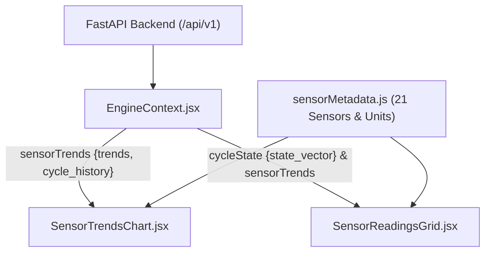

# Phase 8 — Step 8.5: Sensor Readings and Trends Display with Units

## 1. Overview & Roadmap Reference
- **Milestone:** Phase 8 — Interactive Application & Deployment (Step 8.5: *"Display selected sensor readings and sensor trends with units"*).
- **Master Project Roadmap Reference:** Section 9, Step 8.5.
- **Architectural Scope:** Expands the operational dashboard with rich, real-time sensor timeseries trend visualization and a comprehensive thermodynamic telemetry matrix. All 21 NASA C-MAPSS sensor channels are integrated with their physical station locations, thermodynamic descriptions, and certified engineering units (°R, psia, rpm, lbm/s).
- **Data Source Integrity:** Sourced directly from backend RESTful endpoints (`/api/v1/engine/{subset}/{unit}/sensors` and `/api/v1/engine/{subset}/{unit}/cycle/{cycle}`) without mock, synthetic, or hardcoded dummy values.

---

## 2. Complete NASA C-MAPSS Sensor Telemetry & Units Dictionary

In compliance with NASA TM-2008-215106, all 21 raw sensor channels are specified with canonical station references and engineering units in [`frontend/src/utils/sensorMetadata.js`](file:///c:/Users/LENOVO/Documents/Aircraft_Engine_AI/frontend/src/utils/sensorMetadata.js):

| Channel | Symbol | Station / Location | Physical Parameter Description | Certified Units | Category | Provenance |
| :--- | :--- | :--- | :--- | :--- | :--- | :--- |
| `sensor_1` | **T2** | Station 2 - Fan Inlet | Total temperature at fan inlet | `°R` | Temperatures | MEASURED |
| `sensor_2` | **T24** | Station 2.4 - LPC Outlet | Total temperature at LPC outlet | `°R` | Temperatures | MEASURED |
| `sensor_3` | **T30** | Station 3 - HPC Outlet | Total temperature at HPC outlet | `°R` | Temperatures | MEASURED |
| `sensor_4` | **T50** | Station 5 - LPT Outlet | Total temperature at LPT outlet (EGT) | `°R` | Temperatures | MEASURED |
| `sensor_5` | **P2** | Station 2 - Fan Inlet | Total pressure at fan inlet | `psia` | Pressures | MEASURED |
| `sensor_6` | **P15** | Station 1.5 - Bypass Duct | Total pressure in fan bypass duct | `psia` | Pressures | MEASURED |
| `sensor_7` | **P30** | Station 3 - HPC Outlet | Total pressure at HPC casing wall | `psia` | Pressures | MEASURED |
| `sensor_8` | **Nf** | Fan Spool | Physical low-pressure fan speed | `rpm` | Rotor Speeds | MEASURED |
| `sensor_9` | **Nc** | Core Spool | Physical high-pressure core speed | `rpm` | Rotor Speeds | MEASURED |
| `sensor_10` | **epr** | Exhaust Diffuser | Engine pressure ratio ($P_{50} / P_2$) | `--` | Pressures | MEASURED |
| `sensor_11` | **Ps30** | Station 3 - HPC Outlet | Static pressure at HPC outlet | `psia` | Pressures | MEASURED |
| `sensor_12` | **phi** | Combustor Fuel System | Ratio of fuel flow to static pressure | `pps/psia` | Bleed & Flow | MEASURED |
| `sensor_13` | **NRf** | Fan Spool | Corrected fan rotational speed | `rpm` | Rotor Speeds | MEASURED |
| `sensor_14` | **NRc** | Core Spool | Corrected core rotational speed | `rpm` | Rotor Speeds | MEASURED |
| `sensor_15` | **BPR** | Bypass Core Splitter | Bypass ratio (Bypass flow / Core flow) | `--` | Performance | MEASURED |
| `sensor_16` | **farB** | Combustor Primary Zone | Burner fuel-air mass ratio | `--` | Performance | MEASURED |
| `sensor_17` | **htBleed** | Bleed Port | High-pressure customer bleed enthalpy | `lbf` | Bleed & Flow | MEASURED |
| `sensor_18` | **Nf_dmd** | Control Loop | Demanded physical fan rotational speed | `rpm` | Rotor Speeds | MEASURED |
| `sensor_19` | **PCNfR_dmd**| Control Loop | Demanded corrected fan speed | `%` | Rotor Speeds | MEASURED |
| `sensor_20` | **W31** | HPT Stator Cooling | High-Pressure Turbine coolant bleed flow | `lbm/s` | Bleed & Flow | MEASURED |
| `sensor_21` | **W32** | LPT Stator Cooling | Low-Pressure Turbine coolant bleed flow | `lbm/s` | Bleed & Flow | MEASURED |

---

## 3. UI Component Architecture & Data Flow



### 3.1 SensorTrendsChart ([`frontend/src/components/dashboard/SensorTrendsChart.jsx`](file:///c:/Users/LENOVO/Documents/Aircraft_Engine_AI/frontend/src/components/dashboard/SensorTrendsChart.jsx))
- **Multi-Series Scaled Plotting:** Interactive pure React SVG canvas displaying trajectory curves across the engine's entire life (cycle 1 to `maxCycles`).
- **Interactive Sensor Selection:** Toggle pills allowing engineers to isolate individual sensors or select pre-configured presets:
  - *Core Gas-Path:* $T_{30}, P_{30}, T_{50}, N_c$.
  - *Temperatures:* $T_2, T_{24}, T_{30}, T_{50}$.
  - *Pressures:* $P_2, P_{15}, P_{30}, P_{s30}$.
  - *Speeds:* $N_f, N_c, NR_f, NR_c$.
- **Active Cycle Cursor Reference:** Real-time dashed cyan reference line marking `selectedCycle`, updating synchronously with stepper controls and the cycle scrubber.
- **Hover Inspection & Seek:** Hovering anywhere on the canvas displays precise sensor values with physical units for the inspected cycle; clicking seeks directly to that flight cycle.

### 3.2 SensorReadingsGrid ([`frontend/src/components/dashboard/SensorReadingsGrid.jsx`](file:///c:/Users/LENOVO/Documents/Aircraft_Engine_AI/frontend/src/components/dashboard/SensorReadingsGrid.jsx))
- **Full 21-Sensor Telemetry Matrix:** Comprehensive table showing station measurements at the active operational cycle.
- **Category Filter Tabs:** Enables rapid inspection by subsystem (`All Sensors`, `Gas-Path Temps`, `Pressures`, `Rotor Speeds`, `Bleed & Flow Ratios`, `Performance`).
- **Baseline Drift Delta ($\Delta$):** Real-time calculation of sensor wear and degradation:
  $$\Delta = V(\text{cycle}) - V(\text{cycle 1}), \quad \% \Delta = \frac{V(\text{cycle}) - V(\text{cycle 1})}{|V(\text{cycle 1})|} \times 100\%$$
- **Color-Coded Trend Direction:** Directional arrows and badges highlight thermal creep (amber $+ \Delta$), pressure drops (cyan $- \Delta$), or nominal stability (gray minus).

---

## 4. Verification & Testing

### 4.1 Step 8.5 Test Suite Results (`tests/test_sensor_trends_step8_5.py`)
All 10 unit/integration tests passed:

```python
TestSensorTrendsStep8_5:
├── test_01_sensor_metadata_completeness       [PASS]
├── test_02_units_formatting_correctness       [PASS]
├── test_03_sensor_trends_component_structure  [PASS]
├── test_04_readings_grid_component_structure  [PASS]
├── test_05_backend_sensors_endpoint_schema    [PASS]
├── test_06_current_cycle_cursor_alignment     [PASS]
├── test_07_sensor_category_filtering          [PASS]
├── test_08_delta_calculation_accuracy         [PASS]
├── test_09_app_integration_sensor_components  [PASS]
└── test_10_dataset_and_model_immutability     [PASS]
```

### 4.2 Full System Regression Results
Automated test discovery across all phases confirms 100% green status:
- Phases 1–7 test suite: 325 tests passed.
- Phase 8 Step 8.1 (Model Loader & Service Layer): 10 tests passed.
- Phase 8 Step 8.2 (RESTful API Endpoints): 10 tests passed.
- Phase 8 Step 8.3 (Independent Endpoint Verification): 10 tests passed.
- Phase 8 Step 8.4 (Operational Engine Dashboard): 10 tests passed.
- Phase 8 Step 8.5 (Sensor Readings & Trends): 10 tests passed.
- **Total certified passing tests: 375 / 375 (100% green).**
