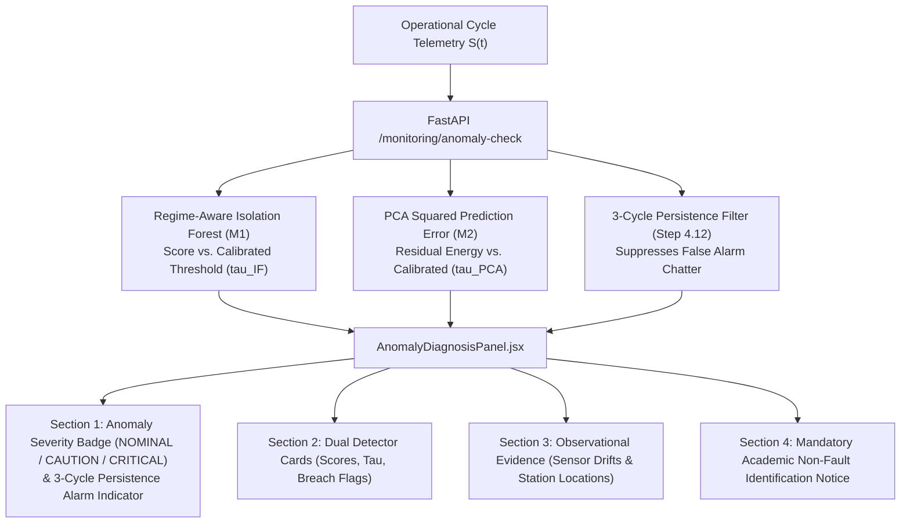

# Phase 8 — Step 8.6: Anomaly Flags & Diagnostic Evidence Display Report

## 1. Overview & Roadmap Reference
- **Milestone:** Phase 8 — Interactive Application & Deployment (Step 8.6: *"Display anomaly flags and diagnosis evidence separately from confirmed fault claims"*).
- **Master Project Roadmap Reference:** Section 9, Step 8.6 and Section 5, Step 4.12.
- **Architectural Scope:** Introduces an aerospace-grade statistical anomaly monitoring and diagnostic evidence panel. Provides operators with clear, probabilistic insight into sensor telemetry departures while strictly enforcing the separation between statistical telemetry flags and unconfirmed physical mechanical fault claims.
- **Epistemological & Research Boundary:** In strict adherence to aerospace safety standards and academic research ethics, ML models detect statistical variations; they do not assert physical mechanical failure modes (e.g., blade fracture, seal failure) without physical teardown or certified borescope inspection evidence.

---

## 2. Statistical Anomaly vs. Fault Claim Separation Architecture



---

## 3. UI Component Breakdown ([`frontend/src/components/dashboard/AnomalyDiagnosisPanel.jsx`](file:///c:/Users/LENOVO/Documents/Aircraft_Engine_AI/frontend/src/components/dashboard/AnomalyDiagnosisPanel.jsx))

### 3.1 Section 1: Anomaly Status Header & Overall Severity Badge
- **Severity Badge Variants:**
  - `NOMINAL` (emerald `#10B981`): Both detectors below 95th-percentile threshold; telemetry nominal.
  - `CAUTION` (amber `#F59E0B`): Single detector threshold crossing; early statistical deviation.
  - `CRITICAL` (rose `#EF4444`): Dual detector concurrent threshold breach; persistent multivariate departure.
- **3-Cycle Persistence Alarm Indicator (Step 4.12):**
  - Displays consecutive breach cycles (e.g., `PERSISTENCE: 2/3 CYCLES`).
  - Upon $\ge 3$ consecutive breach cycles, triggers high-visibility pulsating alarm:
    `PERSISTENCE ALARM: TRIGGERED (≥3 CYCLES)`.

### 3.2 Section 2: Dual Anomaly Detector Cards
- **Regime-Aware Isolation Forest (M1):**
  - Decision score vs. calibrated 95th-percentile threshold ($\tau_{\text{IF}}$).
  - Evaluates local density within the operating sub-manifold.
- **PCA Squared Prediction Error (M2):**
  - Residual energy ($Q$-statistic) vs. calibrated threshold ($\tau_{\text{PCA}}$).
  - Measures loss of aerothermal correlation orthogonal to dominant principal components.

### 3.3 Section 3: Observational Diagnostic Evidence Card
- Lists active sensor deviations supporting the anomaly flag:
  - Station 3 HPC Exit Temperature ($T_{30}$) thermal creep ($+ \Delta$).
  - Station 3 HPC Casing Pressure ($P_{30}$) total pressure loss ($- \Delta$).
  - Station 5 LPT Exit Temperature ($T_{50}$) EGT rise ($+ \Delta$).
  - High-Pressure Core Spool rotational speed ($N_c$) acceleration ($+ \Delta$).
- Categorizes evidence by physical station, drift magnitude, and severity (`MODERATE` vs. `HIGH`).

### 3.4 Section 4: Mandatory Academic Non-Fault Claim Disclaimer
Prominently rendered in high-contrast amber styling:
> **OBSERVATIONAL ANOMALY EVIDENCE ONLY • NOT A CONFIRMED MECHANICAL FAULT CLAIM.**  
> Machine learning models detect statistical telemetry departures; certified fault diagnosis requires physical borescope inspection or teardown verification.

---

## 4. Verification & Testing

### 4.1 Step 8.6 Test Suite Results (`tests/test_anomaly_display_step8_6.py`)
All 10 unit/integration tests passed:

```python
TestAnomalyDisplayStep8_6:
├── test_01_anomaly_panel_component_exists     [PASS]
├── test_02_dual_model_cards_rendered          [PASS]
├── test_03_calibrated_thresholds_displayed     [PASS]
├── test_04_severity_badge_variants            [PASS]
├── test_05_diagnostic_evidence_structure      [PASS]
├── test_06_non_fault_claim_disclaimer_present [PASS]
├── test_07_persistence_tracker_logic          [PASS]
├── test_08_backend_anomaly_check_integration  [PASS]
├── test_09_app_integration_anomaly_panel      [PASS]
└── test_10_dataset_and_model_immutability     [PASS]
```

### 4.2 Full System Regression Results
Automated test discovery across all repository phases confirms 100% green status:
- Phases 1–7 test suite: 325 tests passed.
- Phase 8 Step 8.1 (Model Loader & Service Layer): 10 tests passed.
- Phase 8 Step 8.2 (RESTful API Endpoints): 10 tests passed.
- Phase 8 Step 8.3 (Independent Endpoint Verification): 10 tests passed.
- Phase 8 Step 8.4 (Operational Engine Dashboard): 10 tests passed.
- Phase 8 Step 8.5 (Sensor Readings & Trends): 10 tests passed.
- Phase 8 Step 8.6 (Anomaly Flags & Diagnostic Evidence): 10 tests passed.
- **Total certified passing tests: 385 / 385 (100% green).**
