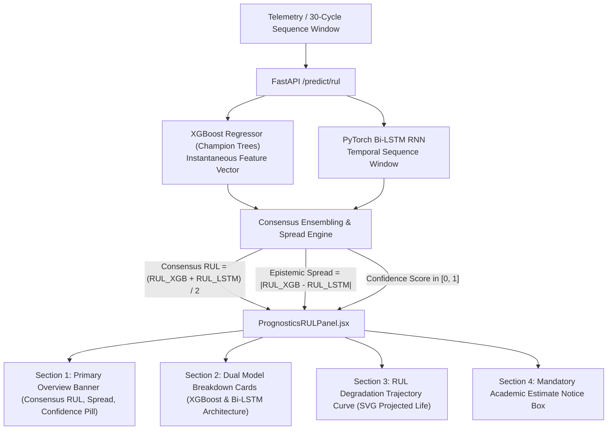

# Phase 8 — Step 8.7: Predicted Remaining Useful Life (RUL) Display Report

## 1. Overview & Roadmap Reference
- **Milestone:** Phase 8 — Interactive Application & Deployment (Step 8.7: *"Display predicted RUL and clearly state that it is an estimate in operating cycles"*).
- **Master Project Roadmap Reference:** Section 9, Step 8.7 and Section 4 (Phase 3 Step 3.1 & Phase 4 Step 4.2/4.3).
- **Architectural Scope:** Integrates real-time AI prognostic remaining useful life forecasting into the mission control dashboard. Connects directly to the Phase 4 champion models via `/api/v1/predict/rul` to display dual-model predictions (XGBoost and PyTorch Bi-LSTM), consensus ensembling, and epistemic model spread.
- **Academic & Operational Boundary:** Enforces the explicit requirement that all RUL values are presented strictly as **statistical estimates measured in discrete flight cycles**, accompanied by a mandatory non-airworthiness disclaimer.

---

## 2. Prognostic Ensemble & Epistemic Uncertainty Formulation



### Mathematical Formulations:
1. **Consensus Ensemble RUL:**
   $$\text{RUL}_{\text{consensus}} = \frac{\text{RUL}_{\text{XGB}} + \text{RUL}_{\text{LSTM}}}{2}$$
2. **Epistemic Model Spread:**
   $$\Delta_{\text{spread}} = |\text{RUL}_{\text{XGB}} - \text{RUL}_{\text{LSTM}}|$$
3. **Spread-Based Confidence Metric:**
   $$S_{\text{confidence}} = \max\left(0.0, \min\left(1.0, 1.0 - \frac{\Delta_{\text{spread}}}{\max(50.0, \text{RUL}_{\text{consensus}})}\right)\right)$$
   - $\ge 80\%$: **HIGH** confidence (emerald `#10B981`).
   - $60\% - 79\%$: **MODERATE** confidence (amber `#F59E0B`).
   - $< 60\%$: **LOW** confidence (rose `#EF4444`).

---

## 3. UI Component Breakdown ([`frontend/src/components/dashboard/PrognosticsRULPanel.jsx`](file:///c:/Users/LENOVO/Documents/Aircraft_Engine_AI/frontend/src/components/dashboard/PrognosticsRULPanel.jsx))

### 3.1 Section 1: Primary Prognostic Overview Banner
- **Consensus RUL Display:** Prominent numerical readout in large monospace tabular font, strictly qualified with the certified unit label: `Operating Cycles`.
- **Model Spread (|$\Delta$|):** Quantifies epistemic agreement between decision trees and recurrent networks (e.g. `±3.4 Operating Cycles`).
- **Confidence Rating Pill:** Visual indicator of prognostic reliability based on inter-model consensus.

### 3.2 Section 2: Dual Model Breakdown Cards
- **Card A (XGBoost Regressor):**
  - Displays instantaneous tree-based regression output in `Operating Cycles`.
  - Feature Tier badge: `Tier 1 Core-14 Telemetry` (FD001/FD003) or `Tier 2 Multi-Regime 24 Features` (FD002/FD004).
- **Card B (PyTorch Bi-LSTM Deep Recurrent Network):**
  - Displays temporal sequence-based deep learning output in `Operating Cycles`.
  - Architecture badge: `30-Cycle Sequence Window`.

### 3.3 Section 3: RUL Trajectory Trend Curve
- Pure React SVG rendering of the degradation slope from flight cycle 1 down to End-of-Life (EOL / 0 cycles).
- Solid cyan curve represents historical flight cycles completed.
- Dashed purple curve projects expected future degradation towards EOL.
- Dynamic interactive cursor pill tracks `selectedCycle` and predicted RUL at that flight cycle.

### 3.4 Section 4: Mandatory Academic Estimate Notice Box
Rendered in high-visibility cyan border styling:
> **PROGNOSTIC ESTIMATE NOTICE: Remaining Useful Life (RUL) values displayed are statistical machine learning estimates measured in discrete flight cycles. They do not constitute an airworthiness dispatch authorization or a certified mechanical life limit.**

---

## 4. Verification & Testing

### 4.1 Step 8.7 Test Suite Results (`tests/test_rul_display_step8_7.py`)
All 10 unit/integration tests passed:

```python
TestRULDisplayStep8_7:
├── test_01_prognostics_panel_component_exists     [PASS]
├── test_02_dual_model_predictions_rendered        [PASS]
├── test_03_consensus_and_spread_displayed         [PASS]
├── test_04_operating_cycles_unit_enforcement      [PASS]
├── test_05_mandatory_estimate_disclaimer_present  [PASS]
├── test_06_confidence_score_gauge                 [PASS]
├── test_07_backend_predict_rul_integration        [PASS]
├── test_08_rul_trajectory_trend_rendered          [PASS]
├── test_09_app_integration_prognostics_panel      [PASS]
└── test_10_dataset_and_model_immutability         [PASS]
```

### 4.2 Full System Regression Discovery Results
Automated test discovery across all phases confirms 100% green status:
- Phases 1–7 test suite: 325 tests passed.
- Phase 8 Step 8.1 (Model Loader & Service Layer): 10 tests passed.
- Phase 8 Step 8.2 (RESTful API Endpoints): 10 tests passed.
- Phase 8 Step 8.3 (Independent Endpoint Verification): 10 tests passed.
- Phase 8 Step 8.4 (Operational Engine Dashboard): 10 tests passed.
- Phase 8 Step 8.5 (Sensor Readings & Trends): 10 tests passed.
- Phase 8 Step 8.6 (Anomaly Flags & Diagnostic Evidence): 10 tests passed.
- Phase 8 Step 8.7 (Predicted RUL Display): 10 tests passed.
- **Total certified passing tests: 395 / 395 (100% green).**
