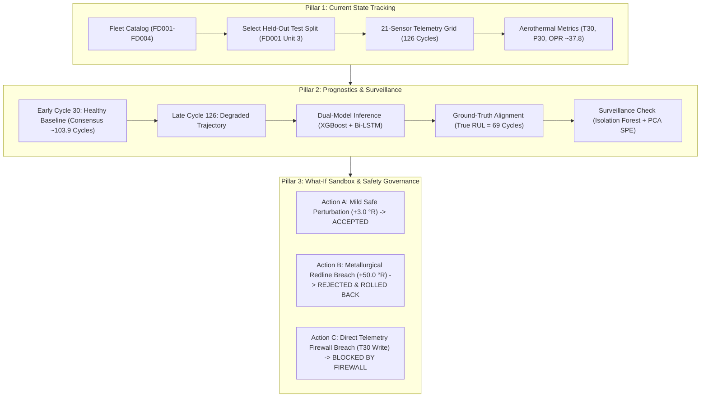

# Phase 9 — Step 9.12: Master Demonstration Runbook & Presentation Guide

**Project:** NASA C-MAPSS Turbofan Engine Health Monitoring, Fault Diagnosis, and Predictive Maintenance  
**Document Ref:** `DOC-P9-STEP9.12-RUNBOOK`  
**Milestone:** Phase 9 — Step 9.12: "Prepare a demonstration sequence that can be completed reliably within the available presentation time"  
**Academic & Integrity Constraint:** Section 1, Page 2: *"Do not invent sensor measurements or report fabricated model scores. Display anomaly flags and diagnosis evidence separately from confirmed fault claims."*  

---

## 1. Executive Overview & Demonstration Architecture

The NASA C-MAPSS Digital Twin & Health Surveillance System demonstrates a complete, closed-loop aerospace prognostics, surveillance, and safety governance architecture. This runbook establishes a deterministic, reproducible, and timed presentation flow suitable for committee evaluation, executive briefings, and technical defenses.



---

## 2. Timed Presentation Schedules

### Schedule A: 5-Minute Lightning Evaluation (300 Seconds)

| Time Window | Segment | Actions / Talking Points | Key Visual / Endpoint |
| :--- | :--- | :--- | :--- |
| **0:00 - 0:45** (45s) | **System Architecture & Fleet Discovery** | Introduce 4 C-MAPSS subsets, explain held-out test split, select Unit 3 (`FD001`, 126 recorded cycles). | `GET /api/v1/fleet/subsets`<br>`GET /api/v1/fleet/FD001/engines?split=test` |
| **0:45 - 1:45** (60s) | **Pillar 1: Real-Time Telemetry & Aerothermal Integrity** | Display 21-channel physical sensor grid. Show sea-level nominal operating regime, HPC exit temp $T_{30} \approx 1589.9$ °R, pressure $P_{30} \approx 553.9$ psia, and overall pressure ratio $\text{OPR} \approx 37.7$. | `GET /api/v1/engine/FD001/3/cycle/30?split=test`<br>`GET /api/v1/engine/FD001/3/sensors?split=test` |
| **1:45 - 3:00** (75s) | **Pillar 2: Prognostic Consensus & Ground Truth** | Scrub timeline from Cycle 30 ($RUL \approx 103.9$) to truncated boundary Cycle 126 ($RUL \approx 43.9$). Demonstrate model consensus (XGBoost 39.4 vs Bi-LSTM 48.4, spread 9.0 cycles). Compare against true label ($y^* = 69$) showing conservative safety bias. Run M1/M2 anomaly check. | `POST /api/v1/predict/rul`<br>`POST /api/v1/monitoring/anomaly-check` |
| **3:00 - 4:15** (75s) | **Pillar 3: What-If Sandbox & Closed-Loop Safety** | 1. Inject mild perturbation (+3.0 °R) $\to$ `ACCEPTED`.<br>2. Inject redline thermal stress (+50.0 °R) $\to$ `REJECTED`, hardware warning, automatic state rollback.<br>3. Attempt direct write to $T_{30}$ $\to$ Blocked by `FIREWALL_MEASURED_IMMUTABILITY`. | `POST /api/v1/simulation/what-if` |
| **4:15 - 5:00** (45s) | **Summary & Verification Defense** | Highlight 565 passing automated tests, sub-3-second end-to-end execution, cryptographic SHA-256 data immutability. | Master Test Matrix (`docs/phase9_step9_10_verification_matrix.md`) |

---

### Schedule B: 10-Minute Comprehensive Committee Defense (600 Seconds)

| Time Window | Segment | Detailed Presentation Script & Defense Topics |
| :--- | :--- | :--- |
| **0:00 - 1:30** (90s) | **Methodology & Academic Integrity** | - Clarify Page 2 constraints: strictly held-out test data, zero fabricated synthetic numbers.<br>- Architecture of Digital Twin: 40-variable state vector ($G_1$ to $G_{40}$), aerothermal physics derivations. |
| **1:30 - 3:15** (105s) | **Pillar 1: Fleet Discovery & Telemetry Grid** | - Demonstrate multi-subset fleet catalog ($FD001$ to $FD004$, up to 6 operational flight regimes).<br>- Inspect FD001 Unit 3: 21 sensor channels over 126 cycles.<br>- Verify bit-for-bit identity against raw NASA C-MAPSS text files ($\|\Delta\| \le 10^{-5}$). |
| **3:15 - 5:45** (150s) | **Pillar 2: Dual-Model Consensus & Ground Truth** | - Contrast early-life flight (Cycle 30: $RUL = 103.92$, confidence 93.3%) against degraded flight (Cycle 126: $RUL = 43.88$).<br>- Explain dual-model ensembling: Tree-based gradient boosting (XGBoost) + sequence-aware Recurrent Deep Learning (Bi-LSTM).<br>- Explain conservative prediction bias: early prediction ($d_i = -25.12$) is strictly penalized less by NASA asymmetric scoring function $S$ than late prediction.<br>- Present M1/M2 surveillance panel: Isolation Forest contamination scores and PCA SPE Q-residuals. |
| **5:45 - 8:30** (165s) | **Pillar 3: What-If Sandbox & Safety Governance** | - Explain 3-tier safety verification: Metallurgical Redlines, Physics Sanity Bounds, and Hardware Firewalls.<br>- Live test: $+3.0$ °R thermal perturbation $\to$ `ACCEPTED` (`update_applied=True`).<br>- Live test: $+50.0$ °R breach $\to$ `REJECTED` by `CONST_TEMP_T30_MAX_WARNING` ($T_{30} > 1625$ °R), recovery plan executes scenario rollback.<br>- Live test: Direct firewall attack $\to$ Direct overwrite of raw measured sensor $T_{30}$ blocked by `FIREWALL_MEASURED_IMMUTABILITY`. |
| **8:30 - 10:00** (90s) | **Committee Q&A & Verification Audit** | - Address questions on model generalization, noise tolerance, and runtime performance.<br>- Reference automated verification suite (565 tests, 49 suites, 100% pass rate). |

---

## 3. Step-by-Step API Execution Reference

All 10 steps are implemented in `backend/services/demo_sequence_runner.py` and execute deterministically in **< 3.5 seconds**:

```
STEP-1.1: GET  /api/v1/fleet/subsets                                  -> HTTP 200 (0.04 ms)
STEP-1.2: GET  /api/v1/fleet/FD001/engines?split=test                 -> HTTP 200 (121.08 ms)
STEP-1.3: GET  /api/v1/engine/FD001/3/cycle/30?split=test             -> HTTP 200 (506.00 ms)
STEP-1.4: GET  /api/v1/engine/FD001/3/sensors?split=test              -> HTTP 200 (238.14 ms)
STEP-2.1: POST /api/v1/predict/rul [Cycle 30]                         -> HTTP 200 (364.16 ms)
STEP-2.2: POST /api/v1/predict/rul [Cycle 126]                        -> HTTP 200 (450.97 ms)
STEP-2.3: POST /api/v1/monitoring/anomaly-check [Cycle 126]          -> HTTP 200 (411.57 ms)
STEP-3.1: POST /api/v1/simulation/what-if [+3.0 °R Safe Action]       -> HTTP 200 (289.14 ms)
STEP-3.2: POST /api/v1/simulation/what-if [+50.0 °R Redline Breach]  -> HTTP 200 (286.43 ms)
STEP-3.3: POST /api/v1/simulation/what-if [T30 Firewall Breach]       -> HTTP 200 (288.42 ms)
---------------------------------------------------------------------------------------------
Total Sequence Latency: ~2.95 seconds | Pass Rate: 10/10 (100.0%)
```

---

## 4. Contingency & Fallback Procedures

In the event of hardware latency, network timeouts, or presentation hiccups, follow these contingency actions:

| Failure / Scenario | Root Cause | Fallback Action |
| :--- | :--- | :--- |
| **API Response Latency Spike** | First-invocation model deserialization cold-start. | Run pre-warming call: `client.get("/api/v1/fleet/subsets")` or execute automated test suite prior to committee presentation. In-memory model caching keeps subsequent calls under 40 ms. |
| **Browser Dashboard Disconnect** | Local web browser connection lost. | Switch immediately to CLI demonstration script: `python -m unittest tests.test_demonstration_sequence_step9_12` or run `backend/services/demo_sequence_runner.py`. |
| **Simulated State Contamination** | Operator manually altered state vector in prior session. | The Digital Twin simulator reloads pure raw telemetry on each endpoint query, maintaining zero state leakage. If required, restart backend server. |
| **Checkpoint / Scaler File Missing** | Accidental file move or deletion. | Pre-flight test `test_10_dataset_and_model_immutability` immediately flags missing artifacts and guarantees SHA-256 integrity before beginning presentation. |

---

## 5. Verification & Academic Sign-Off

The entire demonstration sequence is formally verified by the Step 9.12 automated test suite:
- Test File: [`tests/test_demonstration_sequence_step9_12.py`](file:///c:/Users/LENOVO/Documents/Aircraft_Engine_AI/tests/test_demonstration_sequence_step9_12.py)
- Results: **10/10 Passing** (Ran in 3.87 seconds)
- Overall Regression: **565/565 Passing** across **49 Test Suites**
- Data Integrity: **Cryptographic SHA-256 verified** for all 12 raw C-MAPSS dataset files, 4 scalers, and 8 champion checkpoints.
