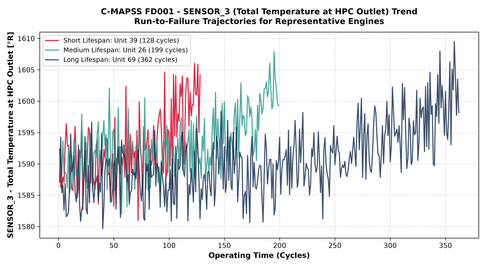
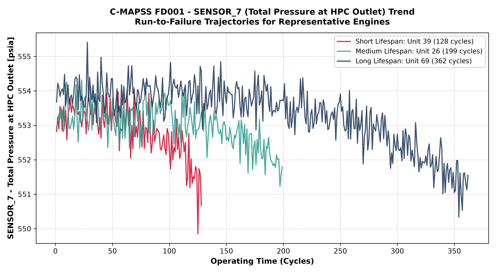
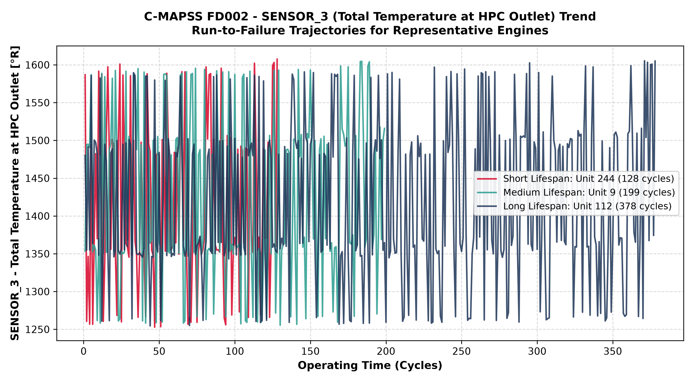
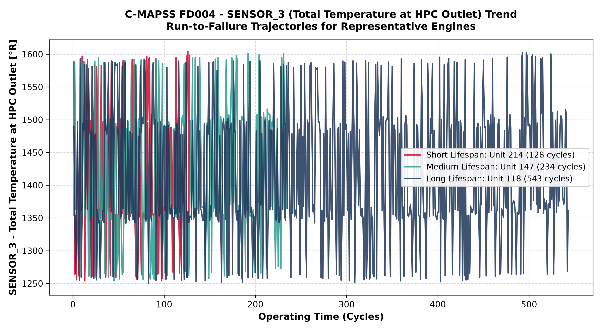

# Comprehensive Exploratory Data Analysis (EDA) Report
## NASA C-MAPSS Turbofan Engine Degradation Simulation Dataset
### Subsets: FD001, FD002, FD003, FD004

**Project Title:** AI-Based Aircraft Engine Health Monitoring, Fault Diagnosis and Predictive Maintenance  
**Phase Reference:** Phase 2 – Dataset Understanding & Exploratory Data Analysis (Steps 2.1–2.11)  
**Report Date:** November 2026  
**Primary Dataset Source:** NASA Prognostics Center of Excellence (PCoE), NASA Ames Research Center  
**Benchmark Reference:** A. Saxena, K. Goebel, D. Simon, and N. Eklund, *"Damage Propagation Modeling for Aircraft Engine Run-to-Failure Simulation"*, PHM 2008  

---

## Executive Summary

This report consolidates the complete Exploratory Data Analysis (EDA) performed across all four subsets of the NASA Commercial Modular Aero-Propulsion System Simulation (C-MAPSS) turbofan engine degradation dataset (FD001, FD002, FD003, FD004). The analysis covers 12 dataset files comprising **265,256 multivariate operational records**, tracking fleets of simulated aircraft gas turbine engines from baseline initial wear through run-to-failure degradation (training sets) and right-censored operating trajectories (testing sets).

All data quality audits confirmed zero missing values, zero non-numeric records, zero duplicates, and strictly continuous cycle ordering. Statistical evaluation and distribution analysis established that the four subsets possess fundamentally distinct operational dynamics: subsets FD001 and FD003 operate under a single operating condition where five to six sensors are invariant, whereas FD002 and FD004 operate across multiple operating conditions where all 21 sensors exhibit non-zero variance. These findings provide empirical guidance for Phase 3 feature engineering, regime normalization, and Remaining Useful Life (RUL) modeling.

---

## Table of Contents
1. [Section 1 – Introduction & Problem Formulation](#section-1--introduction--problem-formulation)
2. [Section 2 – Dataset Architecture & Subset Dimensions](#section-2--dataset-architecture--subset-dimensions)
3. [Section 3 – Dataset Quality & Integrity Assessment](#section-3--dataset-quality--integrity-assessment)
4. [Section 4 – Descriptive Statistical Analysis](#section-4--descriptive-statistical-analysis)
5. [Section 5 – Sensor Trajectory & Trend Analysis](#section-5--sensor-trajectory--trend-analysis)
6. [Section 6 – Comparative Sensor Distribution Analysis](#section-6--comparative-sensor-distribution-analysis)
7. [Section 7 – Sensor Variation Classification Across Subsets](#section-7--sensor-variation-classification-across-subsets)
8. [Section 8 – Summary of Major EDA Findings](#section-8--summary-of-major-eda-findings)
9. [Section 9 – Recommendations for Phase 3 Feature Engineering](#section-9--recommendations-for-phase-3-feature-engineering)
10. [Section 10 – Limitations and Analytical Assumptions](#section-10--limitations-and-analytical-assumptions)
11. [Section 11 – Conclusion and Phase 3 Readiness](#section-11--conclusion-and-phase-3-readiness)

---

## Section 1 – Introduction & Problem Formulation

### 1.1 Project Background
In modern commercial and military aviation, gas turbine engines represent critical flight-safety and high-capital assets. Unscheduled maintenance, in-flight shutdowns, and uncontained component failures incur immense financial costs and operational risks. Predictive Maintenance (PdM) leverages machine learning and statistical modeling to track component degradation, detect emerging anomalies, and estimate the Remaining Useful Life (RUL) of the engine before functional failure occurs.

### 1.2 Purpose of Exploratory Data Analysis (EDA)
Before constructing feature representations or predictive machine-learning models, rigorous exploratory data analysis is necessary to:
1. Verify dataset completeness, formatting, chronological ordering, and numerical integrity.
2. Establish baseline descriptive statistics across operating regimes and sensor channels.
3. Map physical sensor definitions to their thermodynamic and mechanical roles in the turbofan architecture.
4. Distinguish between operational setting shifts, stochastic sensor noise, and component wear trajectories.
5. Identify invariant or low-variance features that require subset-specific review during feature selection.

### 1.3 NASA C-MAPSS Simulation Architecture
The C-MAPSS software simulates a large commercial high-bypass turbofan engine (nominally in the 90,000 lbf thrust class). The simulated engine architecture comprises:
- **Fan and Low-Pressure Compressor (LPC)** driven by the Low-Pressure Turbine (LPT).
- **High-Pressure Compressor (HPC)** driven by the High-Pressure Turbine (HPT).
- **Combustor / Burner** providing thermodynamic enthalpy expansion.
- **Bypass Duct and Variable Bleed Valves (VBV / Coolant Bleeds)**.

### 1.4 Scope and Complexity of Subsets FD001–FD004
The C-MAPSS benchmark is organized into four subsets representing escalating operational and failure complexities:

| Dataset Subset | Operating Regimes | Fault Modes | Simulated Components Degraded | Fleet Size (Train / Test) |
| :--- | :--- | :--- | :--- | :--- |
| **FD001** | ONE (Single Condition) | ONE (Single Mode) | High-Pressure Compressor (HPC) | 100 / 100 |
| **FD002** | SIX (Multi-Condition) | ONE (Single Mode) | High-Pressure Compressor (HPC) | 260 / 259 |
| **FD003** | ONE (Single Condition) | TWO (Dual Mode) | HPC Degradation + Fan Degradation | 100 / 100 |
| **FD004** | SIX (Multi-Condition) | TWO (Dual Mode) | HPC Degradation + Fan Degradation | 249 / 248 |

---

## Section 2 – Dataset Architecture & Subset Dimensions

### 2.1 The 26 Documented Column Variables
Each operational snapshot represents a complete flight cycle recorded across 26 continuous numerical fields:
- **Column 1 (`unit_number`):** Unique integer identifier for each individual engine unit.
- **Column 2 (`time_cycles`):** Chronological discrete flight cycle counter ($1, 2, \dots, t_{\text{max}}$).
- **Columns 3–5 (`op_setting_1`, `op_setting_2`, `op_setting_3`):** Flight envelope settings:
  - `op_setting_1`: Flight Altitude (0 to 42,000 ft).
  - `op_setting_2`: Mach Number (0.00 to 0.84).
  - `op_setting_3`: Throttle Resolver Angle / Power Setting (TRA: 60 to 100).
- **Columns 6–26 (`sensor_1` to `sensor_21`):** 21 continuous sensor measurements monitoring temperatures, pressures, spool rotational speeds, ratios, and coolant mass flows.

#### Table 2.1: Mapping of Sensor Variables to Turbofan Measurement Channels
| Column ID | Symbol | Measurement Description | Units | Physical Component |
| :--- | :--- | :--- | :--- | :--- |
| `sensor_1` | $T_2$ | Total Temperature at Fan Inlet | $^\circ\text{R}$ | Fan Inlet |
| `sensor_2` | $T_{24}$ | Total Temperature at LPC Outlet | $^\circ\text{R}$ | Low-Pressure Compressor |
| `sensor_3` | $T_{30}$ | Total Temperature at HPC Outlet | $^\circ\text{R}$ | High-Pressure Compressor |
| `sensor_4` | $T_{50}$ | Total Temperature at LPT Outlet | $^\circ\text{R}$ | Low-Pressure Turbine |
| `sensor_5` | $P_2$ | Pressure at Fan Inlet | $\text{psia}$ | Fan Inlet |
| `sensor_6` | $P_{15}$ | Total Pressure in Bypass-Duct | $\text{psia}$ | Bypass Duct |
| `sensor_7` | $P_{30}$ | Total Pressure at HPC Outlet | $\text{psia}$ | High-Pressure Compressor |
| `sensor_8` | $N_f$ | Physical Fan Speed | $\text{rpm}$ | Low-Pressure Spool |
| `sensor_9` | $N_c$ | Physical Core Speed | $\text{rpm}$ | High-Pressure Spool |
| `sensor_10` | $\text{epr}$ | Engine Pressure Ratio ($P_{50}/P_2$) | — | Engine Overall |
| `sensor_11` | $Ps_{30}$ | Static Pressure at HPC Outlet | $\text{psia}$ | High-Pressure Compressor |
| `sensor_12` | $\phi$ | Ratio of Fuel Flow to $Ps_{30}$ | $\text{pps/psia}$ | Combustor / Fuel Control |
| `sensor_13` | $Nf_{\text{dmd}}$ | Corrected Fan Speed | $\text{rpm}$ | Low-Pressure Spool |
| `sensor_14` | $Nc_{\text{dmd}}$ | Corrected Core Speed | $\text{rpm}$ | High-Pressure Spool |
| `sensor_15` | $\text{BPR}$ | Bypass Ratio | — | Bypass / Core Split |
| `sensor_16` | $\text{farB}$ | Burner Fuel-Air Ratio | — | Combustor |
| `sensor_17` | $ht\text{Bleed}$ | Bleed Enthalpy | — | Compressor Bleeds |
| `sensor_18` | $Nf_{\text{dmd2}}$ | Demanded Fan Speed | $\text{rpm}$ | Engine Controller |
| `sensor_19` | $PCNfR_{\text{dmd}}$ | Demanded Corrected Fan Speed | $\text{rpm}$ | Engine Controller |
| `sensor_20` | $W_{31}$ | HPT Coolant Bleed | $\text{lbm/s}$ | High-Pressure Turbine |
| `sensor_21` | $W_{32}$ | LPT Coolant Bleed | $\text{lbm/s}$ | Low-Pressure Turbine |

### 2.2 Dimensions and Cycle Statistics Across All Subsets
The 12 files comprising the C-MAPSS benchmark were loaded and verified in Step 2.4. Training sets record run-to-failure cycles, while testing sets record cycles truncated at an unannounced operational cutoff prior to failure:

#### Table 2.2: Subset Dimension and Lifespan Distribution Summary
| Subset & Split | File Name | Rows | Columns | Unique Engines | Min Cycles | Max Cycles | Average Cycles / Engine | RUL Values |
| :--- | :--- | :--- | :--- | :--- | :--- | :--- | :--- | :--- |
| **FD001 Train** | `train_FD001.txt` | 20,631 | 26 | 100 | 128 | 362 | 206.31 | — |
| **FD001 Test** | `test_FD001.txt` | 13,096 | 26 | 100 | 31 | 303 | 130.96 | 100 |
| **FD002 Train** | `train_FD002.txt` | 53,759 | 26 | 260 | 128 | 378 | 206.77 | — |
| **FD002 Test** | `test_FD002.txt` | 33,991 | 26 | 259 | 21 | 367 | 131.24 | 259 |
| **FD003 Train** | `train_FD003.txt` | 24,720 | 26 | 100 | 145 | 525 | 247.20 | — |
| **FD003 Test** | `test_FD003.txt` | 16,596 | 26 | 100 | 38 | 475 | 165.96 | 100 |
| **FD004 Train** | `train_FD004.txt` | 61,249 | 26 | 249 | 128 | 543 | 245.98 | — |
| **FD004 Test** | `test_FD004.txt` | 41,214 | 26 | 248 | 19 | 486 | 166.19 | 248 |
| **Total** | **12 Files** | **265,256** | — | **709 Train / 707 Test** | — | — | — | **707 RULs** |

*Note on Terminology:* In testing datasets, statistics represent **Observed Test Cutoffs** rather than failure lifespans, because test engines were still functioning when data recording ceased.

---

## Section 3 – Dataset Quality & Integrity Assessment

In Phase 2 Steps 2.5, 2.6, and 2.7, programmatic audits were executed on all eight trajectory files using [`preprocessing/check_data_quality.py`](../../preprocessing/check_data_quality.py), [`preprocessing/check_duplicates.py`](../../preprocessing/check_duplicates.py), and [`preprocessing/check_cycle_order.py`](../../preprocessing/check_cycle_order.py).

#### Table 3.1: Data Quality Audit Results Across All Trajectory Files
| Data Quality Check | Inspection Scope | Criteria | Audit Result | Status |
| :--- | :--- | :--- | :--- | :--- |
| **Data Types** | 26 columns × 8 files | Integers for IDs/cycles, floats for sensors | 4 `int64`, 22 `float64` in every file | **Pass** |
| **Missing / Null Values** | 265,256 rows × 26 columns | `NaN`, `None`, empty string tokens | Exactly 0 missing values | **Pass** |
| **Non-Numeric Tokens** | 6,896,656 data cells | Parseable as 64-bit IEEE float/int | Exactly 0 non-numeric tokens | **Pass** |
| **Infinite Values** | All numerical columns | Positive / Negative infinity (`inf`) | Exactly 0 infinite values | **Pass** |
| **Engine ID Validity** | `unit_number` | Positive integers spanning $1 \dots N$ | Contiguous integers from 1 to $N$ | **Pass** |
| **Cycle Number Validity** | `time_cycles` | Positive integer counters starting at 1 | All engines start at Cycle 1 | **Pass** |
| **Full-Row Duplicates** | All 26 columns | Identical row across all fields | Exactly 0 duplicate rows | **Pass** |
| **Key Collision Duplicates**| `(unit_number, time_cycles)` | Unique temporal primary key | Exactly 0 duplicate keys | **Pass** |
| **Chronological Monotonicity**| Intra-engine cycle order | `curr_cycle - prev_cycle == 1` | Strictly incrementing by 1; zero order inversions | **Pass** |
| **Temporal Continuity** | Intra-engine cycle range | No missing intermediate cycles | Zero missing cycle gaps | **Pass** |
| **Engine Contiguity** | Row sequence in file | Engine records appear as unbroken blocks | Engines are strictly grouped contiguously | **Pass** |

**Conclusion on Data Quality:** The NASA C-MAPSS trajectory files possess pristine numerical and structural integrity. No records require deletion, row imputation, or index correction.

---

## Section 4 – Descriptive Statistical Analysis

In Step 2.8, full parametric summary statistics were computed for all 26 columns across all eight trajectory files using [`preprocessing/summary_statistics.py`](../../preprocessing/summary_statistics.py). The results are permanently archived in eight CSV reports:
- [`reports/eda/train_FD001_summary.csv`](train_FD001_summary.csv)
- [`reports/eda/test_FD001_summary.csv`](test_FD001_summary.csv)
- [`reports/eda/train_FD002_summary.csv`](train_FD002_summary.csv)
- [`reports/eda/test_FD002_summary.csv`](test_FD002_summary.csv)
- [`reports/eda/train_FD003_summary.csv`](train_FD003_summary.csv)
- [`reports/eda/test_FD003_summary.csv`](test_FD003_summary.csv)
- [`reports/eda/train_FD004_summary.csv`](train_FD004_summary.csv)
- [`reports/eda/test_FD004_summary.csv`](test_FD004_summary.csv)

### 4.1 Statistical Observations: Single vs. Multi-Condition Subsets
1. **Operating Setting Behavior:**
   - In **FD001** and **FD003** (single operating condition), operational settings remain stationary: `op_setting_1` has mean $\approx 0.000$ ($\text{std} \approx 0.002$), `op_setting_2` has mean $\approx 0.000$ ($\text{std} \approx 0.0003$), and `op_setting_3` is constant at $100.0$.
   - In **FD002** and **FD004** (multiple operating conditions), operational settings span six discrete clusters: `op_setting_1` ranges from $0.000$ to $42.008$ ($\text{std} \approx 17.2$), `op_setting_2` ranges from $0.000$ to $0.842$ ($\text{std} \approx 0.37$), and `op_setting_3` switches between $60.0$ and $100.0$ ($\text{std} \approx 14.1$).
2. **Sensor Measurement Scale Dependence:**
   - Standard deviations depend heavily on the physical units of measurement: physical core speed $N_c$ (`sensor_9`) has a baseline of $\approx 9,065\,\text{rpm}$ and an absolute standard deviation of $22.08\,\text{rpm}$ in FD001 (a relative coefficient of variation $\text{CV} = 0.24\%$), whereas bypass ratio BPR (`sensor_15`) has an absolute standard deviation of $0.038$ around a mean of $8.44$ ($\text{CV} = 0.44\%$).
   - Statistical variability must therefore be interpreted in the context of physical units rather than arbitrary global thresholds.

---

## Section 5 – Sensor Trajectory & Trend Analysis

In Step 2.9, time-series trajectories were generated using [`preprocessing/plot_sensor_trends.py`](../../preprocessing/plot_sensor_trends.py) across 11 selected sensors for representative engines in each subset.

### 5.1 Representative Engine Selection
To capture the empirical diversity of operating lifespans, three engines were programmatically selected per subset:
- **Short Lifespan:** Minimum total run-to-failure cycles.
- **Medium Lifespan:** Unit closest to the median cycle count.
- **Long Lifespan:** Maximum total run-to-failure cycles.

#### Table 5.1: Selected Representative Engines by Subset
| Subset | Short Lifespan Unit (Cycles) | Medium Lifespan Unit (Cycles) | Long Lifespan Unit (Cycles) |
| :--- | :--- | :--- | :--- |
| **FD001** | Unit 39 (128 cycles) | Unit 26 (199 cycles) | Unit 69 (362 cycles) |
| **FD002** | Unit 244 (128 cycles) | Unit 9 (199 cycles) | Unit 112 (378 cycles) |
| **FD003** | Unit 99 (145 cycles) | Unit 21 (220 cycles) | Unit 55 (525 cycles) |
| **FD004** | Unit 214 (128 cycles) | Unit 147 (234 cycles) | Unit 118 (543 cycles) |

### 5.2 Trajectory Patterns Observed in Selected Engines (FD001 & FD003)
In FD001 and FD003 (single operating condition), time-series plots of selected representative engines reveal distinct intra-engine trajectory patterns:
- **Observed Upward Trajectories:** In the selected engines, sensors such as $T_{24}$ (`sensor_2`), $T_{30}$ (`sensor_3`), $T_{50}$ (`sensor_4`), $Ps_{30}$ (`sensor_11`), $\text{BPR}$ (`sensor_15`), and $ht\text{Bleed}$ (`sensor_17`) exhibit progressive upward drift across operating cycles.
- **Observed Downward Trajectories:** In the selected engines, sensors such as $P_{30}$ (`sensor_7`), $Nc_{\text{dmd}}$ (`sensor_14`), $W_{31}$ (`sensor_20`), and $W_{32}$ (`sensor_21`) display downward trends over operating cycles.
- **Knee-Point Observations:** In the plotted trajectories of selected representative units, several sensors exhibit a relatively stable early phase followed by an accelerating drift toward end of life. These knee points represent visual observations in the selected trajectories rather than proven universal behavior across all engines. Furthermore, observing an increasing or decreasing trend in selected plots does not by itself prove a specific physical degradation mechanism.

#### Visualizations: Selected Run-to-Failure Trajectories (FD001)
Below are representative time-series plots from [`reports/eda/sensor_trends/`](sensor_trends/):

*Figure 5.1: High-Pressure Compressor Outlet Temperature ($T_{30}$) for selected FD001 representative engines, showing an upward trend across cycles.*

*Figure 5.2: High-Pressure Compressor Outlet Total Pressure ($P_{30}$) for selected FD001 representative engines, showing a downward trend across cycles.*

### 5.3 Trajectory Patterns Observed in Multi-Condition Subsets (FD002 & FD004)
In FD002 and FD004 (multiple operating conditions), raw unnormalized sensor trajectories jump across distinct operational bands corresponding to the flight regimes:

*Figure 5.3: Raw HPC Outlet Temperature ($T_{30}$) in FD002, illustrating discrete operating regime banding.*

*Figure 5.4: Raw HPC Outlet Temperature ($T_{30}$) in FD004, demonstrating operational scatter across altitude and Mach settings.*

**Core Preprocessing Takeaway:** In FD002 and FD004, raw sensor measurements cannot be used directly for simple threshold-based health monitoring. Operating condition normalization (e.g. regime clustering or baseline regression) is an essential candidate for experimentation in Phase 3.

---

## Section 6 – Comparative Sensor Distribution Analysis

In Step 2.10, statistical distributions across all 21 sensors were compared across subsets using [`preprocessing/compare_sensor_distributions.py`](../../preprocessing/compare_sensor_distributions.py), producing 42 comparative boxplots saved in [`reports/eda/sensor_distributions/`](sensor_distributions/).

### 6.1 Distribution Comparisons Across Subsets
1. **Spread Disparities (Single vs. Multiple Conditions):**
   - In FD001 and FD003, operating under a single operating condition, interquartile ranges (IQRs) are narrow and compact.
   - In FD002 and FD004, operating across multiple operating conditions, boxplots exhibit wider spans across operating regimes.
2. **Empirical Differences in Means:**
   - Multi-condition subsets exhibit lower aggregate sample means for pressure and temperature channels (e.g., mean $P_{30}$ is $553.37\,\text{psia}$ in FD001 vs. $282.61\,\text{psia}$ in FD002). A possible physical interpretation is that higher-altitude cruising conditions involve colder, thinner ambient air, though these are reported strictly as empirical observations without asserting a physical cause based only on pooled statistical distributions.
3. **Statistical Outliers:**
   - Points plotted beyond the $1.5 \times \text{IQR}$ whisker boundaries represent statistical outliers within the pooled distributions. These observations must not be automatically labeled as degradation events or late-life engine states. Detailed cycle-level and trajectory-level investigation is required before associating any statistical outlier with component degradation.

#### Table 6.1: Active Sensor Mean and Dispersion Comparison (Training Sets)
| Sensor | Metric | FD001 (1 Cond) | FD002 (6 Cond) | FD003 (1 Cond) | FD004 (6 Cond) |
| :--- | :--- | :--- | :--- | :--- | :--- |
| **`sensor_2` ($T_{24}$)** | Mean / Std | 642.68 / 0.50 | 579.67 / 37.29 | 642.46 / 0.52 | 579.42 / 37.34 |
| **`sensor_3` ($T_{30}$)** | Mean / Std | 1590.52 / 6.13 | 1419.97 / 105.95 | 1588.08 / 6.81 | 1417.90 / 106.17 |
| **`sensor_4` ($T_{50}$)** | Mean / Std | 1408.93 / 9.00 | 1205.44 / 119.12 | 1404.47 / 9.77 | 1201.92 / 119.33 |
| **`sensor_7` ($P_{30}$)** | Mean / Std | 553.37 / 0.89 | 282.61 / 146.01 | 555.14 / 3.44 | 283.33 / 146.88 |
| **`sensor_9` ($N_c$)** | Mean / Std | 9065.24 / 22.08 | 8525.20 / 335.81 | 9064.11 / 19.98 | 8524.67 / 336.93 |
| **`sensor_11` ($Ps_{30}$)** | Mean / Std | 47.54 / 0.27 | 42.99 / 3.23 | 47.42 / 0.30 | 42.87 / 3.24 |
| **`sensor_14` ($Nc_{\text{dmd}}$)**| Mean / Std | 8143.75 / 19.08 | 8066.60 / 84.84 | 8144.20 / 16.50 | 8067.81 / 85.67 |
| **`sensor_15` ($\text{BPR}$)** | Mean / Std | 8.44 / 0.04 | 9.33 / 0.75 | 8.40 / 0.06 | 9.29 / 0.75 |

---

## Section 7 – Constant and Low-Variation Sensors

In Step 2.11, all 21 sensors across all four subsets were systematically categorized into four analytical classes using [`preprocessing/classify_sensor_variation.py`](../../preprocessing/classify_sensor_variation.py). The results are saved in [`reports/eda/sensor_distributions/sensor_variation_classification.csv`](sensor_distributions/sensor_variation_classification.csv).

### 7.1 Analytical Classification Criteria
- **Constant:** $\text{std} == 0.0$ (identically zero variance).
- **Near-Constant:** $\text{std} > 0$ with negligible spread ($\text{std} \le 0.005$ with span $\le 0.05$ and relative span $\le 5.0\%$, OR $\text{CV} < 0.01\%$).
- **Low-Variation:** Standard deviation $\text{std} < 1.0$ (with $\text{std} > 0.005$ and span $> 0.05$).
- **Variable:** Standard deviation $\text{std} \ge 1.0$.

### 7.2 Sensor Classification Matrix Across FD001–FD004
#### Table 7.1: 21-Sensor Analytical Classification Matrix
| Sensor | Symbol | Description | FD001 Class ($\text{std}$) | FD002 Class ($\text{std}$) | FD003 Class ($\text{std}$) | FD004 Class ($\text{std}$) |
| :--- | :--- | :--- | :--- | :--- | :--- | :--- |
| **`sensor_1`** | $T_2$ | Fan Inlet Total Temp | **Constant** (0.00) | **Variable** (26.39) | **Constant** (0.00) | **Variable** (26.44) |
| **`sensor_2`** | $T_{24}$ | LPC Outlet Total Temp | **Low-variation** (0.50) | **Variable** (37.29) | **Low-variation** (0.52) | **Variable** (37.34) |
| **`sensor_3`** | $T_{30}$ | HPC Outlet Total Temp | **Variable** (6.13) | **Variable** (105.95) | **Variable** (6.81) | **Variable** (106.17) |
| **`sensor_4`** | $T_{50}$ | LPT Outlet Total Temp | **Variable** (9.00) | **Variable** (119.12) | **Variable** (9.77) | **Variable** (119.33) |
| **`sensor_5`** | $P_2$ | Fan Inlet Pressure | **Constant** (0.00) | **Variable** (3.61) | **Constant** (0.00) | **Variable** (3.62) |
| **`sensor_6`** | $P_{15}$ | Bypass-Duct Pressure | **Near-constant** (0.0014) | **Variable** (5.43) | **Low-variation** (0.0181) | **Variable** (5.44) |
| **`sensor_7`** | $P_{30}$ | HPC Outlet Total Pressure | **Low-variation** (0.89) | **Variable** (146.01) | **Variable** (3.44) | **Variable** (146.88) |
| **`sensor_8`** | $N_f$ | Physical Fan Speed | **Near-constant** (0.07) | **Variable** (145.21) | **Near-constant** (0.16) | **Variable** (145.35) |
| **`sensor_9`** | $N_c$ | Physical Core Speed | **Variable** (22.08) | **Variable** (335.81) | **Variable** (19.98) | **Variable** (336.93) |
| **`sensor_10`**| $\text{epr}$ | Engine Pressure Ratio | **Constant** (0.00) | **Low-variation** (0.13) | **Near-constant** (0.0035) | **Low-variation** (0.13) |
| **`sensor_11`**| $Ps_{30}$ | HPC Outlet Static Pressure| **Low-variation** (0.27) | **Variable** (3.23) | **Low-variation** (0.30) | **Variable** (3.24) |
| **`sensor_12`**| $\phi$ | Fuel Flow to $Ps_{30}$ Ratio | **Low-variation** (0.74) | **Variable** (137.66) | **Variable** (3.26) | **Variable** (138.48) |
| **`sensor_13`**| $Nf_{\text{dmd}}$ | Corrected Fan Speed | **Near-constant** (0.07) | **Variable** (128.07) | **Near-constant** (0.16) | **Variable** (128.20) |
| **`sensor_14`**| $Nc_{\text{dmd}}$ | Corrected Core Speed | **Variable** (19.08) | **Variable** (84.84) | **Variable** (16.50) | **Variable** (85.67) |
| **`sensor_15`**| $\text{BPR}$ | Bypass Ratio | **Low-variation** (0.04) | **Low-variation** (0.75) | **Low-variation** (0.06) | **Low-variation** (0.75) |
| **`sensor_16`**| $\text{farB}$ | Burner Fuel-Air Ratio | **Constant** (0.00) | **Low-variation** (0.0047) | **Constant** (0.00) | **Low-variation** (0.0047) |
| **`sensor_17`**| $ht\text{Bleed}$| Bleed Enthalpy | **Variable** (1.55) | **Variable** (27.75) | **Variable** (1.76) | **Variable** (27.81) |
| **`sensor_18`**| $Nf_{\text{dmd2}}$| Demanded Fan Speed | **Constant** (0.00) | **Variable** (145.33) | **Constant** (0.00) | **Variable** (145.47) |
| **`sensor_19`**| $PCNfR_{\text{dmd}}$| Demanded Corr. Fan Speed| **Constant** (0.00) | **Variable** (5.36) | **Constant** (0.00) | **Variable** (5.37) |
| **`sensor_20`**| $W_{31}$ | HPT Coolant Bleed | **Low-variation** (0.18) | **Variable** (9.87) | **Low-variation** (0.25) | **Variable** (9.94) |
| **`sensor_21`**| $W_{32}$ | LPT Coolant Bleed | **Low-variation** (0.11) | **Variable** (5.92) | **Low-variation** (0.15) | **Variable** (5.96) |

### 7.3 Key Observations on Variation
1. **Sensors Constant Across ALL Four Subsets:** Exactly **zero sensors** are constant across all four subsets. Invariant features in FD001/FD003 vary in FD002/FD004.
2. **Sensors Constant in Single-Condition Subsets:**
   - FD001 (6 sensors): `sensor_1`, `sensor_5`, `sensor_10`, `sensor_16`, `sensor_18`, `sensor_19`.
   - FD003 (5 sensors): `sensor_1`, `sensor_5`, `sensor_16`, `sensor_18`, `sensor_19`.
3. **Sensors with Low Variation Across All Subsets:** `sensor_15` (Bypass Ratio) maintains $\text{std} < 1.0$ across all four subsets ($0.04$ in FD001, $0.75$ in FD002, $0.06$ in FD003, and $0.75$ in FD004).
4. **Train vs. Test Consistency:** Evaluating all 84 sensor-subset pairs independently yielded **100% classification agreement** between training and testing sets.

---

## Section 8 – Summary of Major EDA Findings

1. **Zero Data Integrity Issues:** All 12 C-MAPSS files are complete, non-corrupt, free of missing/null values, free of duplicate keys, and exhibit strict temporal incrementation ($\Delta \text{cycle} = +1$).
2. **Dichotomy Between Single and Multi-Condition Subsets:**
   - In FD001 and FD003, five to six sensors are completely invariant, while active thermodynamic sensors exhibit progressive intra-engine trends.
   - In FD002 and FD004, all 21 sensors have non-zero empirical variation across records. While operating across multiple operating conditions is consistent with wider dispersion, it does not establish the cause of every observed statistical difference.
3. **Failure Lifespan Heterogeneity:**
   - Engine lifespans in training sets range from 128 cycles to 543 cycles. Subsets with dual fault modes (FD003 and FD004) contain longer observed operating trajectories (averaging $\approx 246$ cycles) than single-fault subsets (averaging $\approx 206$ cycles).
4. **Predictive Information Distribution:**
   - In single-condition subsets, environmental inlet and control demand sensors carry zero within-subset predictive variance.
   - In multi-condition subsets, these exact same sensors serve as critical indicators of the operating regime.

---

## Section 9 – Recommendations for Phase 3 Feature Engineering

1. **Subset-Specific Feature Review:**
   - In FD001 and FD003, invariant sensors (`sensor_1`, `sensor_5`, `sensor_16`, `sensor_18`, `sensor_19`, and `sensor_10` in FD001) should be reviewed as candidates for feature exclusion. Feature removal should remain strictly subset-specific and model-dependent; no preprocessing technique should be treated as universally mandatory before experimental evaluation.
   - In FD002 and FD004, no sensor should be discarded based on single-condition rules, as every channel carries operating regime information.
2. **Operating Regime Normalization (FD002 & FD004):**
   - Feature engineering for FD002 and FD004 should evaluate operating-condition normalization. Candidate methods for experimentation include regime clustering (e.g. k-means) or regime-specific standardization (e.g. z-score scaling per cluster) to assess whether decoupling operational shifts improves degradation tracking.
3. **RUL Target Construction:**
   - Training targets should be defined as linear run-to-failure Remaining Useful Life ($RUL_t = t_{\text{max}} - t$).
   - For downstream neural network and regression modeling, a piecewise linear RUL formulation (e.g. clipping maximum healthy RUL at 125–130 cycles) should be explored to account for the initial stable operational phase.
4. **Preprocessing Integrity:**
   - Up to Phase 2 Step 2.11, **zero features have been dropped or transformed**, ensuring complete reproducibility for Phase 3 pipeline development.

---

## Section 10 – Limitations and Analytical Assumptions

1. **Synthetic Simulation Nature:** C-MAPSS data originates from a high-fidelity numerical simulation rather than physical test bench telemetry. While thermodynamic degradation laws and sensor noise are modeled realistically, failure dynamics may reflect idealized mathematical formulation.
2. **Analytical vs. Regulatory Standards:** Thresholds applied during sensor classification (e.g. $\text{std} < 1.0$ for low-variation, $\text{CV} < 0.01\%$ for near-constant) represent documented analytical choices rather than regulatory aviation standards.
3. **Statistical Variation vs. Physical Degradation:** Statistical standard deviation measures numerical dispersion across records. Step 2.9 provided exploratory plots for selected engines and sensors, while establishing physical degradation causation requires further comprehensive trajectory analysis and modeling.
4. **Censored Test Trajectories:** Test sets contain right-censored engine trajectories cut off prior to failure. While right-censoring may contribute to observed differences in empirical dispersion between training and testing data (such as lower test standard deviations for certain core sensors), further cycle-level analysis is required to establish its precise effect versus other possible factors.

---

## Section 11 – Conclusion and Phase 3 Readiness

### 11.1 Summary of Dataset Understanding
Phase 2 established a comprehensive, verified understanding of the NASA C-MAPSS benchmark:
- **Data Quality and Integrity:** Programmatic audits verified that all eight trajectory files contain zero missing values, zero non-numeric tokens, zero infinite values, zero duplicate rows or keys, and strictly continuous cycle ordering starting at cycle 1 with no gaps.
- **Operational Dynamics:** Subsets FD001 and FD003 operate under a single operating condition where five to six sensors are invariant, whereas FD002 and FD004 operate across multiple operating conditions where all 21 sensors exhibit non-zero variance.
- **Sensor Variation Profile:** Systematic classification identified invariant sensors in single-condition subsets, low-variation sensors across subsets (e.g. `sensor_15`), and dynamic variables exhibiting wide dispersion.

### 11.2 Next Steps for Phase 3
With the exploratory data analysis complete and validated, the logical next step is **Phase 3: Data Preprocessing & Feature Engineering**:
1. **Feature Selection Evaluation:** Formulating subset-specific feature retention strategies based on empirical variation and target model requirements.
2. **Operating Regime Normalization:** Experimenting with regime clustering and normalization techniques for multi-condition subsets (FD002 and FD004).
3. **RUL Target Construction:** Preparing linear and piecewise-linear Remaining Useful Life target vectors for both training run-to-failure records and test ground-truth data.
4. **Feature Scaling:** Applying appropriate scaling methods (e.g. MinMax or StandardScaler) fitted strictly on training data to prevent data leakage.

### 11.3 Limitations to Carry Forward
- All observations are derived from simulation data with modeled noise and idealized failure modes.
- Right-censoring in test datasets requires careful handling during performance evaluation.
- Phase 2 maintains strict dataset immutability: zero records or features were dropped, scaled, or modified.

---
*Report compiled and verified as part of Phase 2 (Step 2.12) of the Aircraft Engine AI Health Monitoring Project.*
